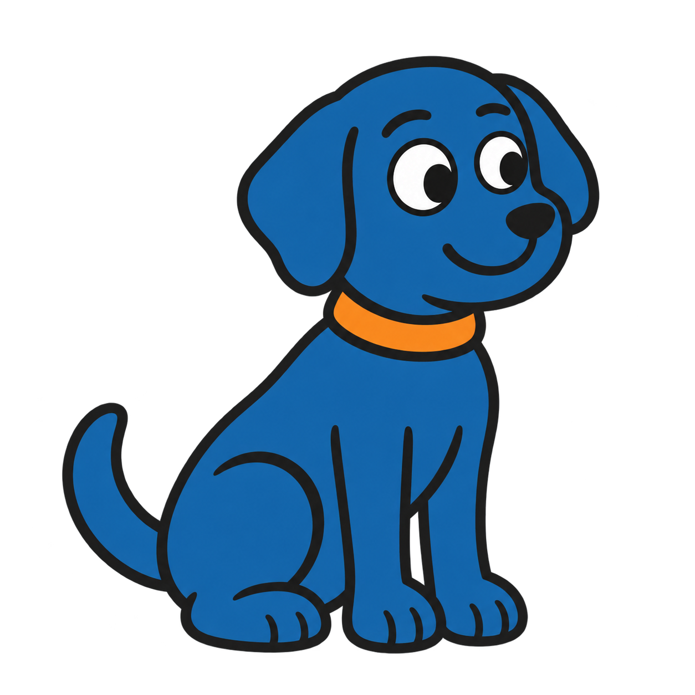
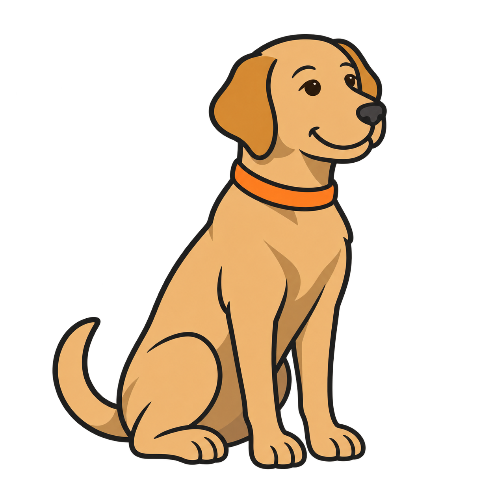
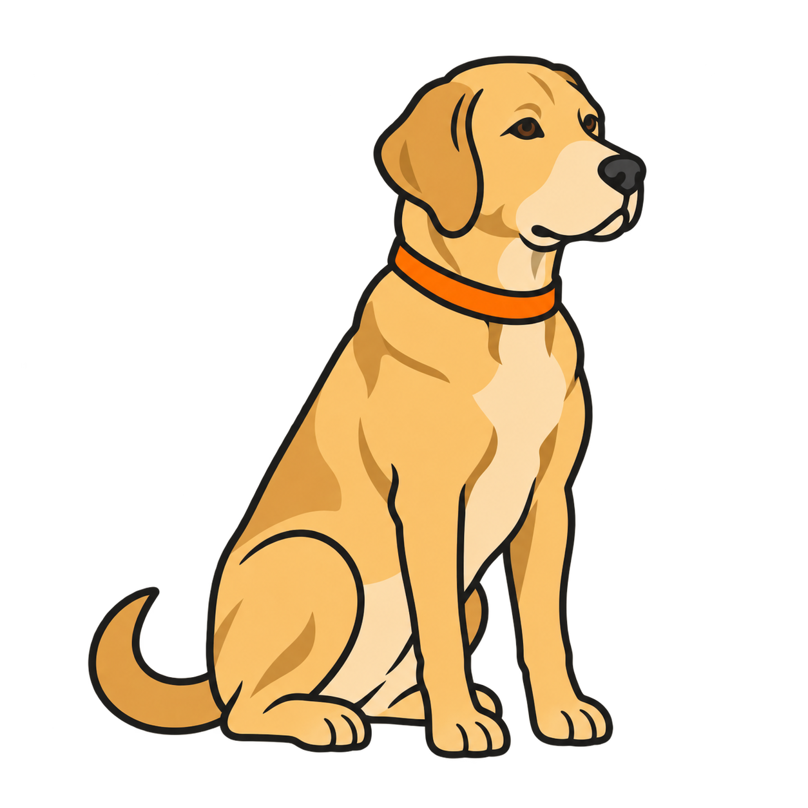
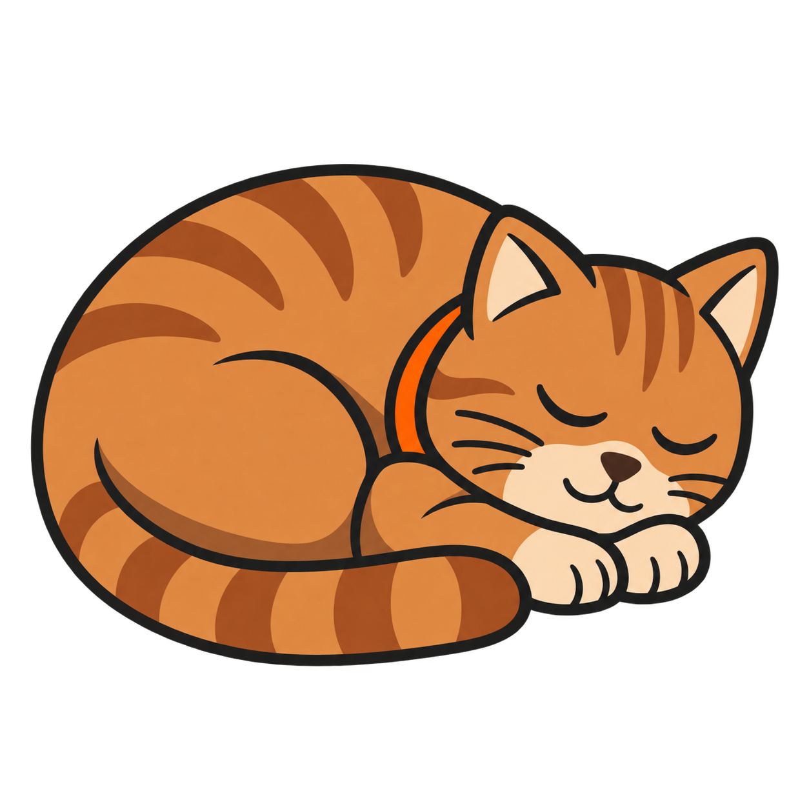
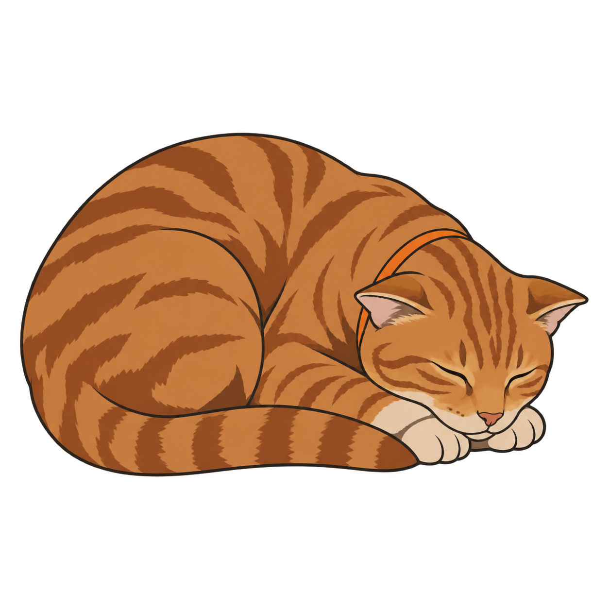

# Animal pictograms: realism and color progression

| Scene | Age 5: symbolic cartoon | Age 10: natural-color illustration | Teen: naturalistic |
|---|---|---|---|
| Dog sitting |  |  |  |
| Cat sleeping |  |  |  |

Drafts generated with built-in OpenAI image_gen. All six PNGs have transparent alpha. The dog set is the latest v3 set selected by the user for upload. The teen cat was revised for more natural adult anatomy. Some tonal variation remains despite the requested flat-fill style.

Reusable instructions: [AAC realism prompt template](catalog/aac-realism-prompt-template.txt). Per-image prompts are recorded in the searchable catalog and the scene prompt files.

Follow the repository's [license and attribution](LICENSE.md).
