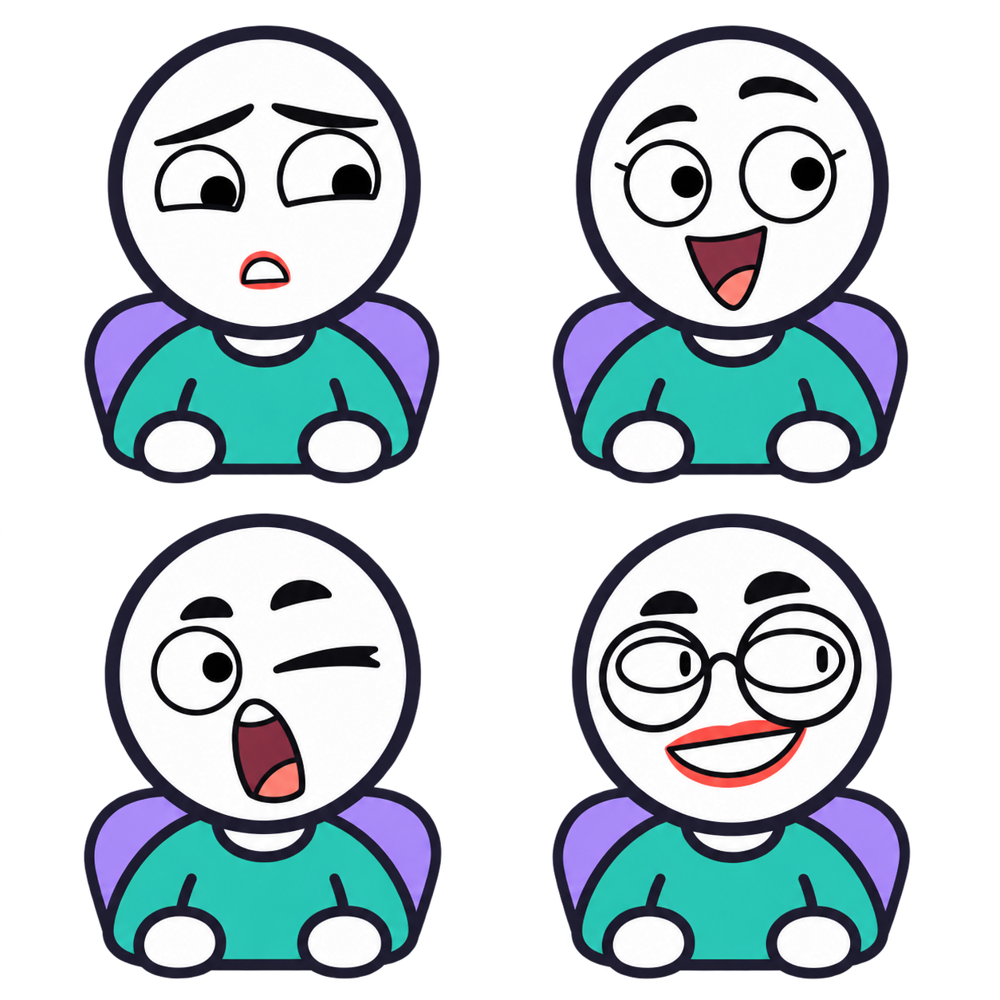
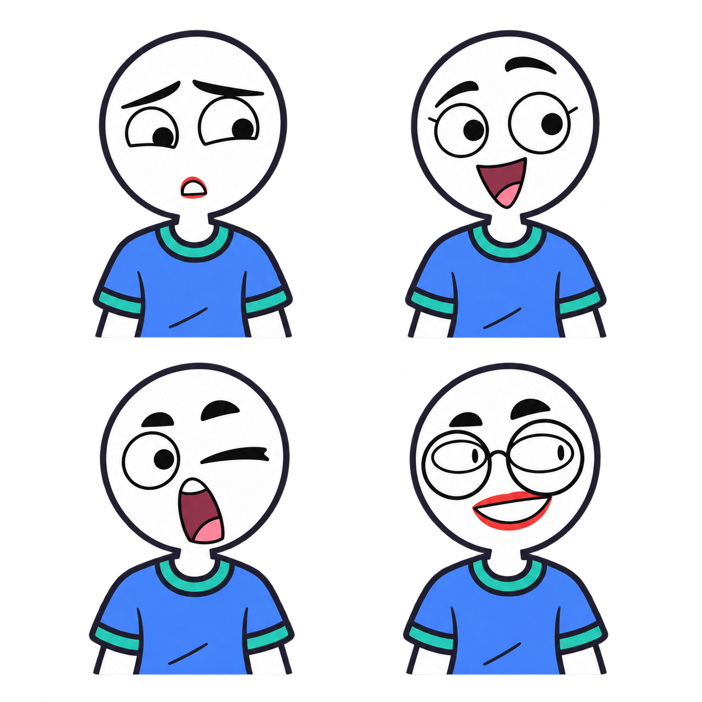

# Character expressions: review

Seven supplied facial expressions combined with the three established age-strand characters. These are comparison sheets, not individual action cards. All sheets are square transparent PNGs without embedded text. Part 1 contains reference expressions 1–4 in reading order; part 2 contains expressions 5–7 in reading order. Faces remain white; original reference skin/background colors are not carried over.

## Ages 0-5

### Part 1: expressions 1–4

### Part 2: expressions 5–7

## Ages 6-11

### Part 1: expressions 1–4

### Part 2: expressions 5–7

## Ages 12-18

### Part 1: expressions 1–4

### Part 2: expressions 5–7

