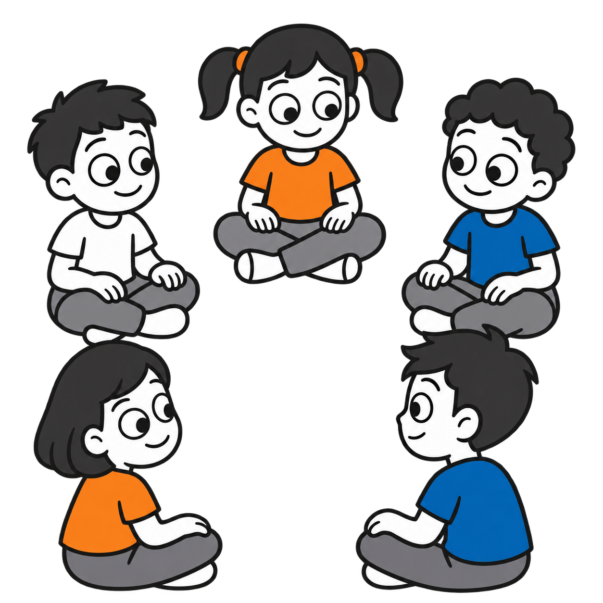
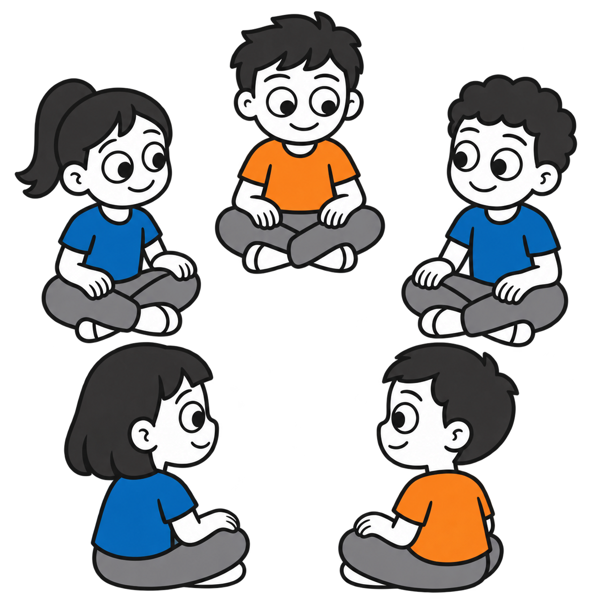

# Circle time at school: age 5

Two standalone square transparent PNGs for the **0–5 age strand only**, with a male or female foreground focal character. Each shows five children approximately 5 years old sitting cross-legged in a circle. No older-age variants were generated. Both are **drafts pending owner review**.

| Boy focal character | Girl focal character |
|---|---|
|  |  |

## Style and validation

Generated with the built-in OpenAI image generation tool using the approved homework illustration as a style reference. Requested #202020 contours, #1769AA blue and #F28C28 orange, opaque white skin and neutral gray trousers. Files are 1254 × 1254 RGBA PNGs with genuine background transparency, including the open center of the circle. Each has five fully framed seated children and no embedded text. Some subtle tonal variation remains; exact hex colors are not guaranteed.

Individual prompts, descriptions, source information and SHA-256 checksums are recorded in `catalog/visuals.json`. Category: Learning and tasks.

## Attribution and rights

Visual supports by Ryan Baker-Barrett of Applied Behavioral Health Practice — https://getadhd.care · https://appliedbehavioral.health · https://github.com/appliedbhp/visual-supports — CC BY-SA 4.0 (https://creativecommons.org/licenses/by-sa/4.0/). Share and adapt, including commercially, with attribution, a license link, indication of changes, and ShareAlike for adaptations. Third-party materials retain their original licenses and attribution. Reference character credit retained: Adventurer by Lisa Wischofsky, via DiceBear, CC BY 4.0 (https://creativecommons.org/licenses/by/4.0/), https://www.dicebear.com/styles/adventurer/. Changes: action artwork adapted with AI; hairstyles, age proportions, palette and cereal-making scene customized.
