# Communication, outdoors, and getting dressed

| Concept | Age 5 | Age 10 | Teen |
|---|---|---|---|
| Listen | 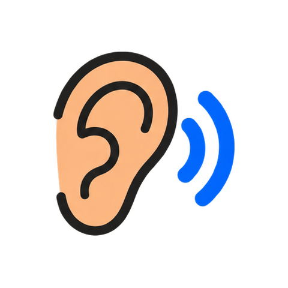 | 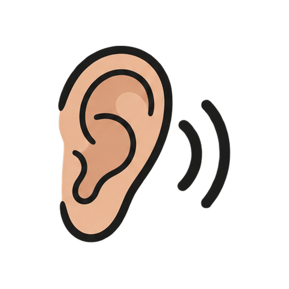 | 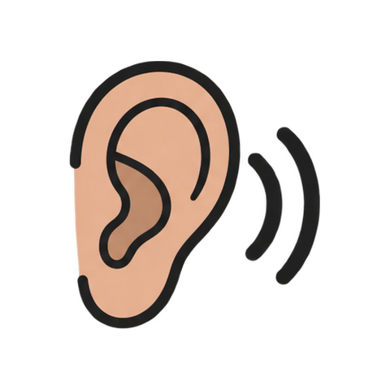 |
| Look |  |  | 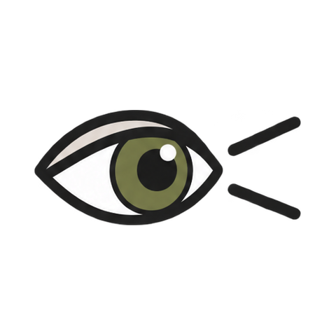 |
| Pause |  |  |  |
| Tree | 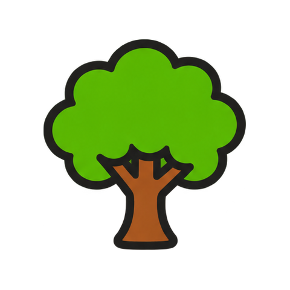 | 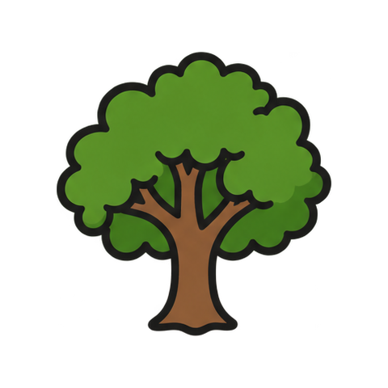 | 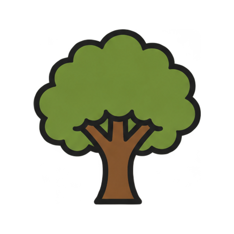 |
| Rain | 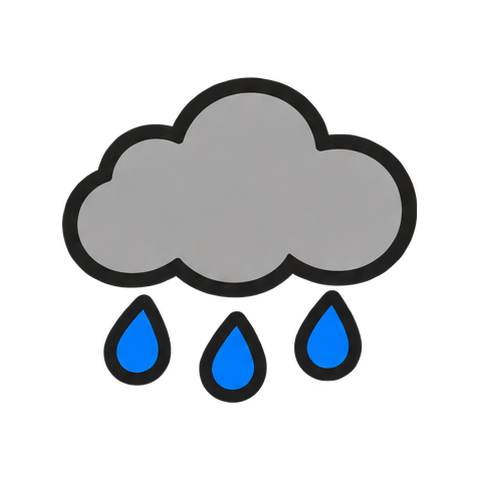 | 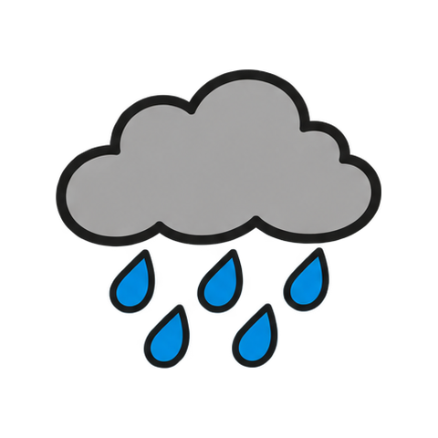 | 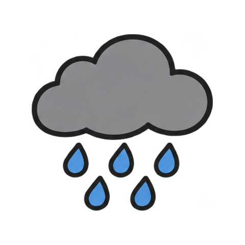 |
| Sun | 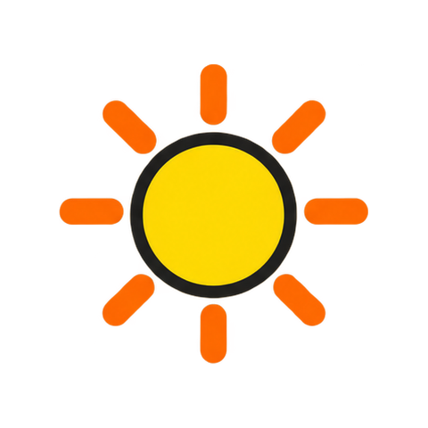 |  | 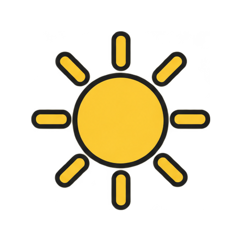 |
| Hairbrush | 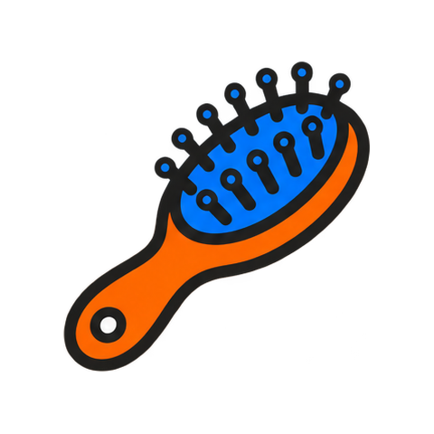 | 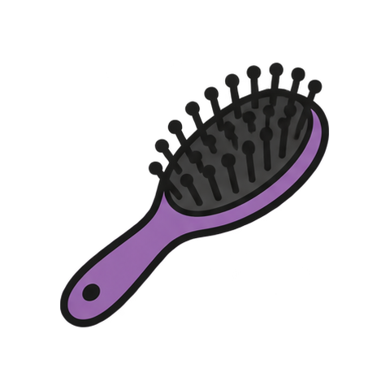 | 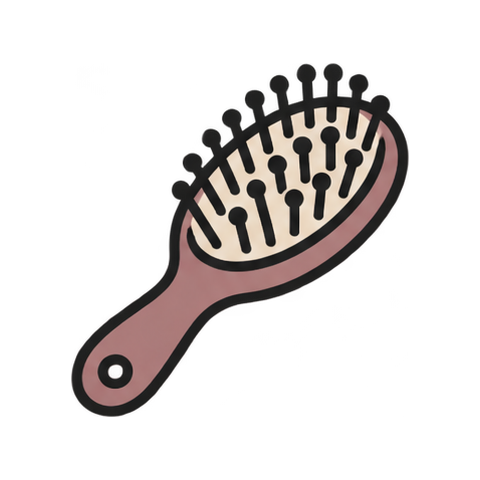 |
| Jacket | 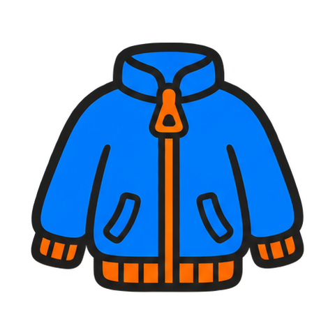 | 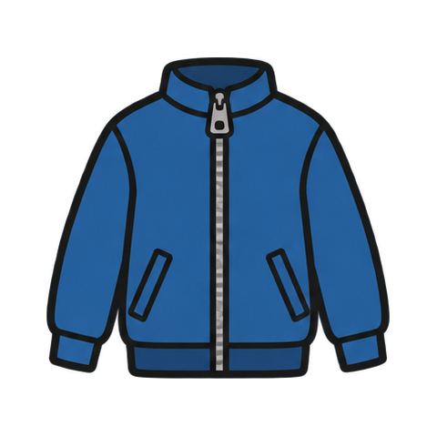 | 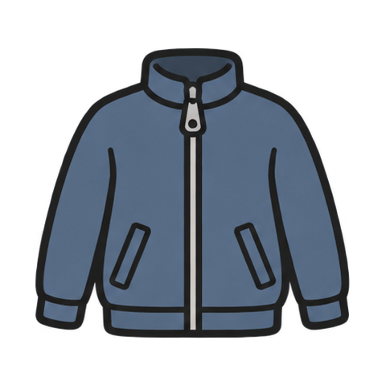 |
| Socks | 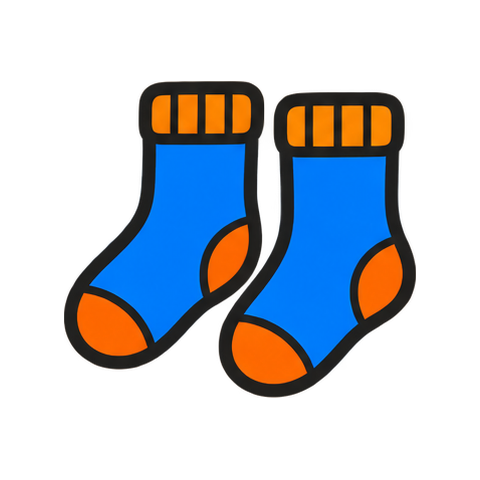 | 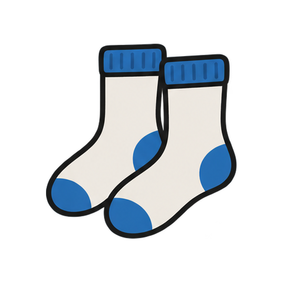 | 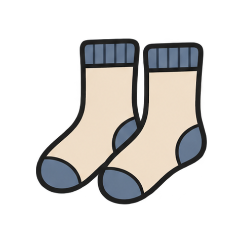 |
