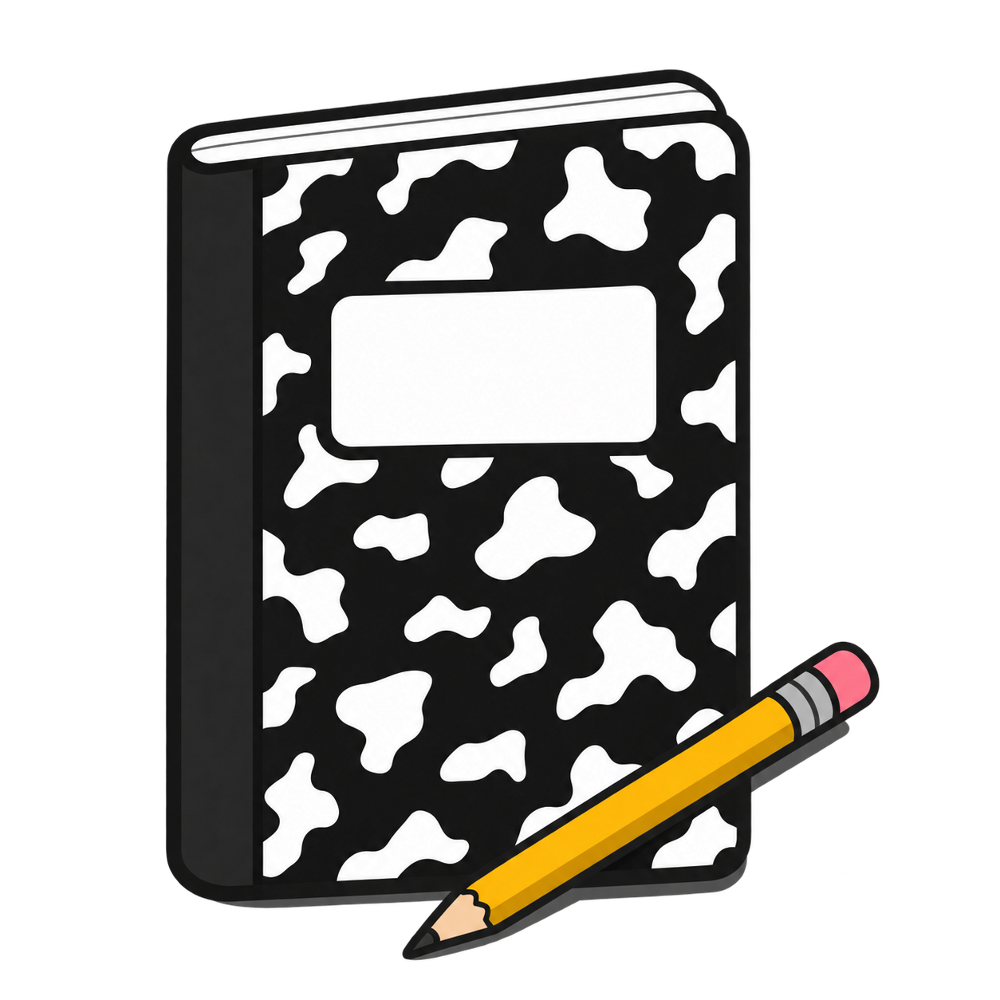
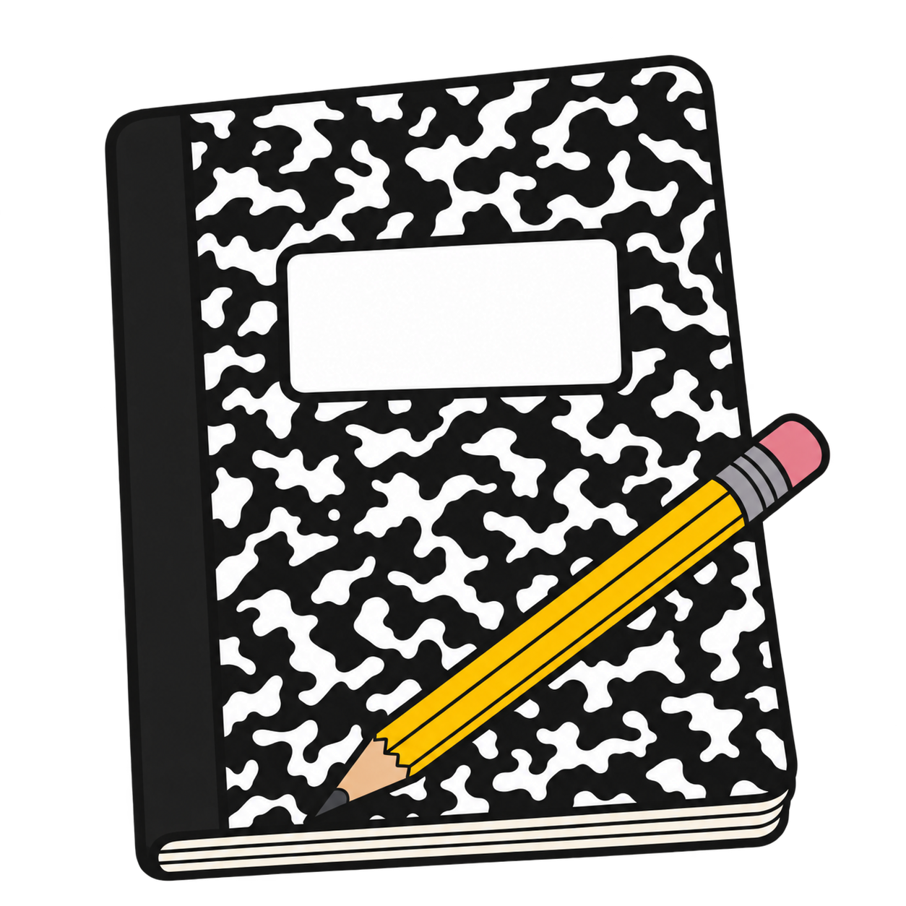

# Composition notebook and pencil

Three age-progressive AAC pictograms, generated with built-in OpenAI image_gen. Transparent PNGs with blank cover labels and no text.

| Age 5: symbolic cartoon | Age 10: natural-color illustration | Teen: naturalistic |
|---|---|---|
|  |  |  |

Drafts pending owner review. Some tonal variation remains despite flat-fill instructions.

[Reusable prompt](catalog/aac-realism-prompt-template.txt) · [Scene prompts](catalog/composition-notebook-and-pencil-generation-prompts.json) · [License and attribution](LICENSE.md)
