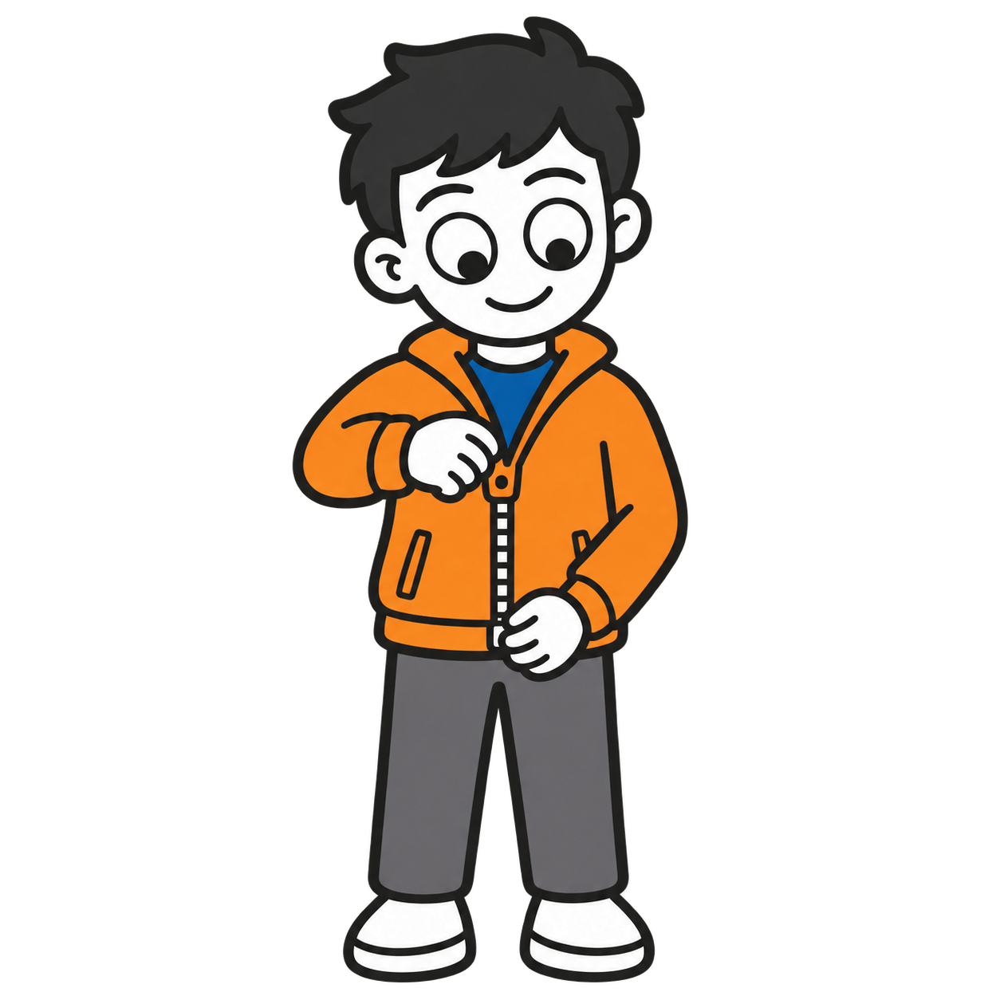
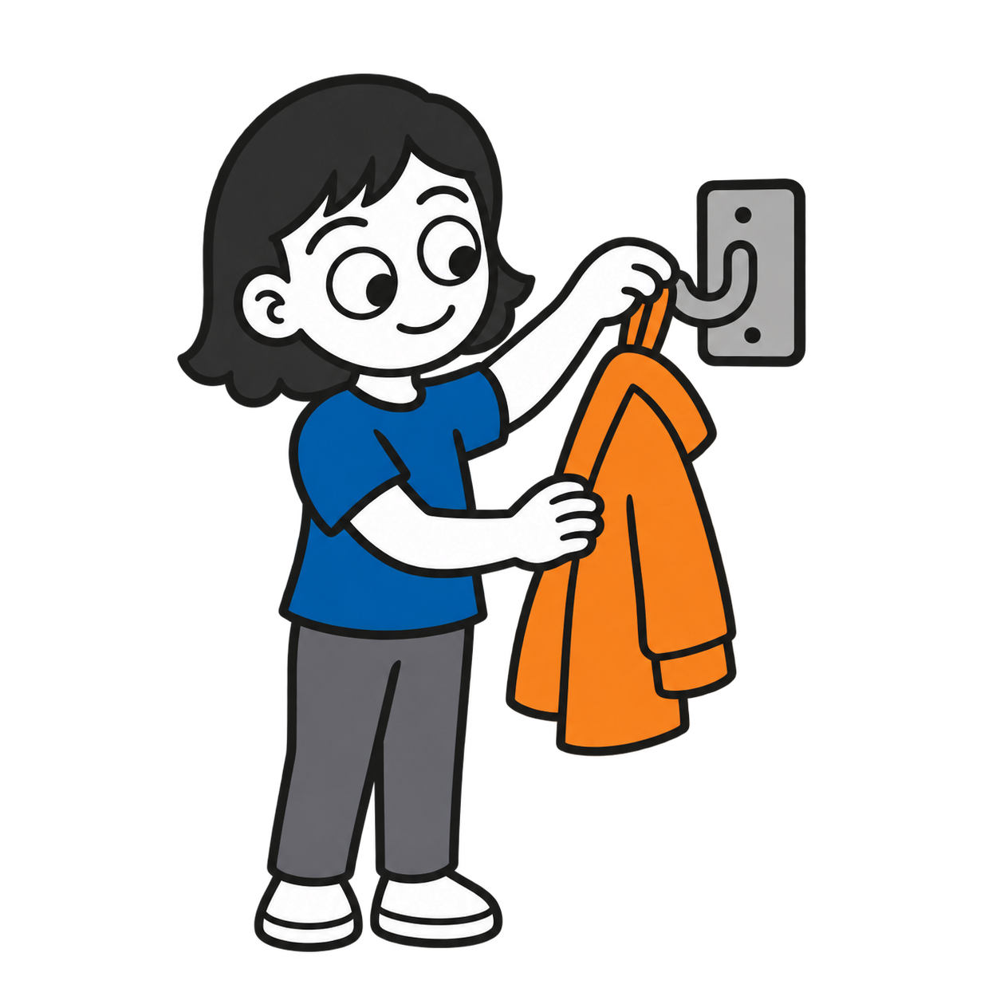
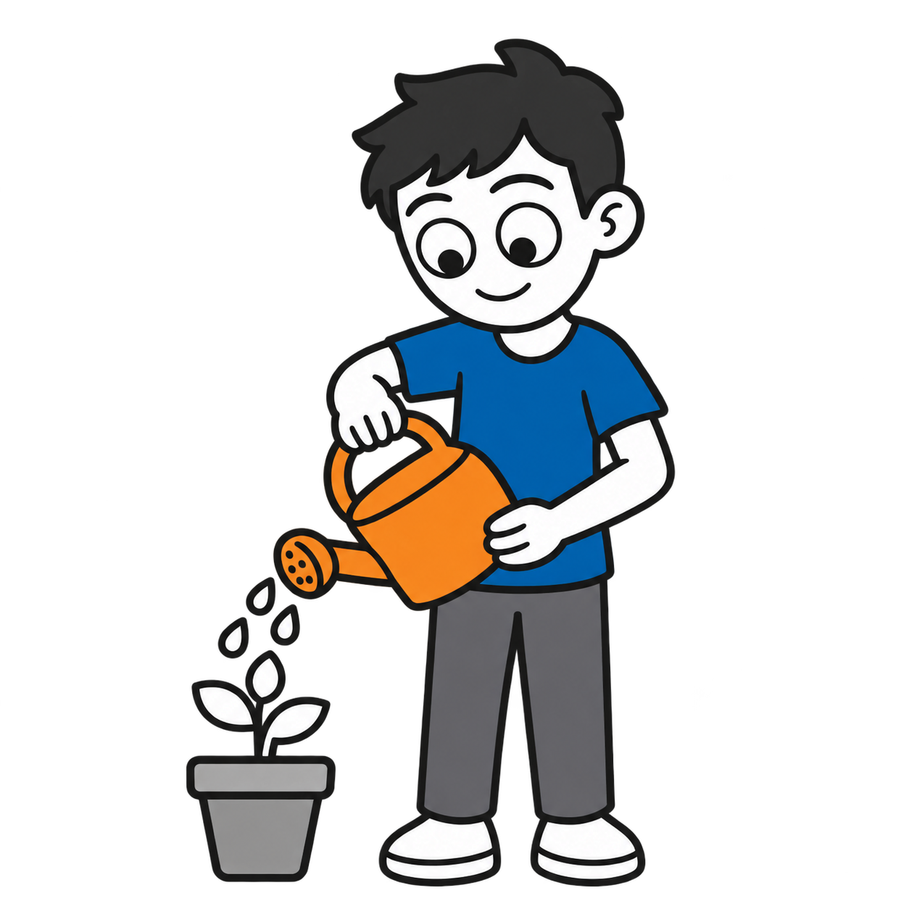
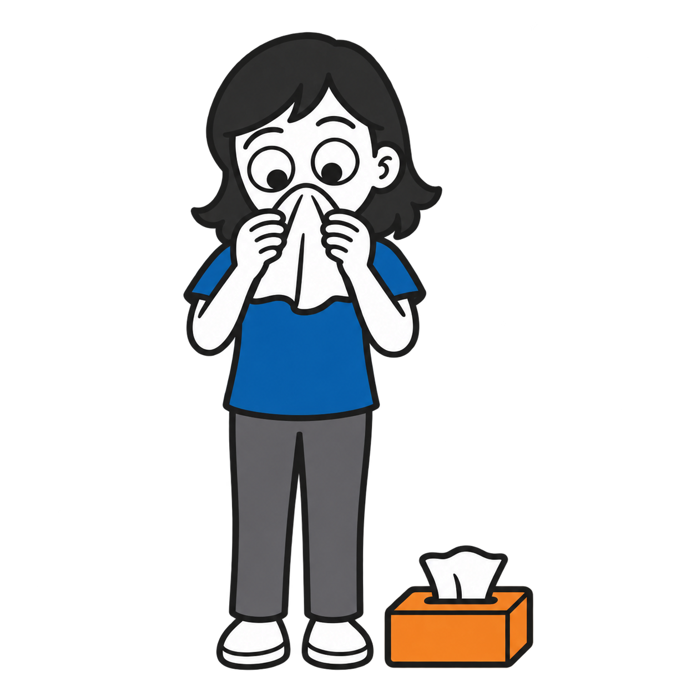
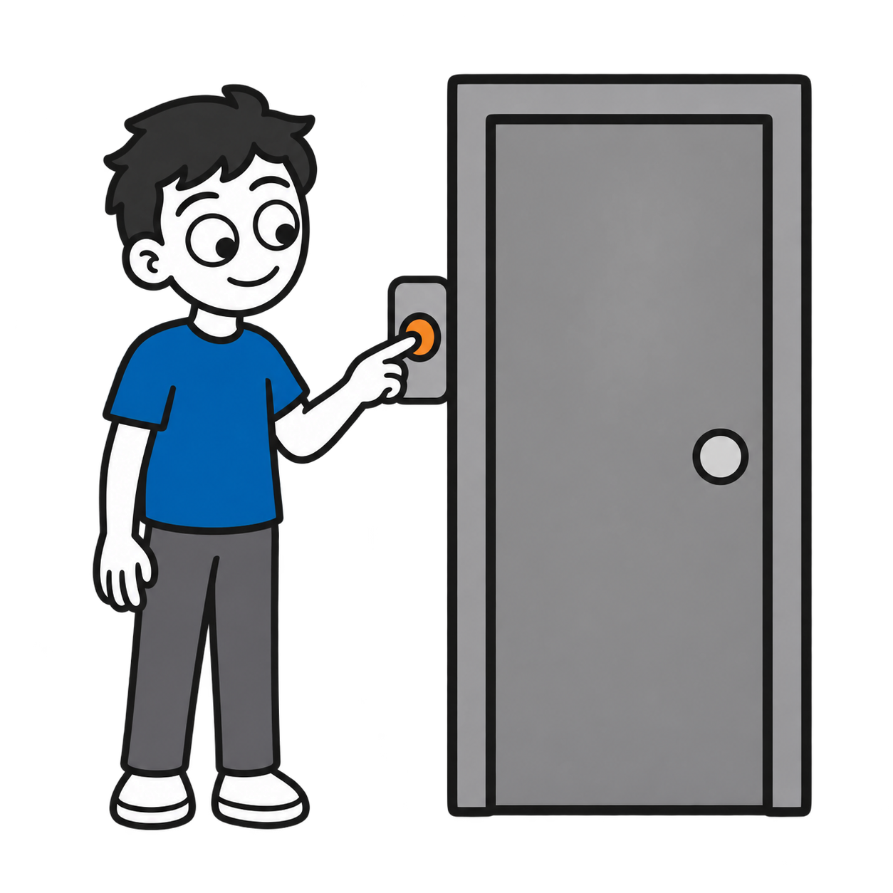
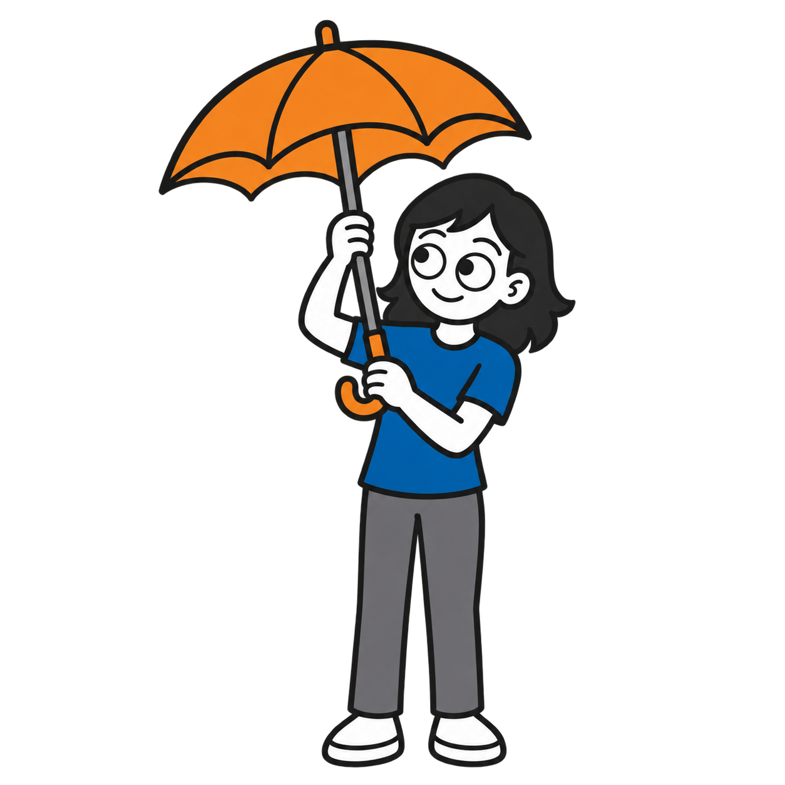

# Everyday vocabulary · Batch 1

Original illustrations using the [ABHP character reference card](references/aac-character-reference-card.png). Vocabulary planning consulted the [ARASAAC category tree](https://antiguo.arasaac.org/pictogramas_color.php).

| Draft | Search keywords | Preview |
| --- | --- | --- |
| Zip a jacket — age 5 | zip a jacket, zipper, getting dressed |  |
| Hang up a coat — age 5 | hang up a coat, coat hook, put away jacket |  |
| Water a plant — age 10 | water a plant, watering can, plant care |  |
| Blow your nose — age 10 | blow your nose, tissue, hygiene |  |
| Ring the doorbell — teen | ring the doorbell, press button, front door |  |
| Open an umbrella — teen | open an umbrella, rain, wet weather |  |

Visual supports by Ryan Baker-Barrett of Applied Behavioral Health Practice. https://getadhd.care · https://appliedbehavioral.health · https://github.com/appliedbhp/visual-supports. Licensed CC BY-SA 4.0 (https://creativecommons.org/licenses/by-sa/4.0/). Third-party reference credit retained: Adventurer by Lisa Wischofsky, via DiceBear, CC BY 4.0 (https://creativecommons.org/licenses/by/4.0/). Character proportions, hair, colors and action adapted using AI.
