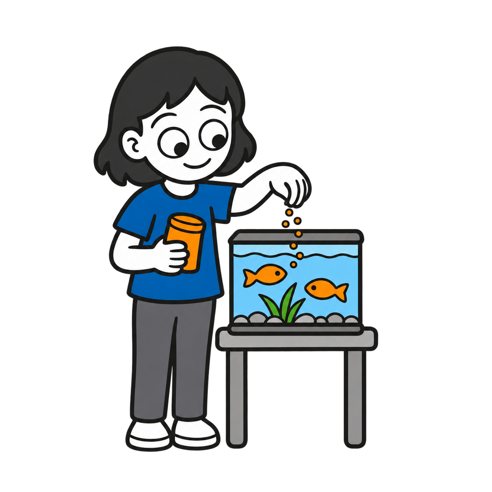
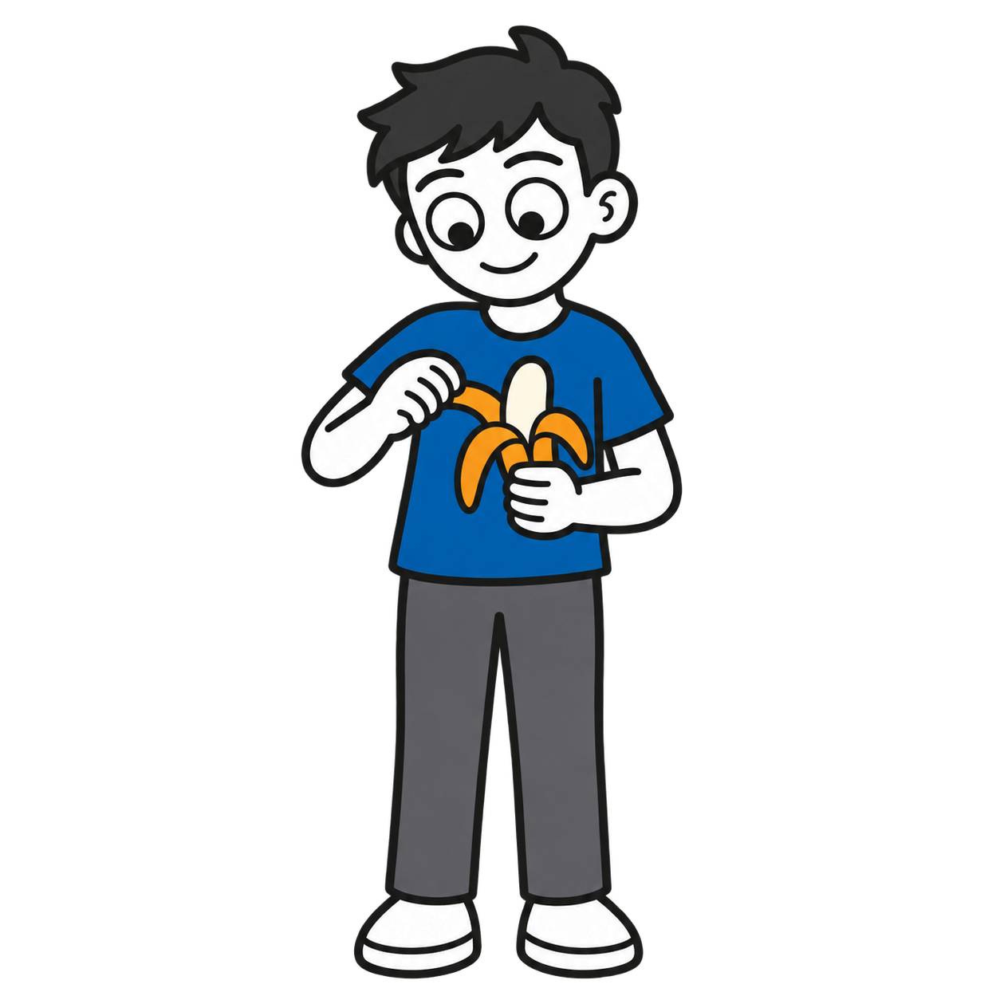
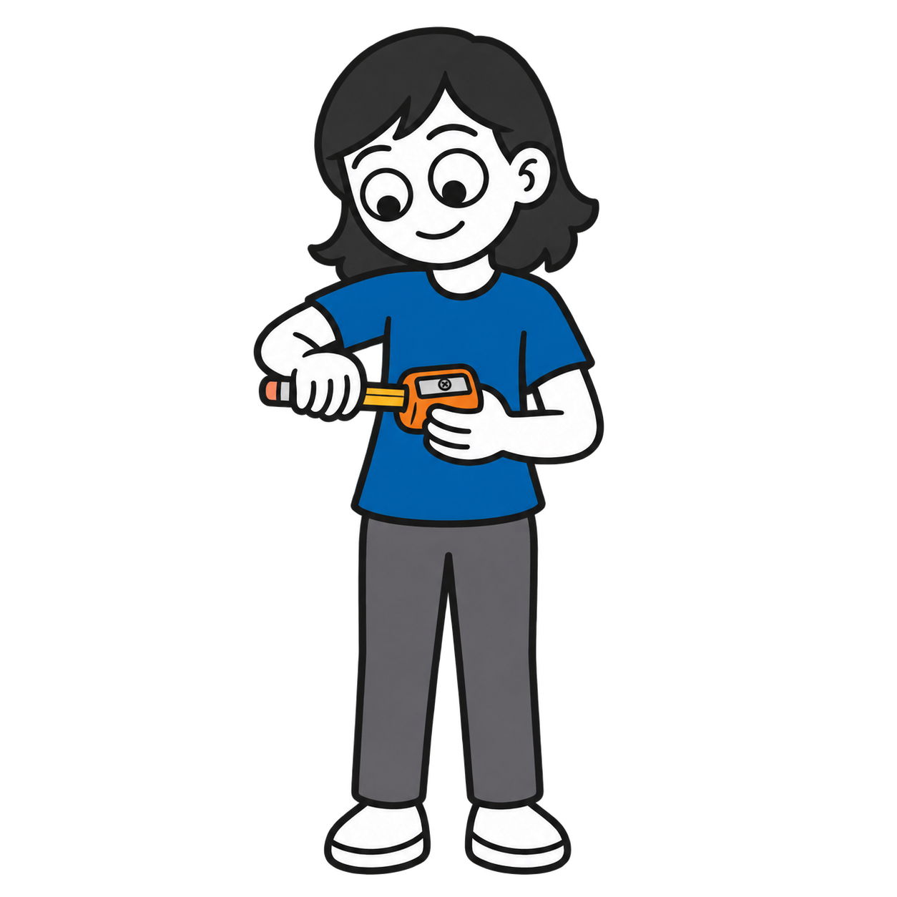
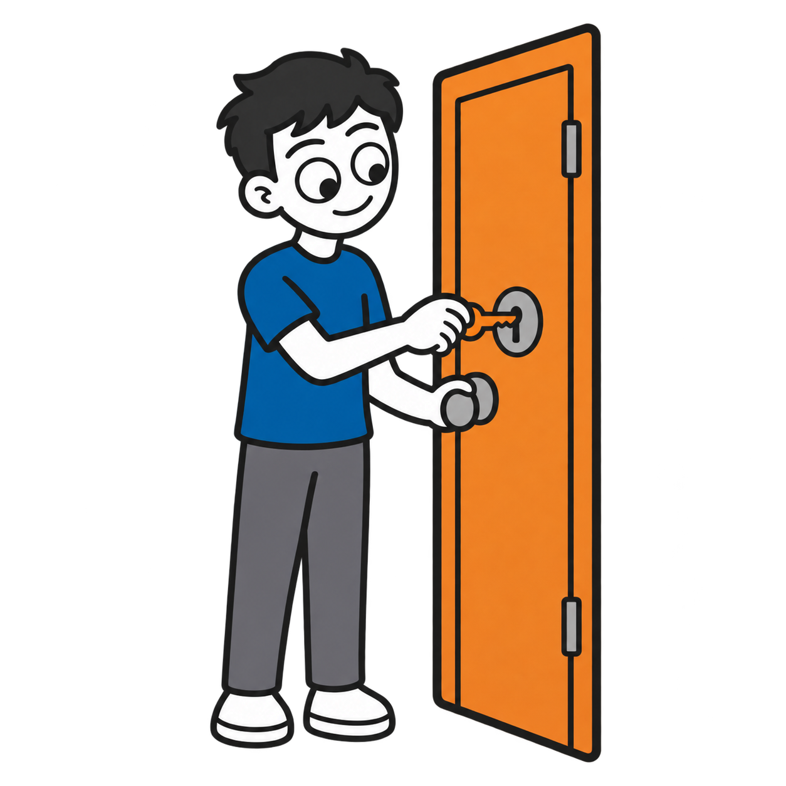

# Everyday vocabulary · Batch 2

Original illustrations using the [ABHP character reference card](references/aac-character-reference-card.png). Vocabulary planning consulted the [ARASAAC category tree](https://antiguo.arasaac.org/pictogramas_color.php).

| Draft | Search keywords | Preview |
| --- | --- | --- |
| Put on mittens — age 5 | put on mittens, gloves, winter clothing |  |
| Feed the fish — age 5 | feed the fish, fish food, aquarium, pet care |  |
| Peel a banana — age 10 | peel a banana, fruit, snack preparation |  |
| Sharpen a pencil — age 10 | sharpen a pencil, pencil sharpener, school supplies |  |
| Lock the door — teen | lock the door, turn the key, house key |  |
| Wrap a gift — teen | wrap a gift, wrap a present, wrapping paper |  |

Visual supports by Ryan Baker-Barrett of Applied Behavioral Health Practice. https://getadhd.care · https://appliedbehavioral.health · https://github.com/appliedbhp/visual-supports. Licensed CC BY-SA 4.0 (https://creativecommons.org/licenses/by-sa/4.0/). Third-party reference credit retained: Adventurer by Lisa Wischofsky, via DiceBear, CC BY 4.0 (https://creativecommons.org/licenses/by/4.0/). Character proportions, hair, colors and action adapted using AI.
