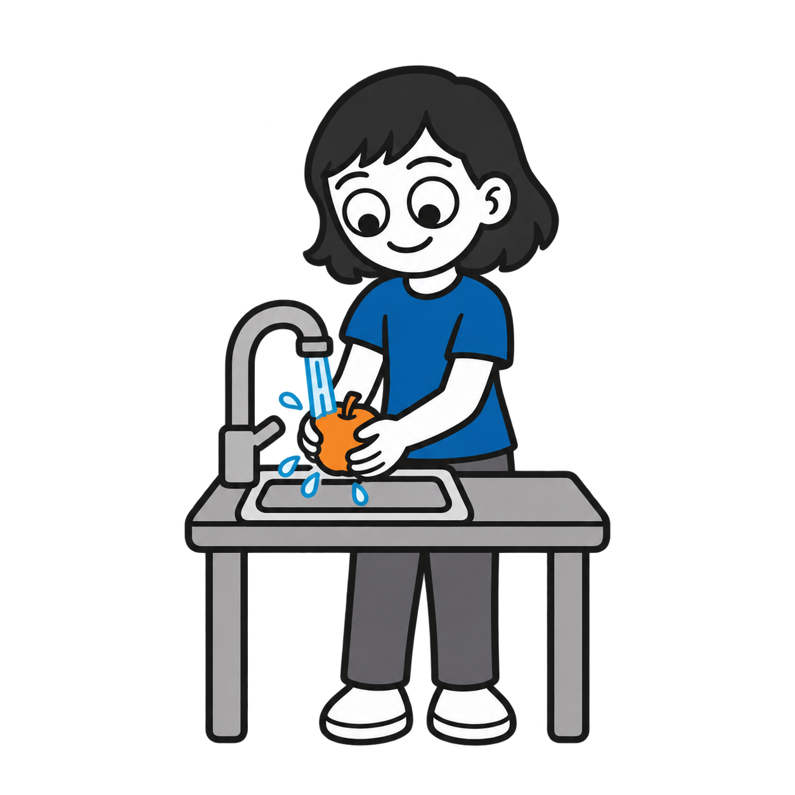
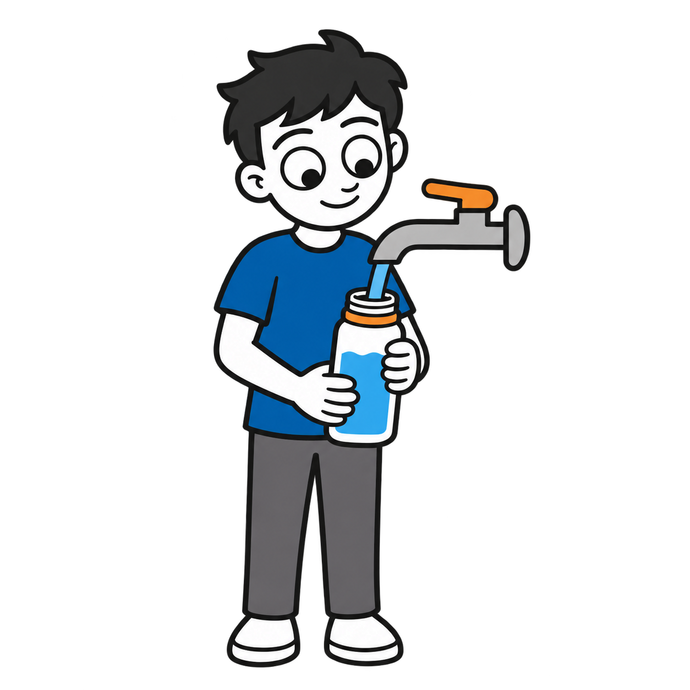
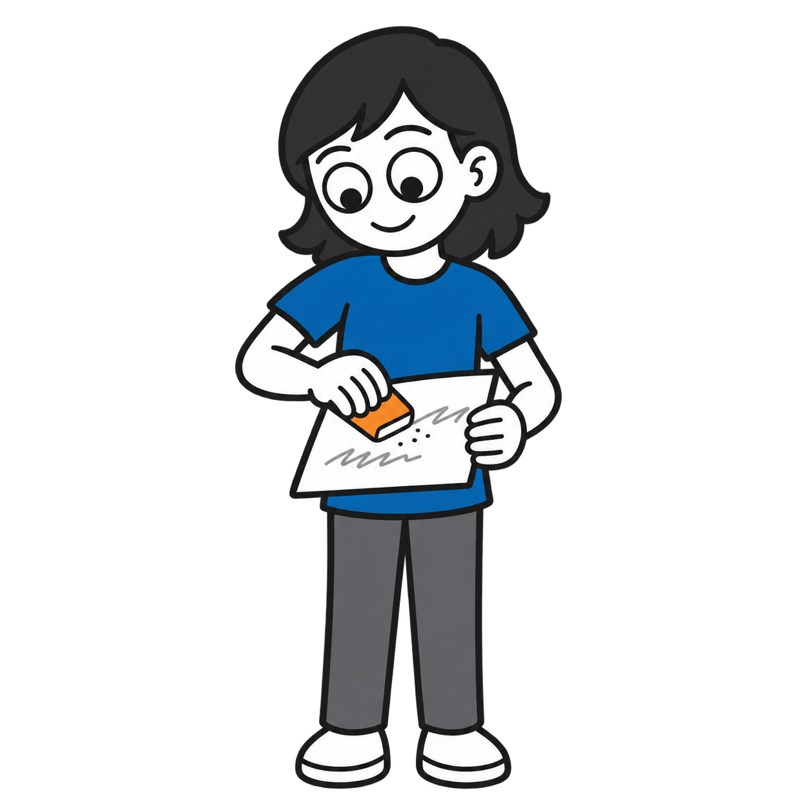
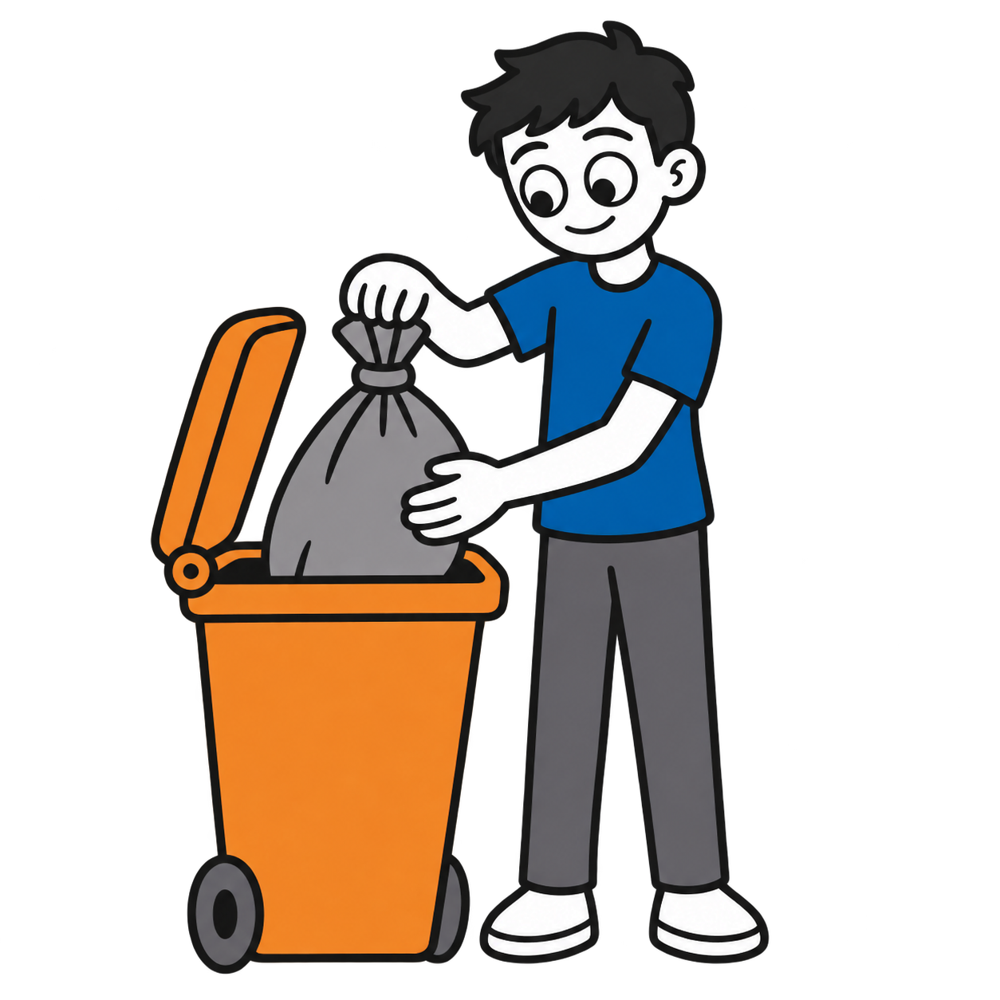

# Everyday vocabulary · Batch 3

Original illustrations using the [ABHP character reference card](references/aac-character-reference-card.png). Vocabulary planning consulted the [ARASAAC category tree](https://antiguo.arasaac.org/pictogramas_color.php).

| Draft | Search keywords | Preview |
| --- | --- | --- |
| Put on a hat — age 5 | put on a hat, winter hat, getting dressed |  |
| Wash an apple — age 5 | wash an apple, rinse fruit, snack preparation |  |
| Fill a water bottle — age 10 | fill a water bottle, refill bottle, drinking water |  |
| Erase pencil marks — age 10 | erase pencil marks, eraser, correct schoolwork |  |
| Take out the trash — teen | take out the trash, garbage bag, rubbish, chores |  |
| Address an envelope — teen | address an envelope, write an address, mail a letter |  |

Visual supports by Ryan Baker-Barrett of Applied Behavioral Health Practice. https://getadhd.care · https://appliedbehavioral.health · https://github.com/appliedbhp/visual-supports. Licensed CC BY-SA 4.0 (https://creativecommons.org/licenses/by-sa/4.0/). Third-party reference credit retained: Adventurer by Lisa Wischofsky, via DiceBear, CC BY 4.0 (https://creativecommons.org/licenses/by/4.0/). Character proportions, hair, colors and action adapted using AI.
