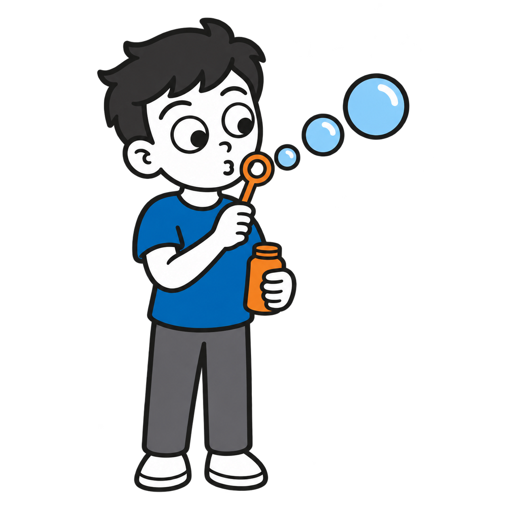
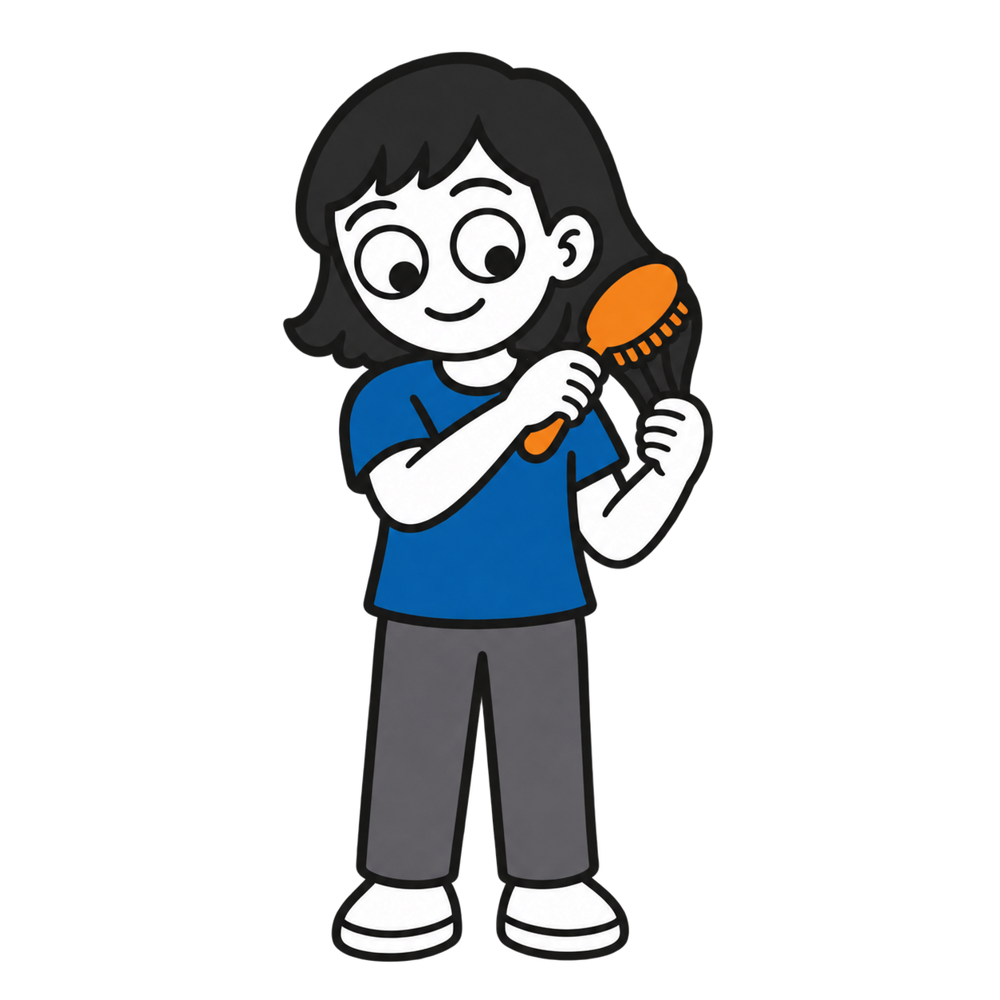
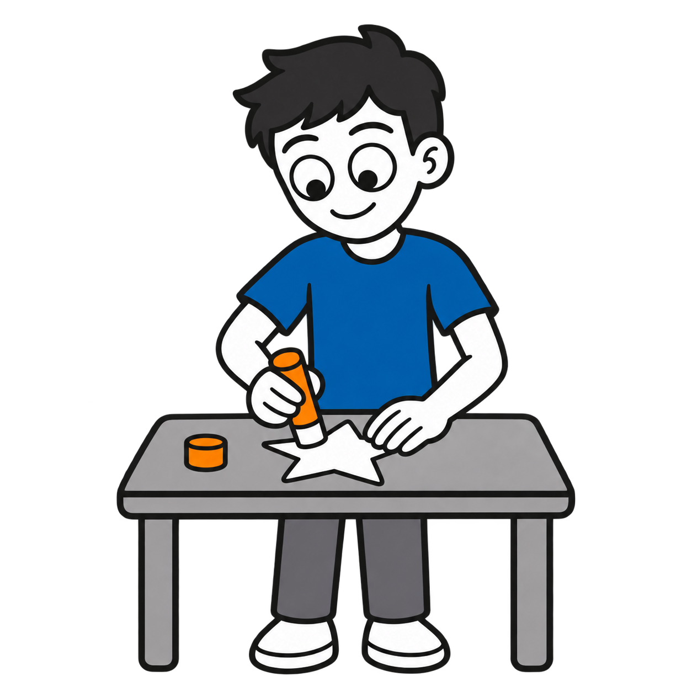
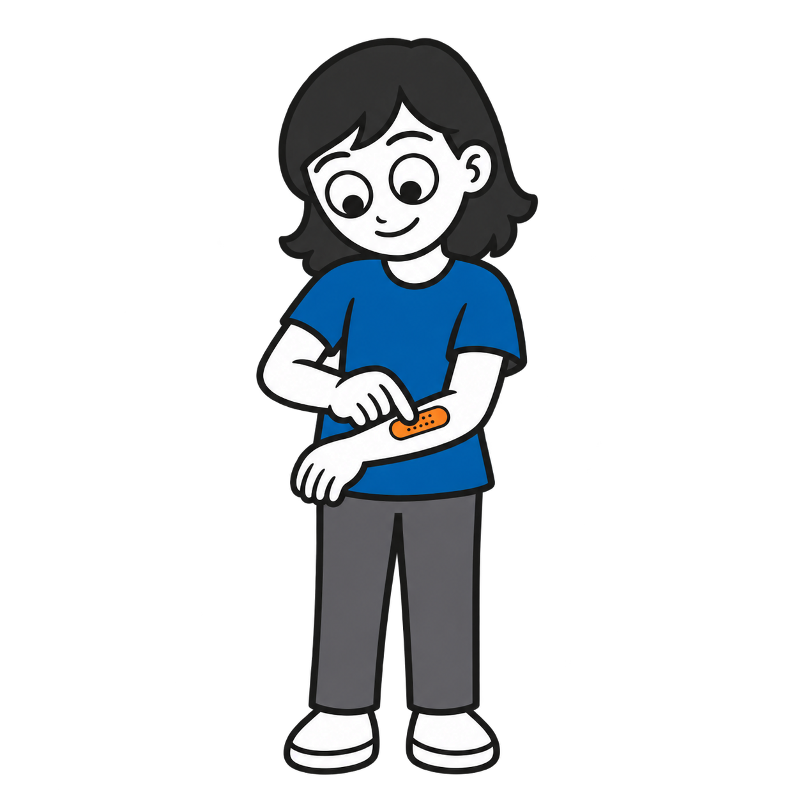
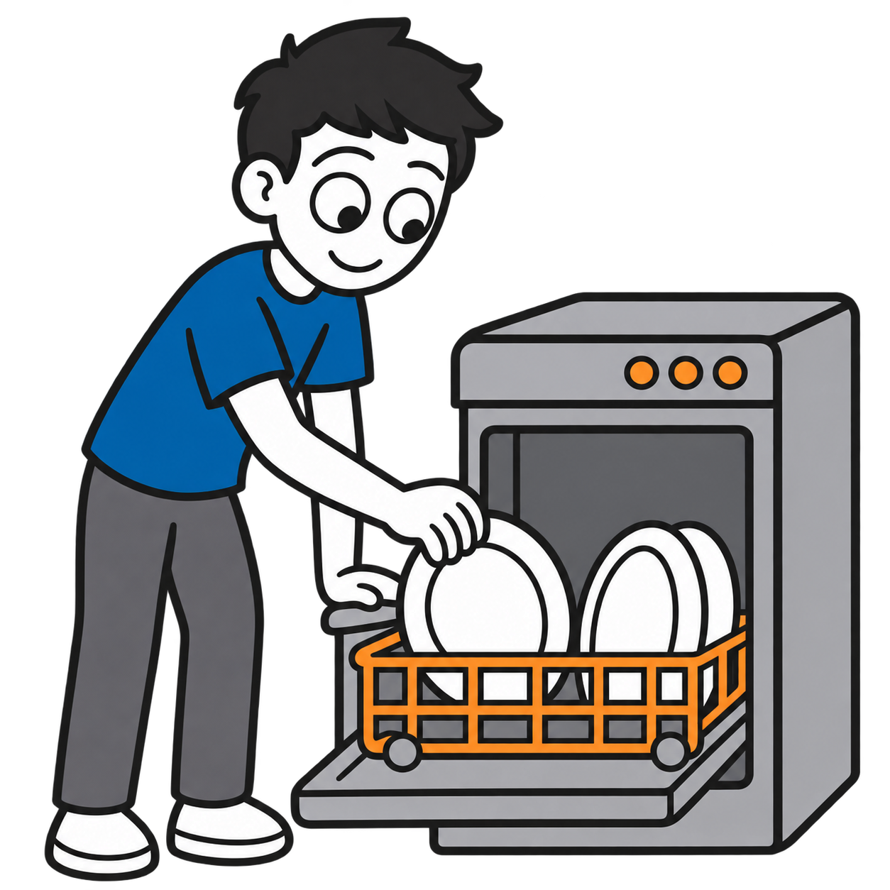
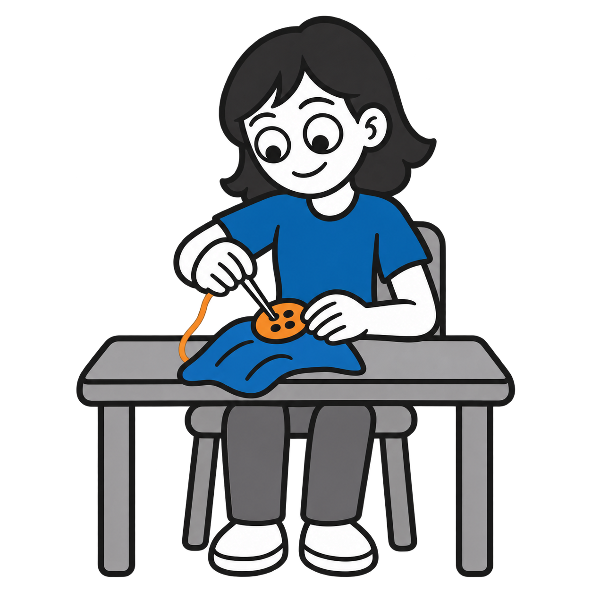

# Everyday vocabulary · Batch 4

Original illustrations using the [ABHP character reference card](references/aac-character-reference-card.png). Vocabulary planning consulted the [ARASAAC category tree](https://antiguo.arasaac.org/pictogramas_color.php).

| Draft | Search keywords | Preview |
| --- | --- | --- |
| Blow bubbles — age 5 | blow bubbles, bubble wand, outdoor play |  |
| Brush your hair — age 5 | brush your hair, hairbrush, grooming |  |
| Use a glue stick — age 10 | use a glue stick, glue paper, school craft |  |
| Put on a bandage — age 10 | put on a bandage, adhesive bandage, first aid |  |
| Load a dishwasher — teen | load a dishwasher, put dishes away, kitchen chore |  |
| Sew on a button — teen | sew on a button, needle and thread, mend clothes |  |

Visual supports by Ryan Baker-Barrett of Applied Behavioral Health Practice. https://getadhd.care · https://appliedbehavioral.health · https://github.com/appliedbhp/visual-supports. Licensed CC BY-SA 4.0 (https://creativecommons.org/licenses/by-sa/4.0/). Third-party reference credit retained: Adventurer by Lisa Wischofsky, via DiceBear, CC BY 4.0 (https://creativecommons.org/licenses/by/4.0/). Character proportions, hair, colors and action adapted using AI.
