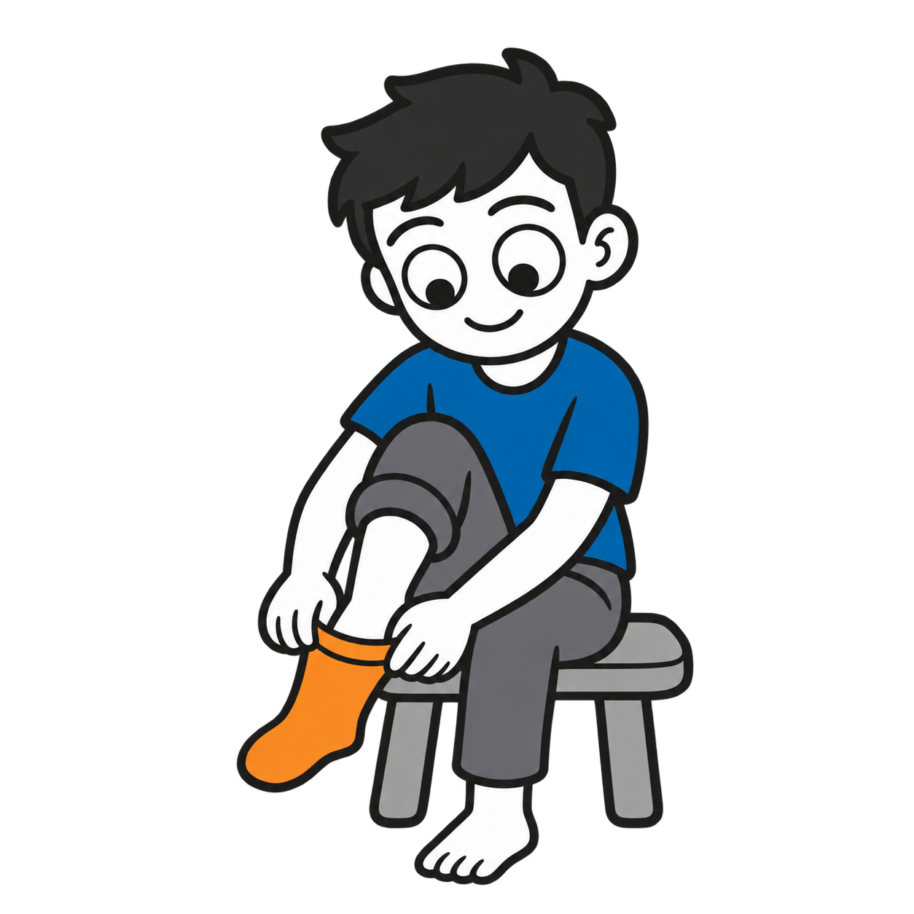
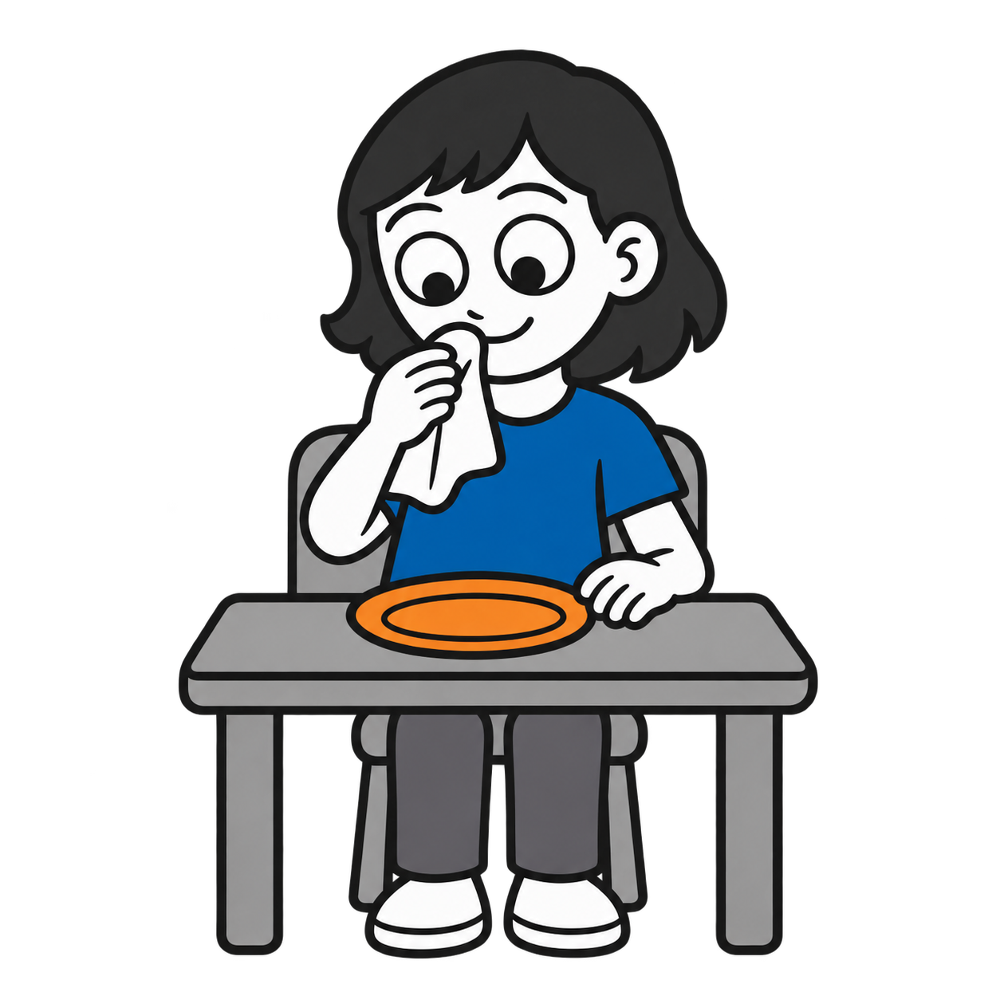
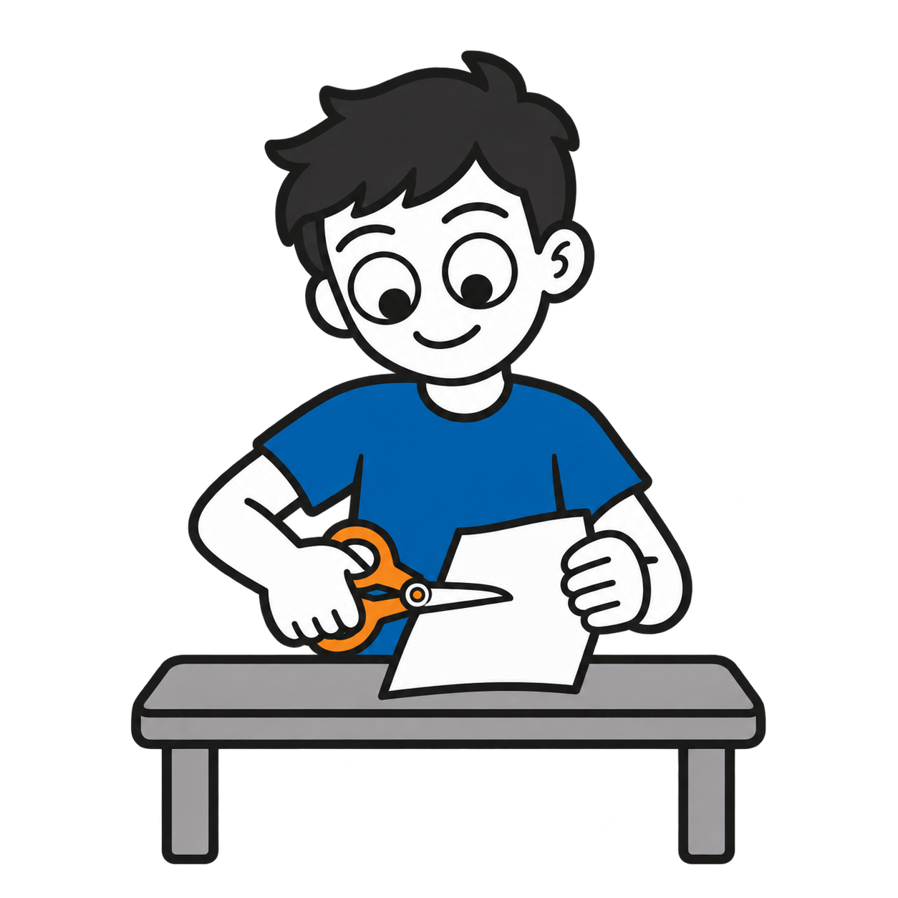
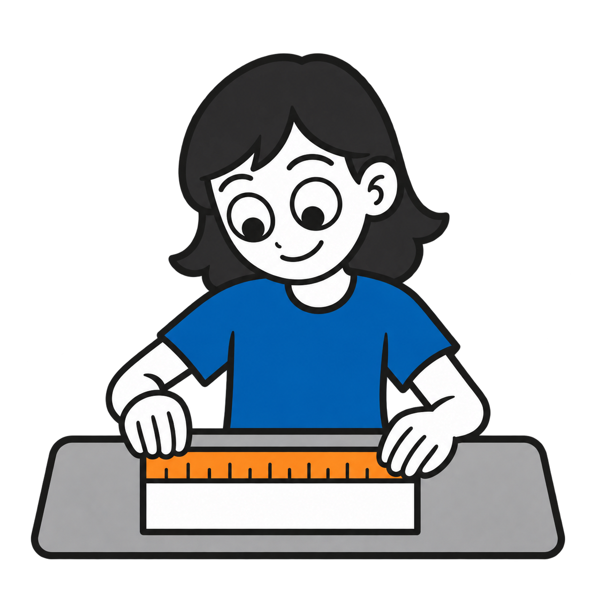
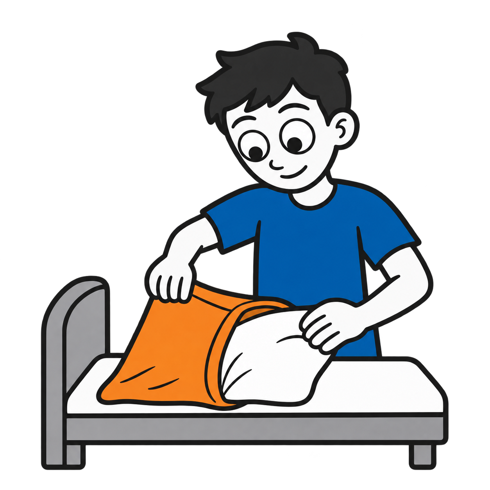
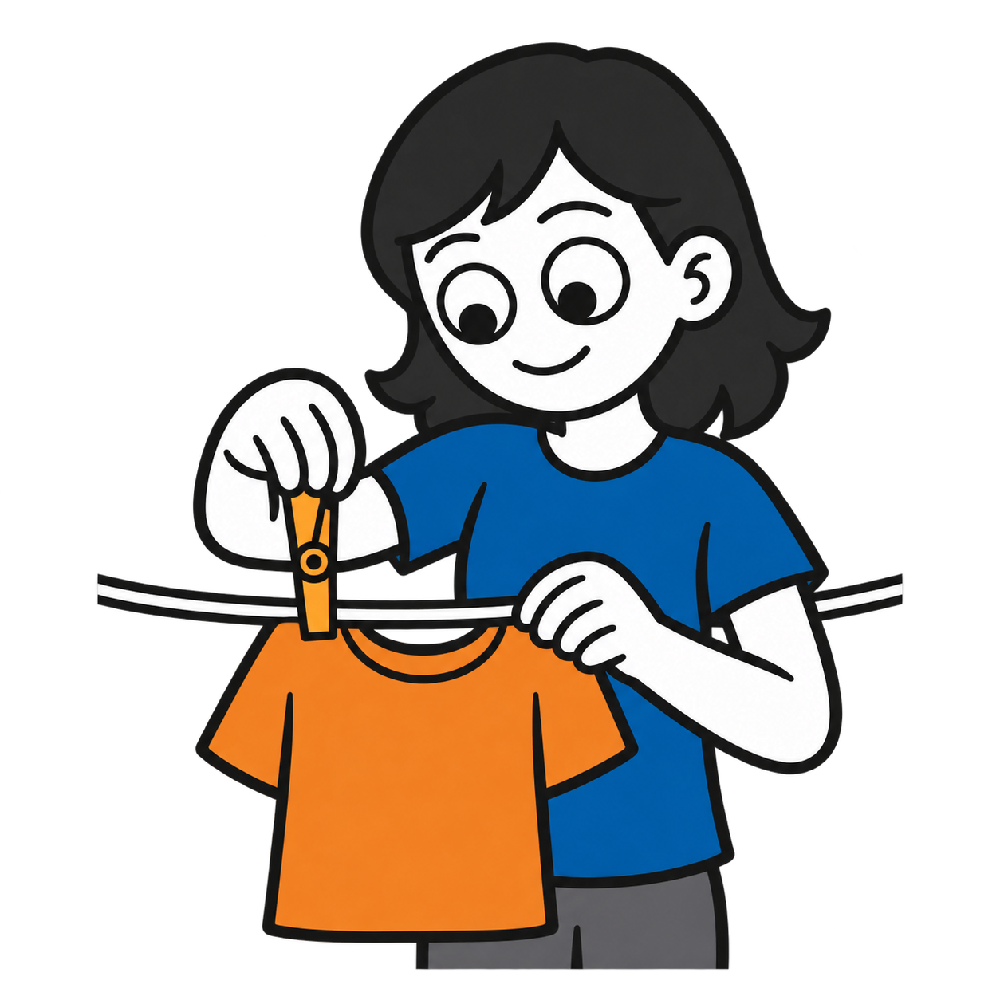

# Everyday vocabulary · Batch 5

Original illustrations using the [ABHP character reference card](references/aac-character-reference-card.png). Vocabulary planning consulted the [ARASAAC category tree](https://antiguo.arasaac.org/pictogramas_color.php).

| Draft | Search keywords | Preview |
| --- | --- | --- |
| Put on socks — age 5 | put on socks, socks, getting dressed |  |
| Use a napkin — age 5 | use a napkin, wipe mouth, table manners |  |
| Cut paper — age 10 | cut paper, scissors, craft |  |
| Measure with a ruler — age 10 | measure with a ruler, measure length, school supplies |  |
| Change a pillowcase — teen | change a pillowcase, put on a pillowcase, bedding |  |
| Hang laundry — teen | hang laundry, clothesline, clothespin, dry clothes |  |

Visual supports by Ryan Baker-Barrett of Applied Behavioral Health Practice. https://getadhd.care · https://appliedbehavioral.health · https://github.com/appliedbhp/visual-supports. Licensed CC BY-SA 4.0 (https://creativecommons.org/licenses/by-sa/4.0/). Third-party reference credit retained: Adventurer by Lisa Wischofsky, via DiceBear, CC BY 4.0 (https://creativecommons.org/licenses/by/4.0/). Character proportions, hair, colors and action adapted using AI.
