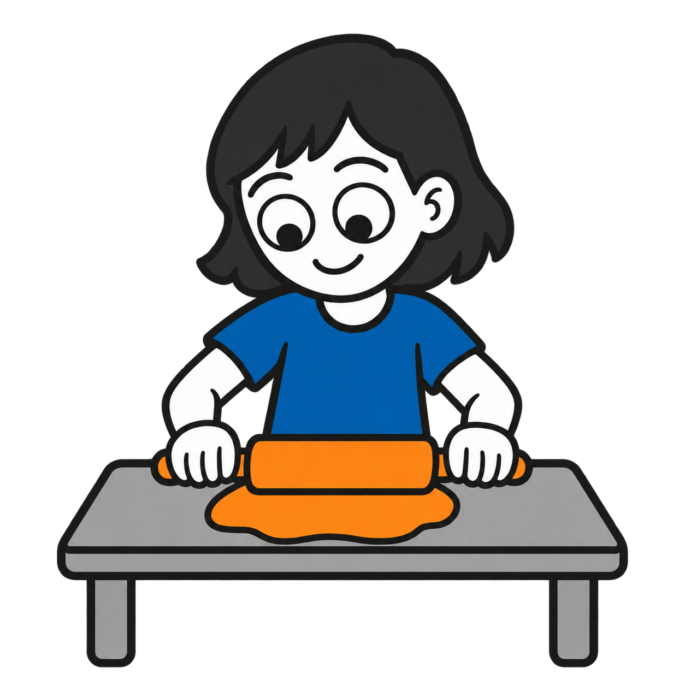
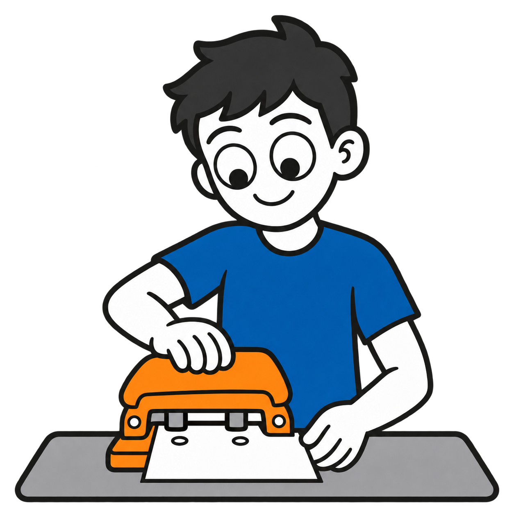
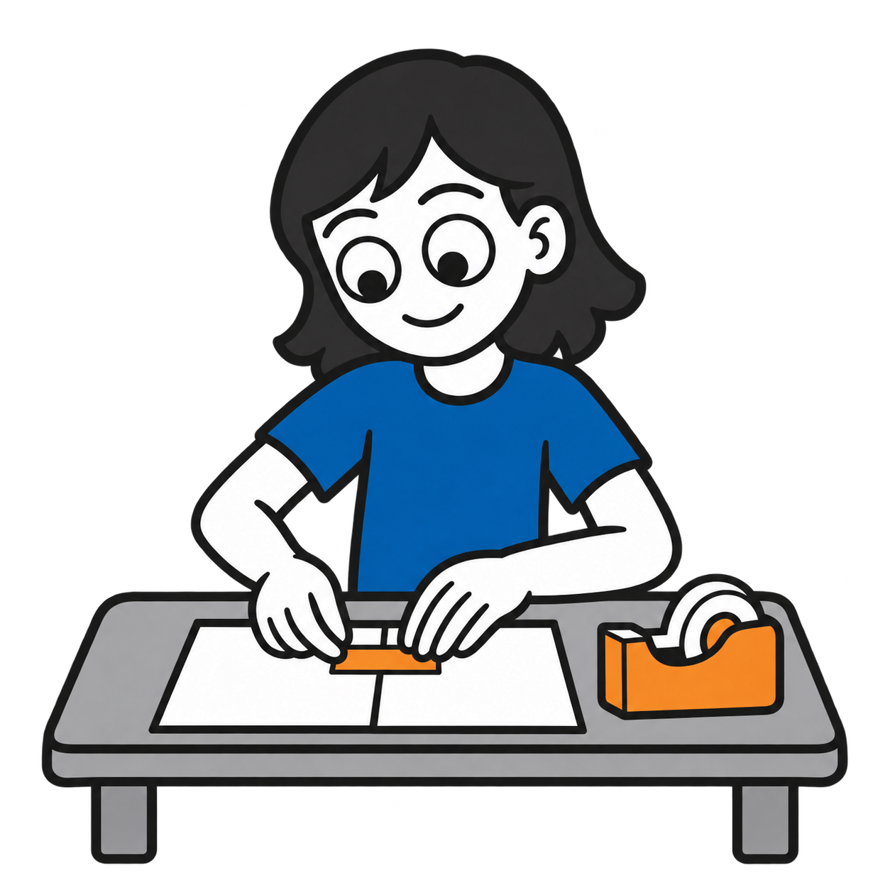

# Everyday vocabulary · Batch 6

Original illustrations using the [ABHP character reference card](references/aac-character-reference-card.png). Vocabulary planning consulted the [ARASAAC category tree](https://antiguo.arasaac.org/pictogramas_color.php).

| Draft | Search keywords | Preview |
| --- | --- | --- |
| Put on sunglasses — age 5 | put on sunglasses, eyewear, sunny day |  |
| Roll play dough — age 5 | roll play dough, rolling pin, sensory play |  |
| Hole punch paper — age 10 | hole punch paper, hole puncher, school supplies |  |
| Tape paper together — age 10 | tape paper together, sticky tape, repair paper |  |
| Replace a trash bag — teen | replace a trash bag, line a bin, trash liner |  |
| Sort the mail — teen | sort the mail, organize letters, envelopes |  |

Visual supports by Ryan Baker-Barrett of Applied Behavioral Health Practice. https://getadhd.care · https://appliedbehavioral.health · https://github.com/appliedbhp/visual-supports. Licensed CC BY-SA 4.0 (https://creativecommons.org/licenses/by-sa/4.0/). Third-party reference credit retained: Adventurer by Lisa Wischofsky, via DiceBear, CC BY 4.0 (https://creativecommons.org/licenses/by/4.0/). Character proportions, hair, colors and action adapted using AI.
