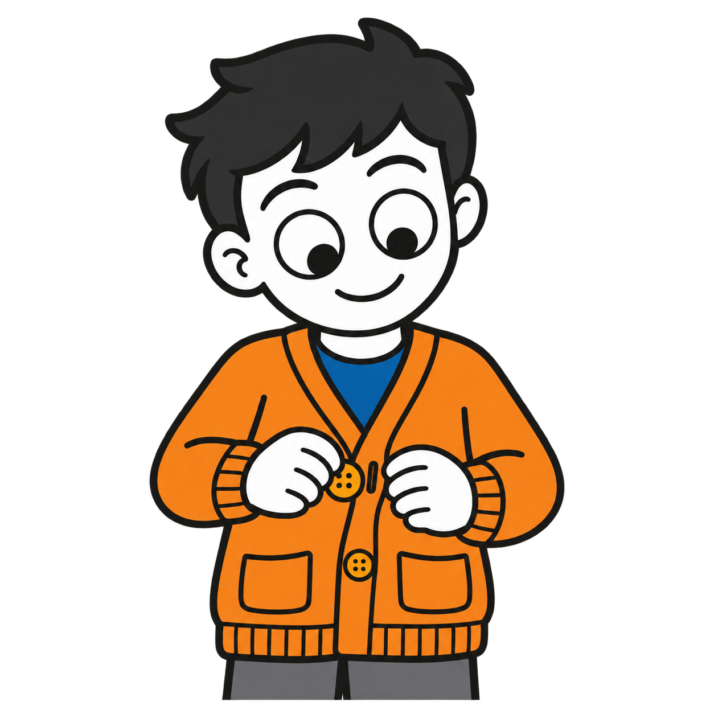
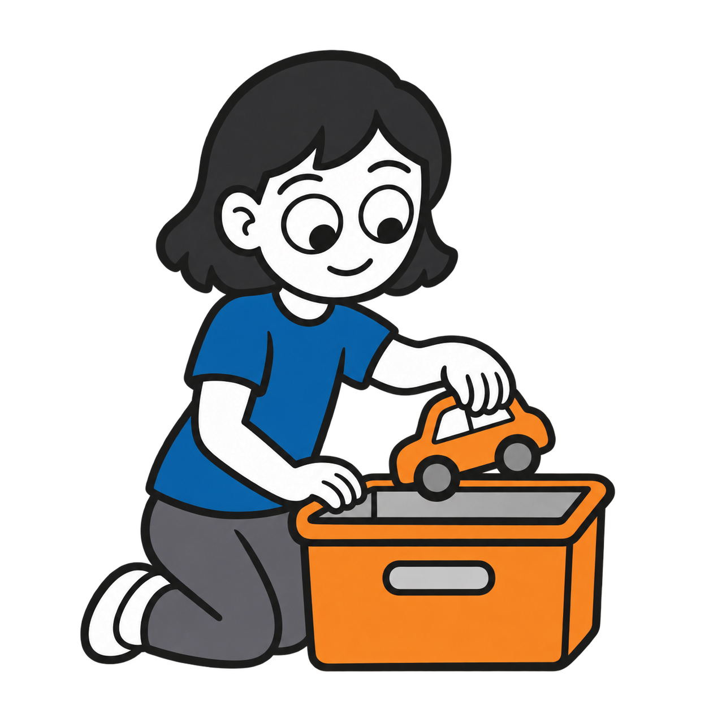
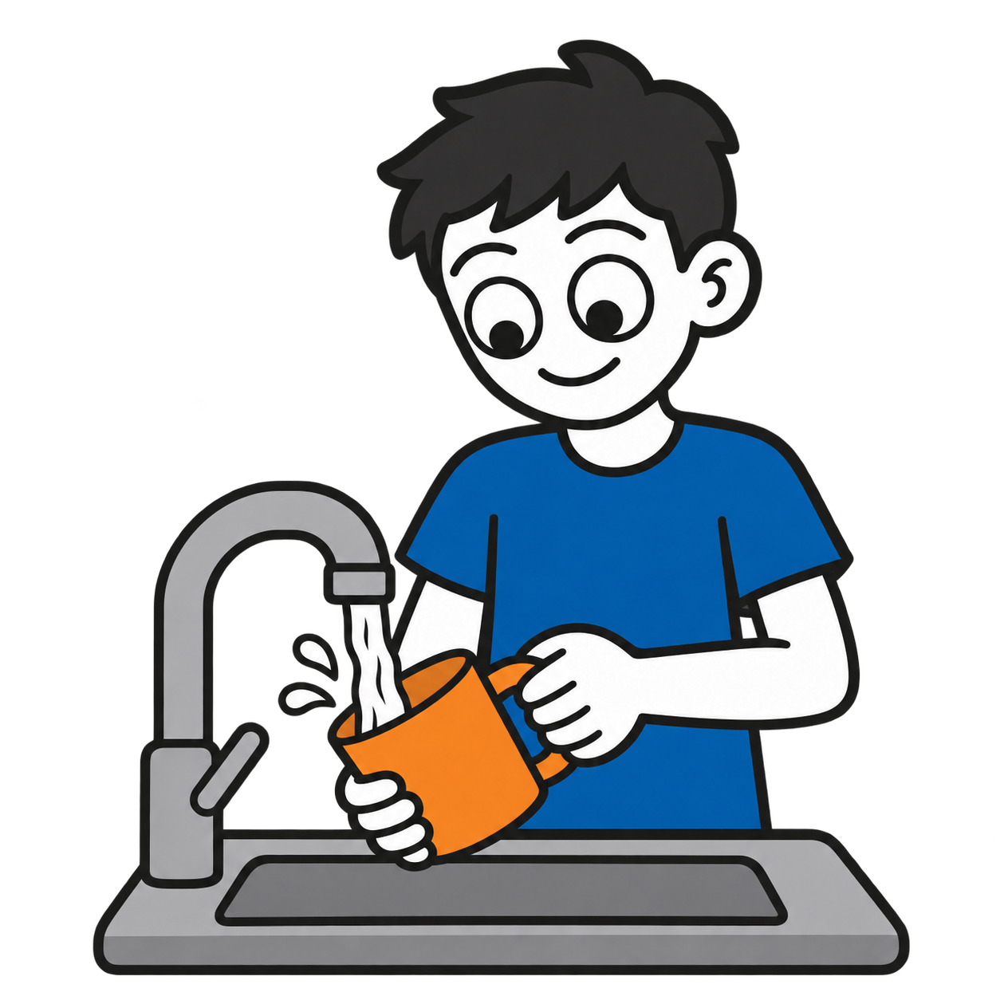
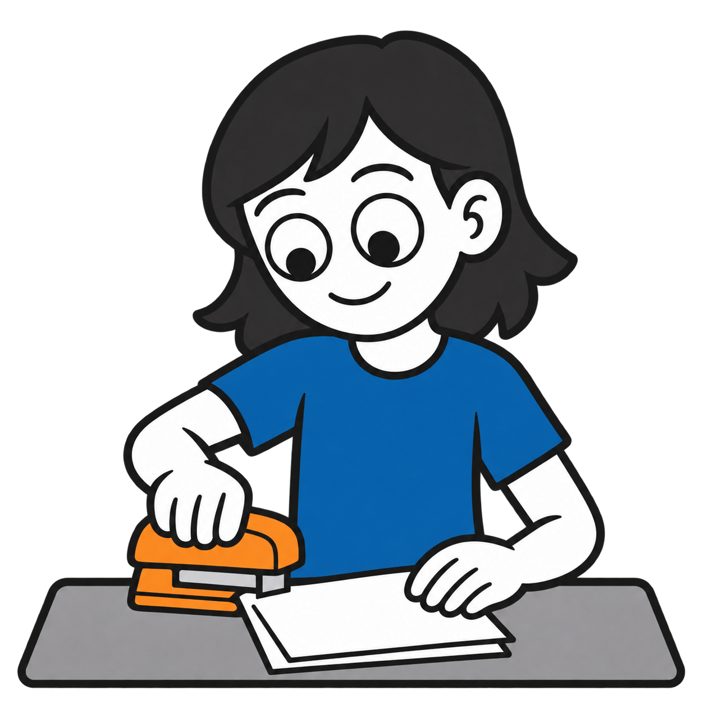
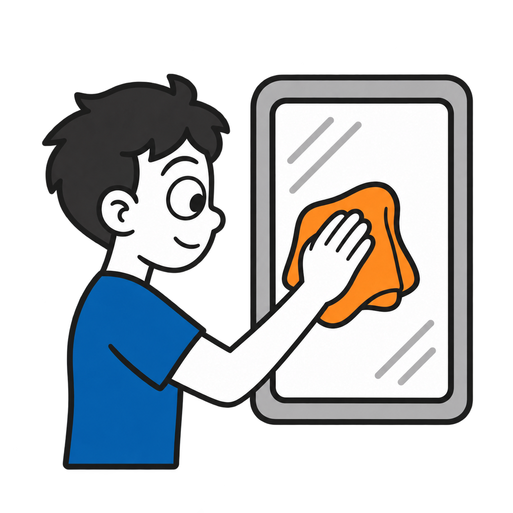
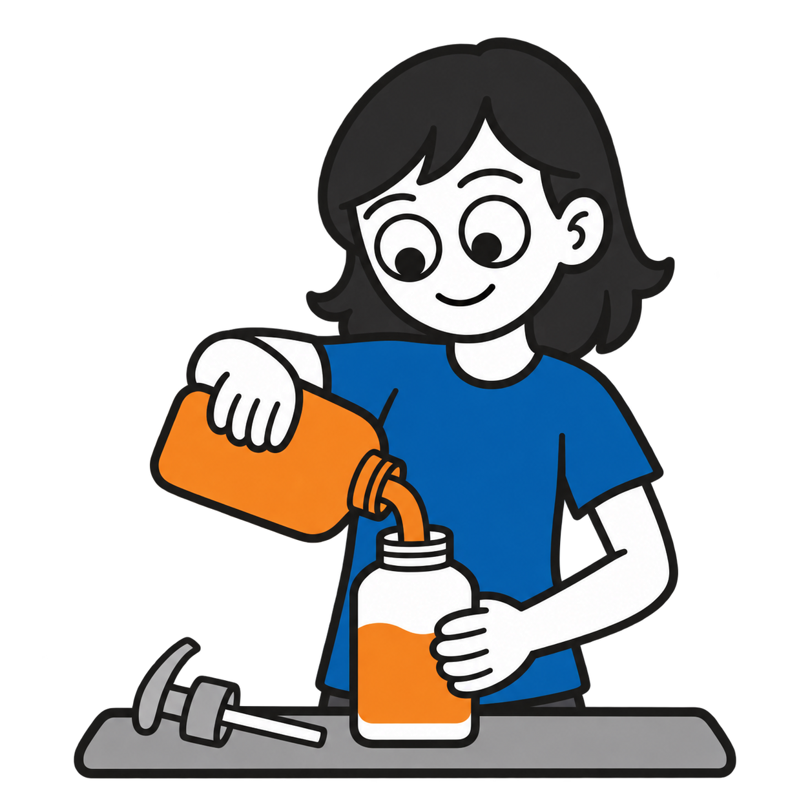

# Everyday vocabulary batch 7

## Button a cardigan

button a cardigan, fasten buttons, getting dressed

## Put a toy in a bin

put a toy in a bin, put toys away, clean up

## Rinse a cup

rinse a cup, wash a cup, sink

## Staple papers

staple papers, use a stapler, school supplies

## Wipe a mirror

wipe a mirror, clean a mirror, cleaning cloth

## Refill a soap dispenser

refill a soap dispenser, liquid soap, refill soap

Visual supports by Ryan Baker-Barrett of Applied Behavioral Health Practice. https://getadhd.care · https://appliedbehavioral.health · https://github.com/appliedbhp/visual-supports. Licensed CC BY-SA 4.0 (https://creativecommons.org/licenses/by-sa/4.0/). Third-party reference credit retained: Adventurer by Lisa Wischofsky, via DiceBear, CC BY 4.0 (https://creativecommons.org/licenses/by/4.0/). Character proportions, hair, colors and action adapted using AI.
