# Everyday AAC vocabulary, continued

| Concept | Age 5 | Age 10 | Teen |
|---|---|---|---|
| Yes |  | 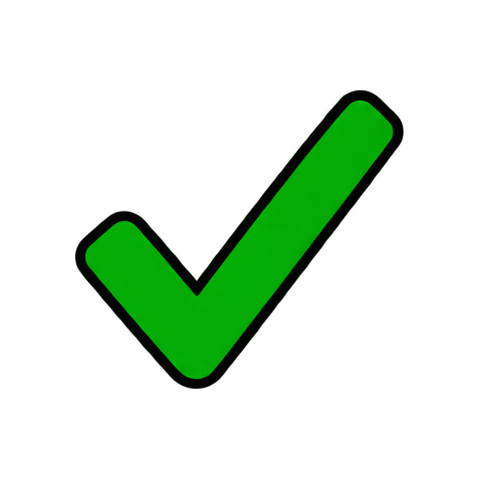 |  |
| No | 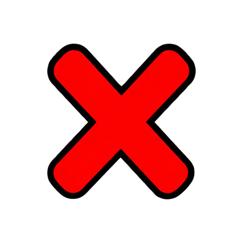 | 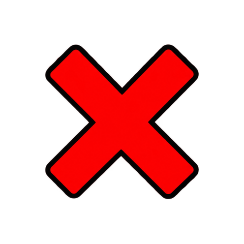 |  |
| Wait | 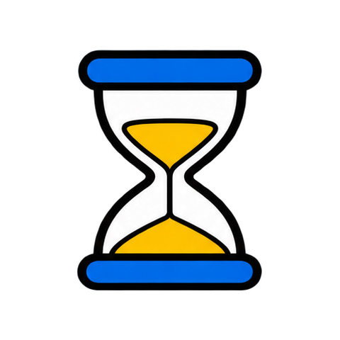 | 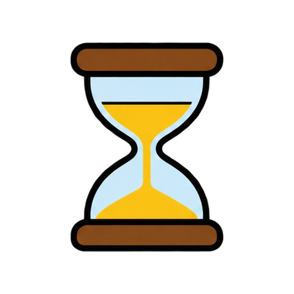 | 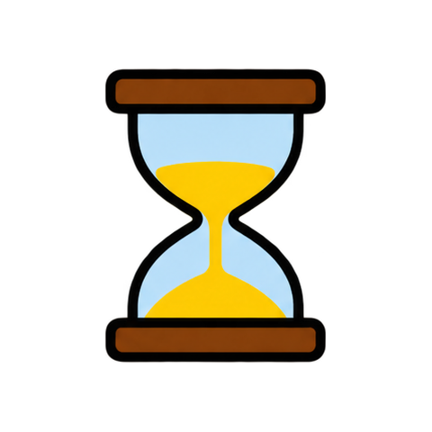 |
| Lunchbox | 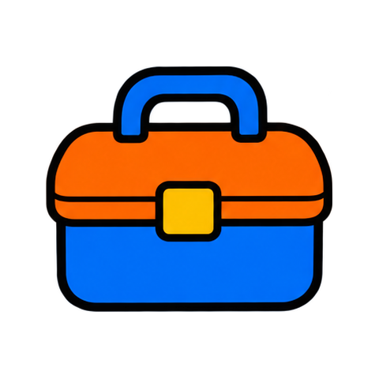 | 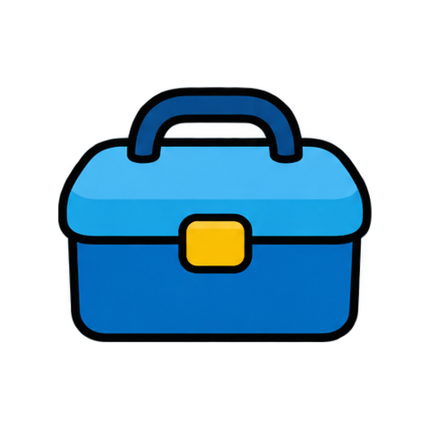 | 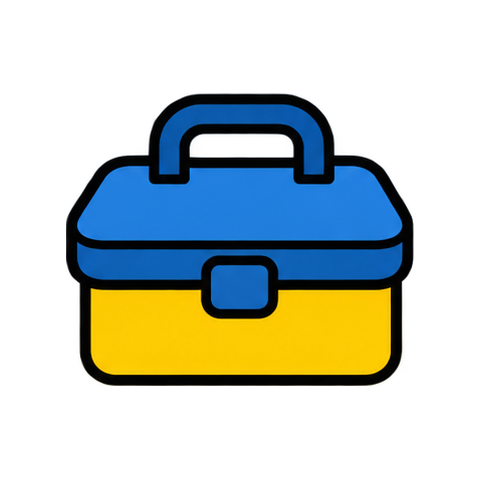 |
| Scissors | 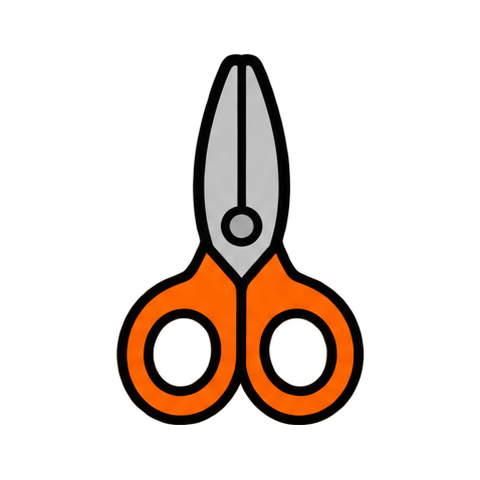 | 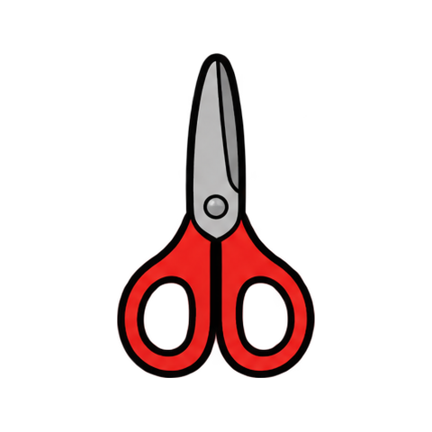 | 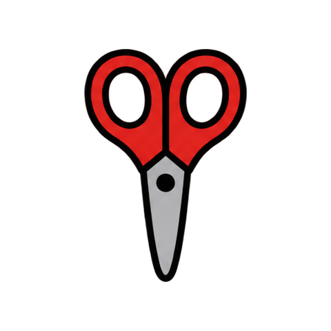 |
| Glue stick | 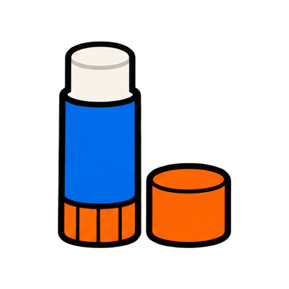 | 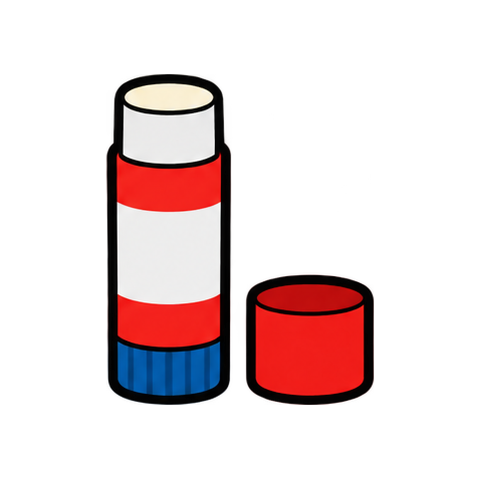 | 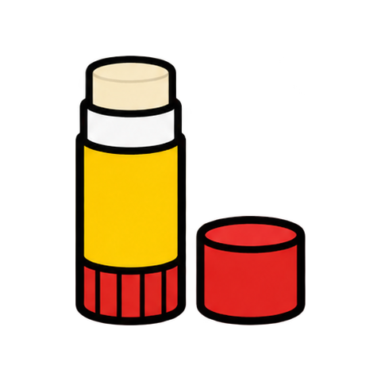 |
| Toilet | 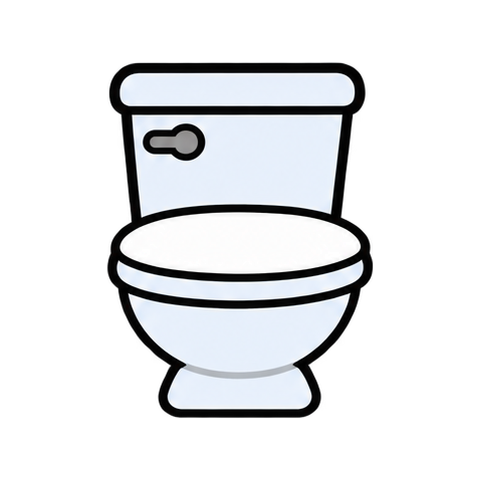 | 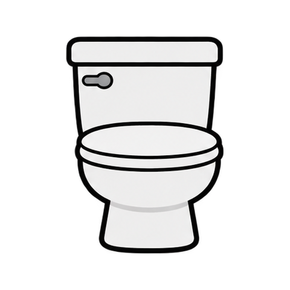 | 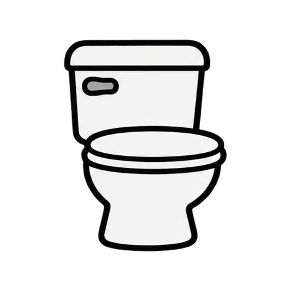 |
| Bath towel | 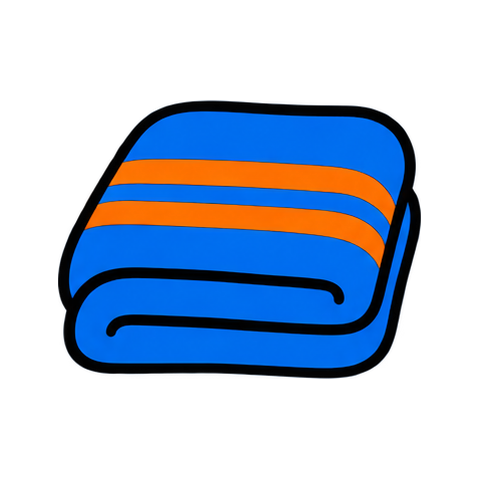 | 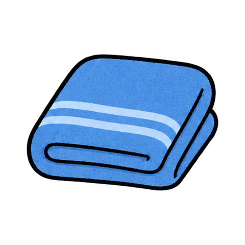 |  |
| Liquid soap | 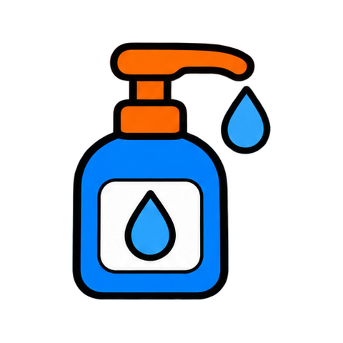 | 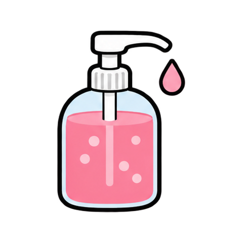 | 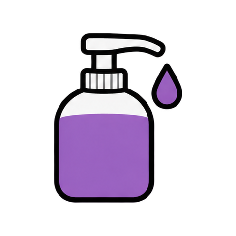 |
