# Everyday AAC vocabulary

Vocabulary planning used the [ARASAAC category tree guide](https://aulaabierta.arasaac.org/en/search-of-pictograms-tree-of-categories-arasaac) and its [English symbol search](https://aulaabierta.arasaac.org/en/arasaac-symbols-search-engine). The artwork is original generated artwork, and the English search aliases are chosen for this library.

| Concept | Age 5 | Age 10 | Teen |
|---|---|---|---|
| Stop | 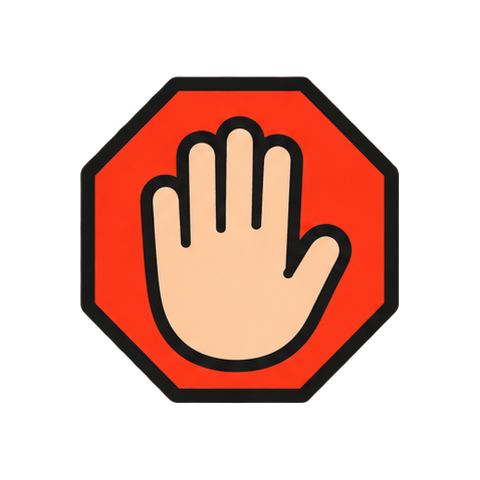 | 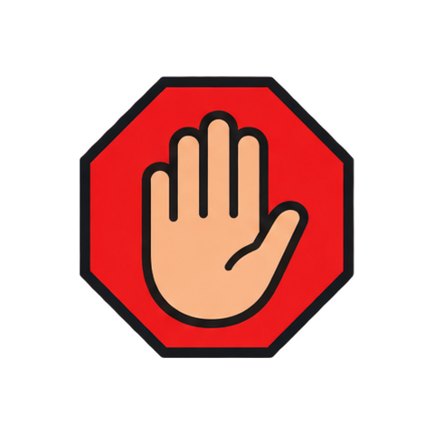 |  |
| Help | 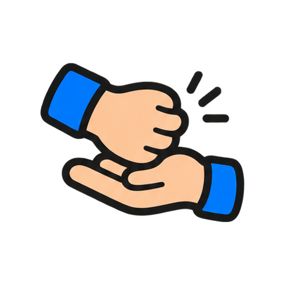 | 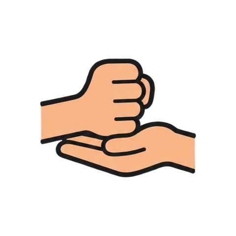 |  |
| Again |  |  | 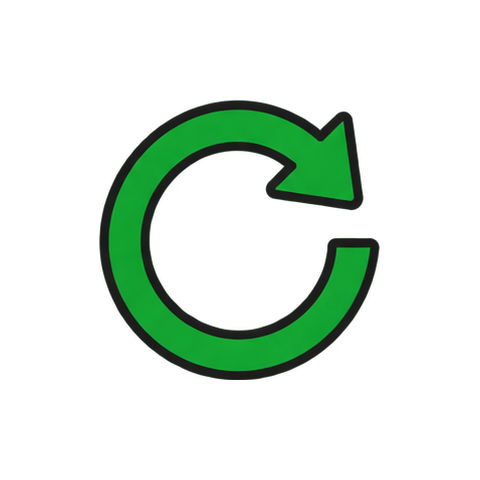 |
| Backpack | 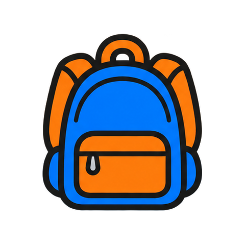 | 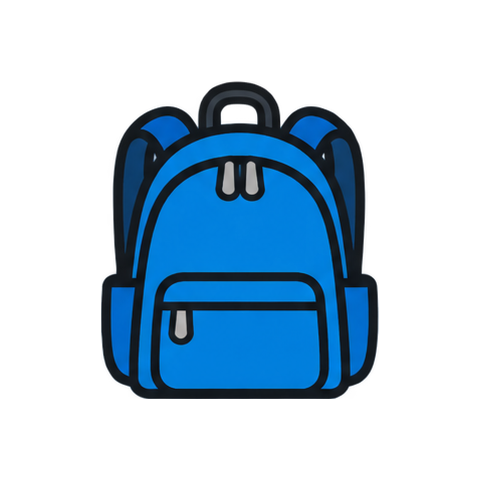 | 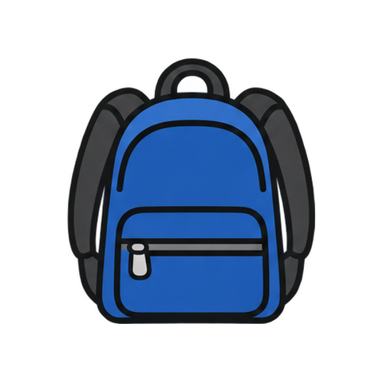 |
| Umbrella | 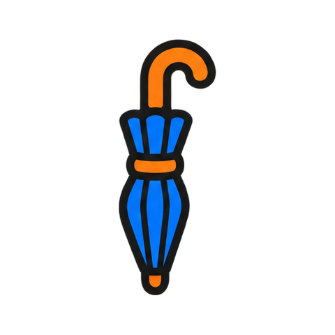 | 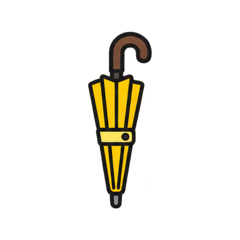 | 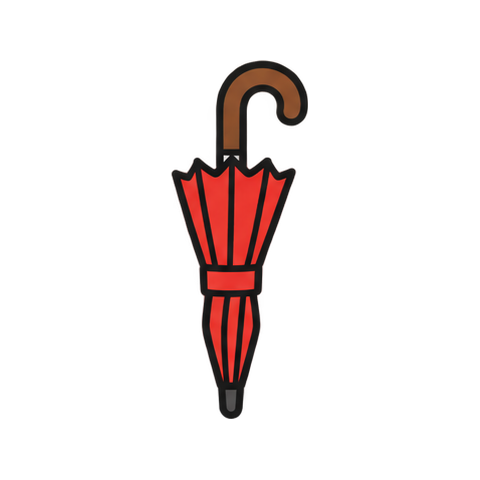 |
| City bus | 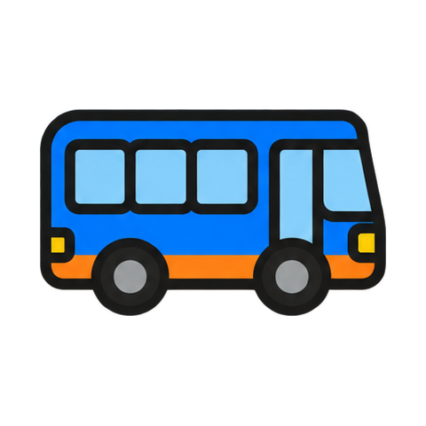 | 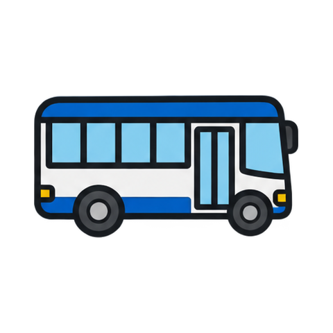 | 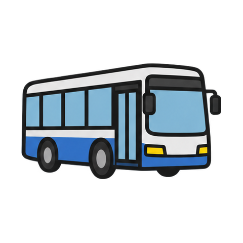 |
| Toothbrush | 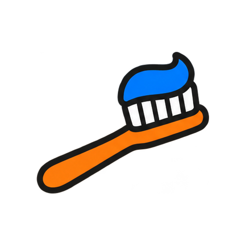 | 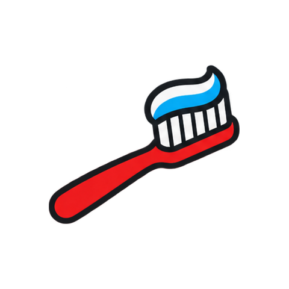 | 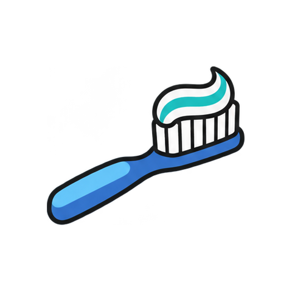 |
| Bar of soap | 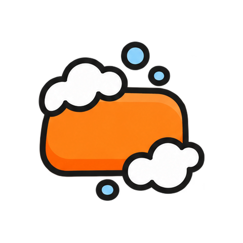 |  | 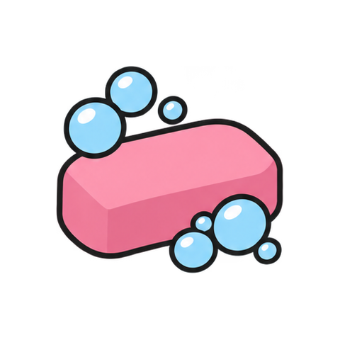 |
| Analog clock | 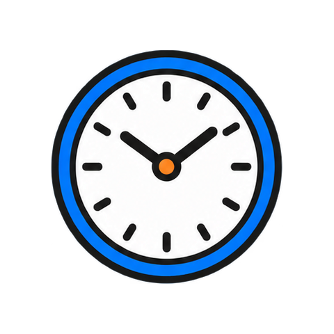 | 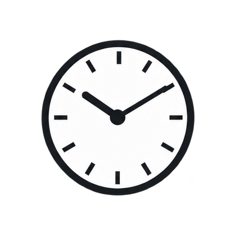 | 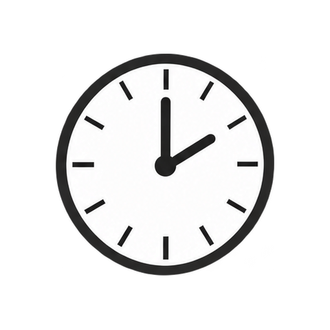 |
