# Feelings, social situations, and recreation

| Concept | Age 5 | Age 10 | Teen |
|---|---|---|---|
| Happy |  |  |  |
| Sad | 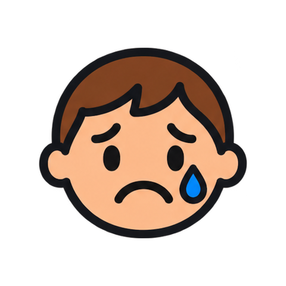 |  |  |
| Angry |  |  |  |
| Handshake |  |  |  |
| Wave hello | 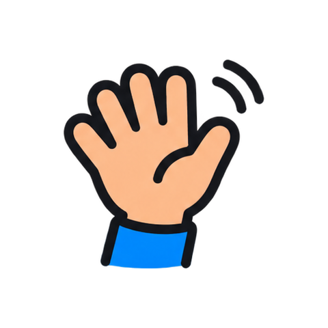 | 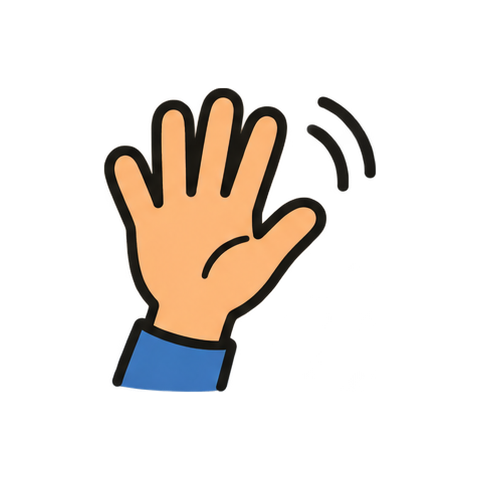 | 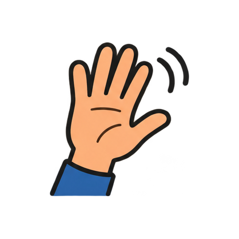 |
| Pass the ball |  | 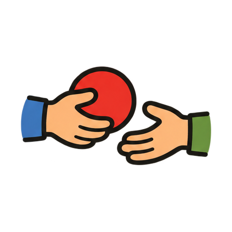 | 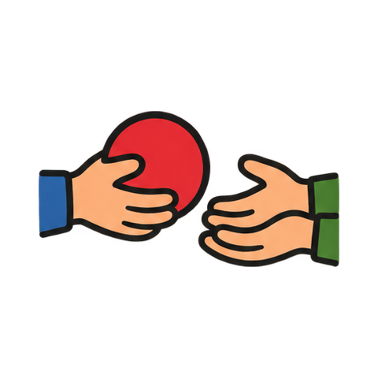 |
| Acoustic guitar | 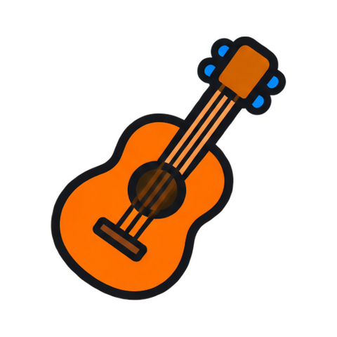 | 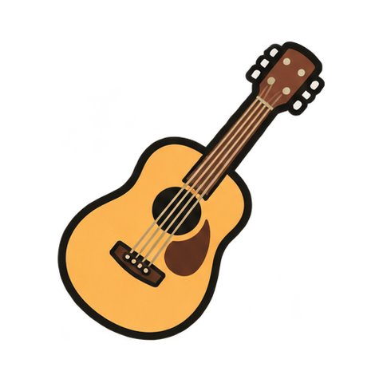 | 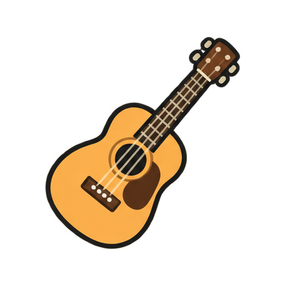 |
| Building blocks | 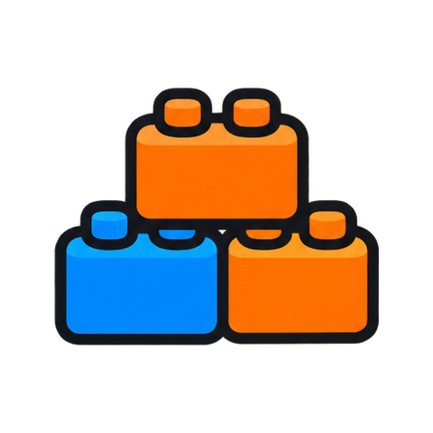 | 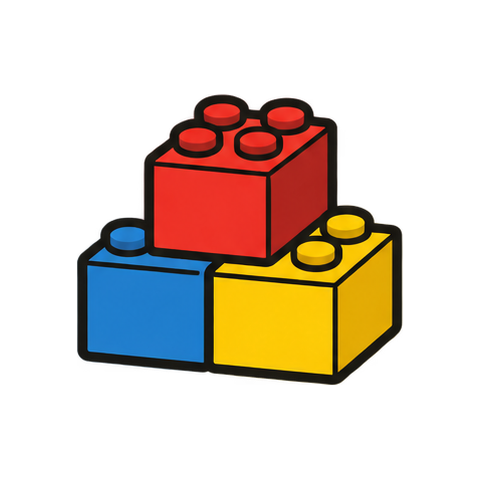 | 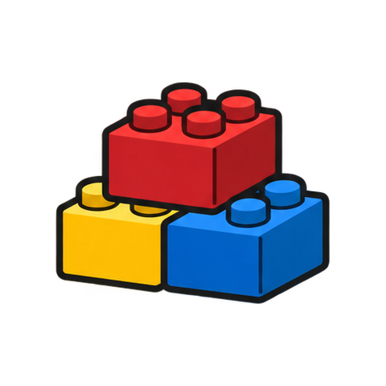 |
| Baseball glove and ball | 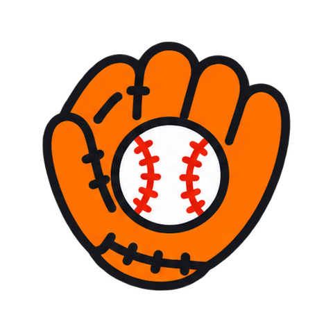 | 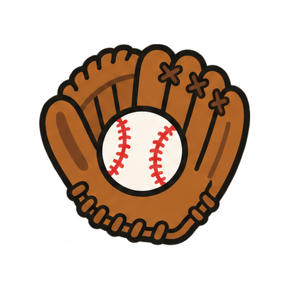 | 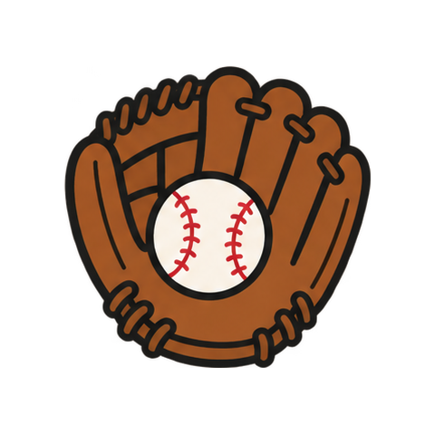 |
