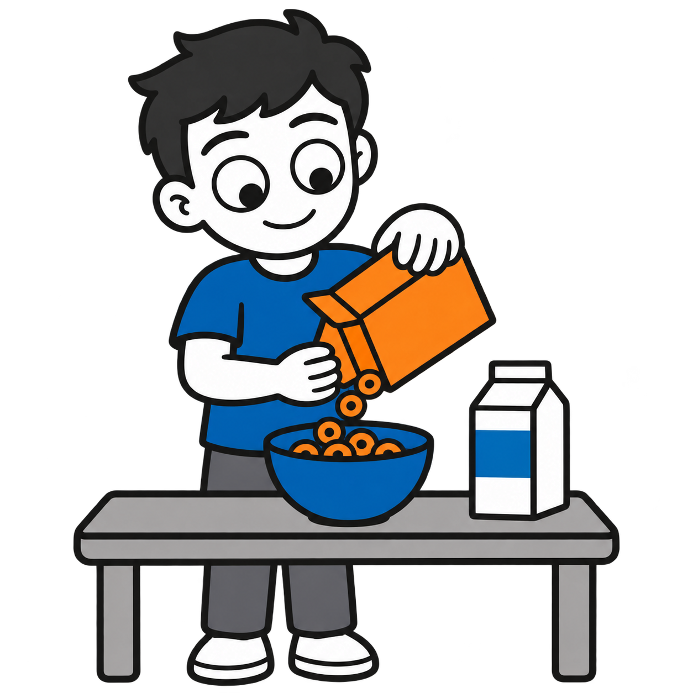
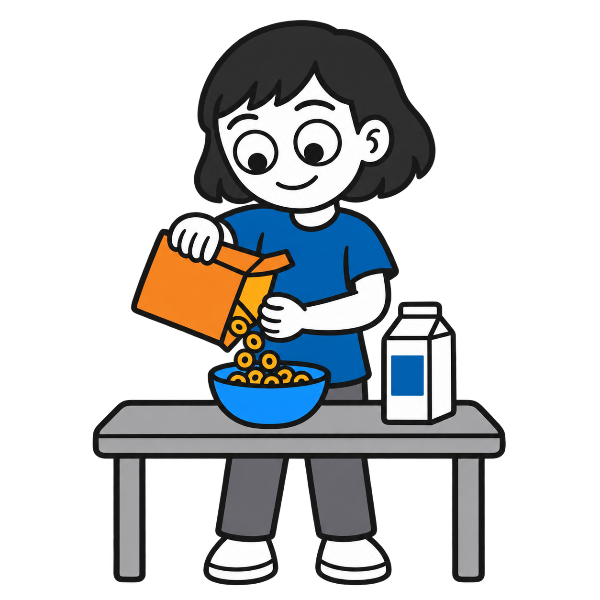
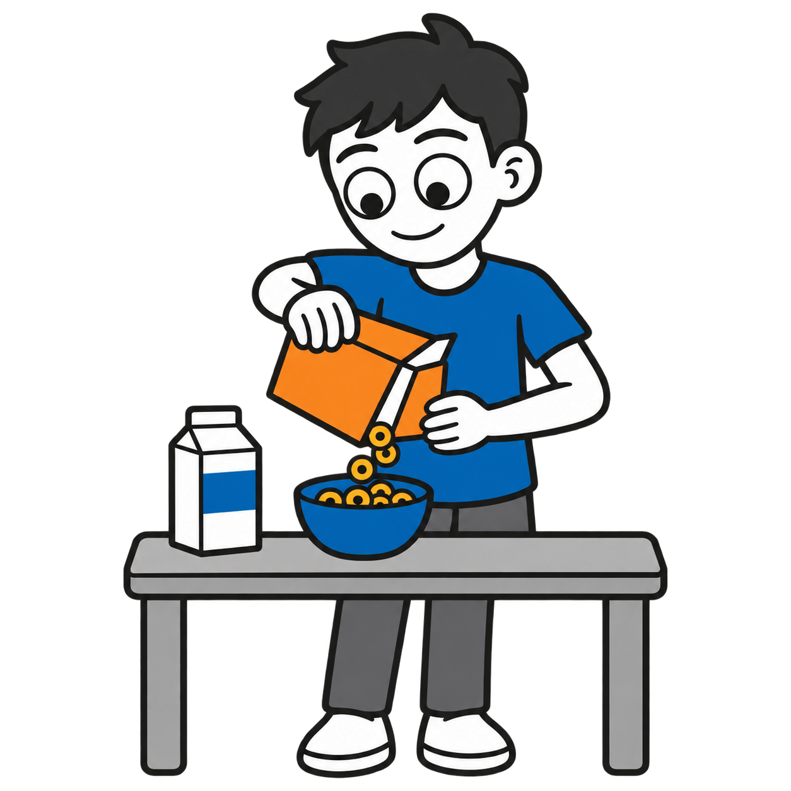
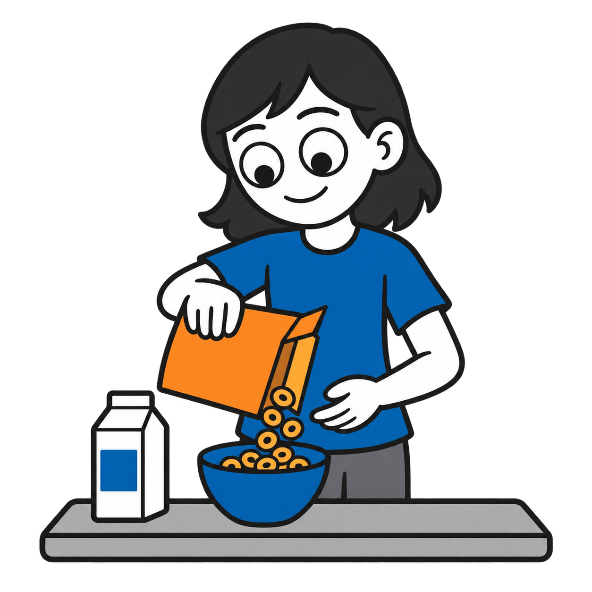
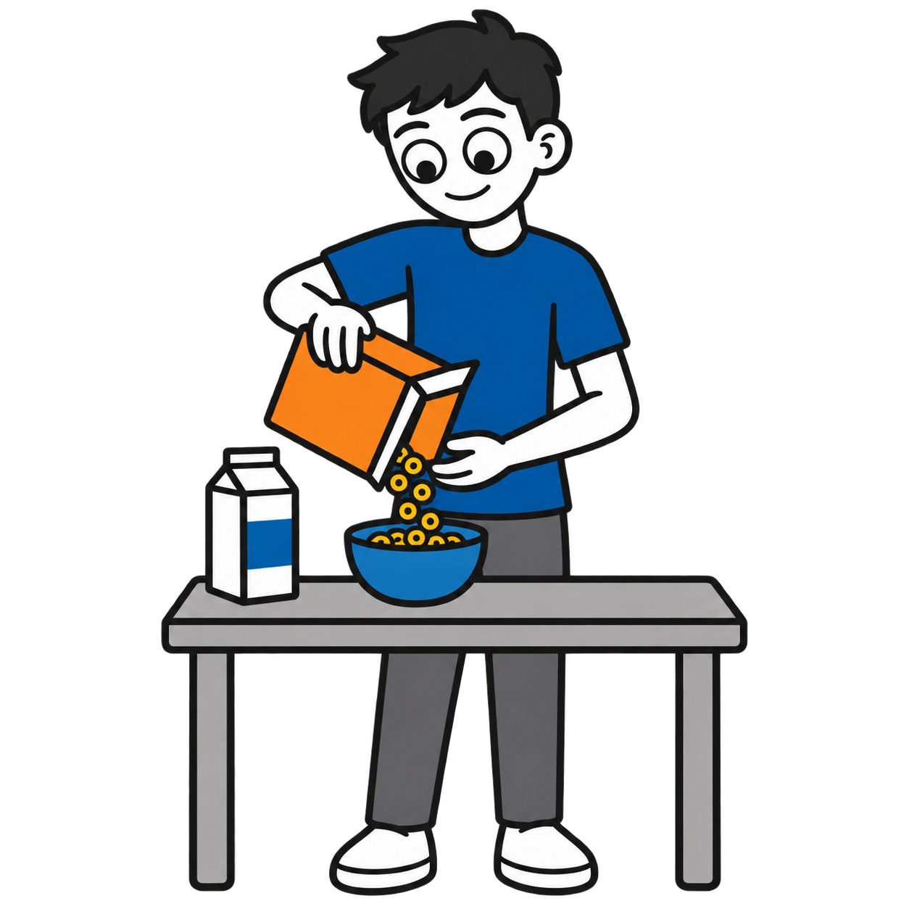
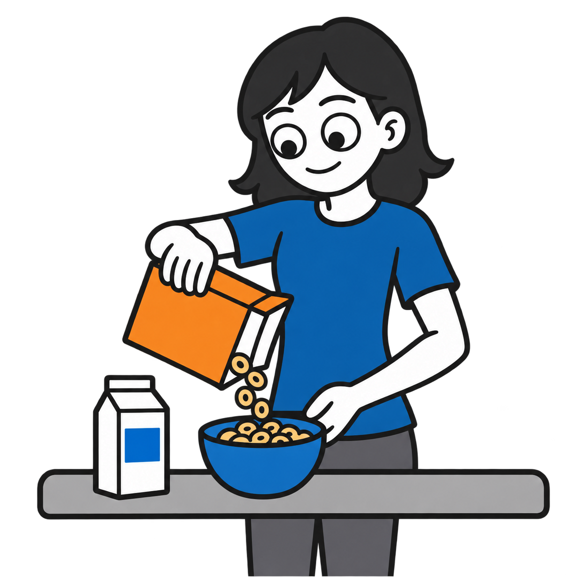

# Making a bowl of cereal: six character variants

Six standalone square transparent PNGs, generated using the built-in OpenAI image generation tool. All are **drafts pending owner review**. Each depicts pouring cereal into a bowl rather than eating breakfast.

| Depicted age | Male | Female |
|---|---|---|
| 5 years |  |  |
| 10 years |  |  |
| Teen (about 15) |  |  |

## Style and validation

Approved homework illustration used as the shared style reference, derived from the user-supplied feed-cats-6.png. Requested outlines #202020, blue #1769AA, orange #F28C28, opaque white skin and props, and transparent background. PNGs are 1254 × 1254 with RGBA transparency. No text or labels are embedded in artwork. Some tonal variation remains despite the flat-fill request; exact hex-color matching needs further review. Head/body proportions vary by age, with simpler younger characters and longer teenage proportions.

Full individual prompts, alt text, source information, checksums and rights are recorded in `catalog/visuals.json`. Files are in each age strand's `daily-routines` folder.

## Attribution and rights

Visual supports by Ryan Baker-Barrett of Applied Behavioral Health Practice — https://getadhd.care · https://appliedbehavioral.health · https://github.com/appliedbhp/visual-supports — CC BY-SA 4.0 (https://creativecommons.org/licenses/by-sa/4.0/). Share and adapt, including commercially, with attribution, a license link, indication of changes, and ShareAlike for adaptations. Third-party materials retain their original licenses and attribution. Reference character credit retained: Adventurer by Lisa Wischofsky, via DiceBear, CC BY 4.0 (https://creativecommons.org/licenses/by/4.0/), https://www.dicebear.com/styles/adventurer/. Changes: action artwork adapted with AI; hairstyles, age proportions, palette and cereal-making scene customized.
