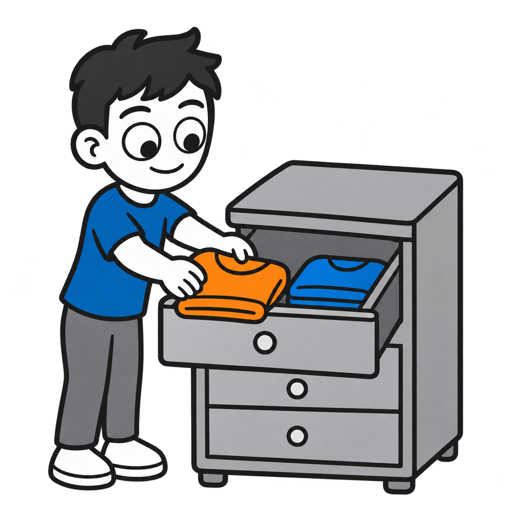
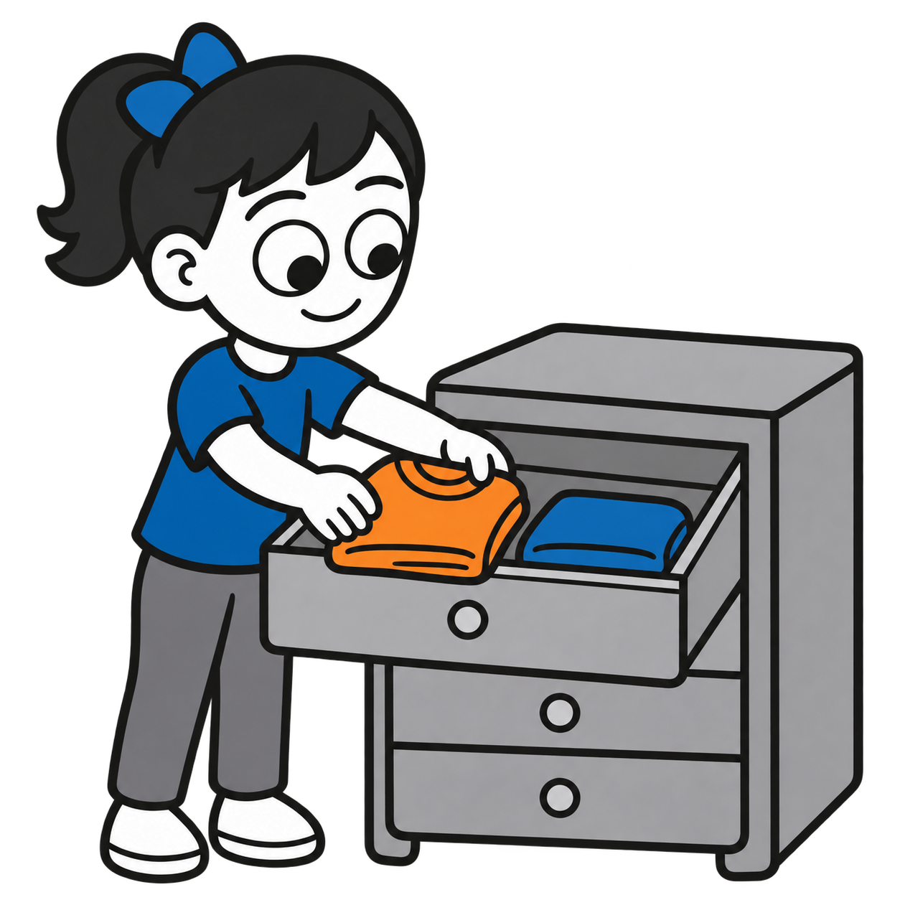
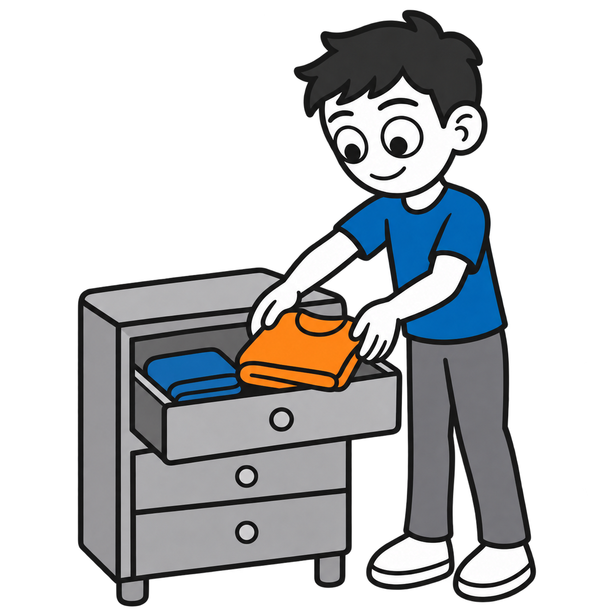
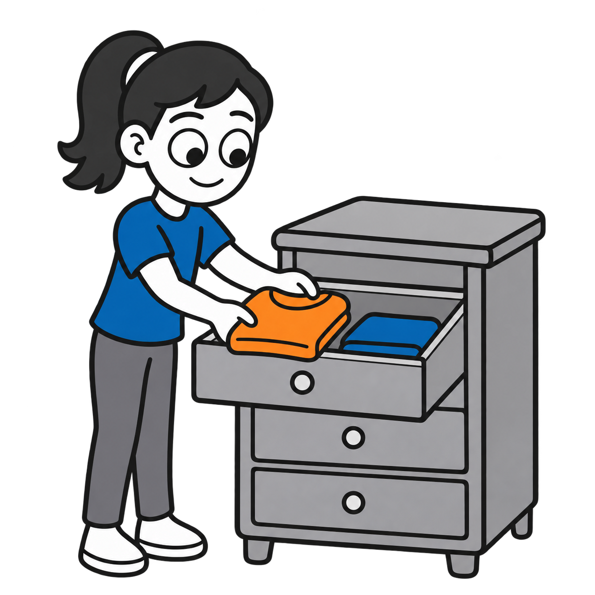
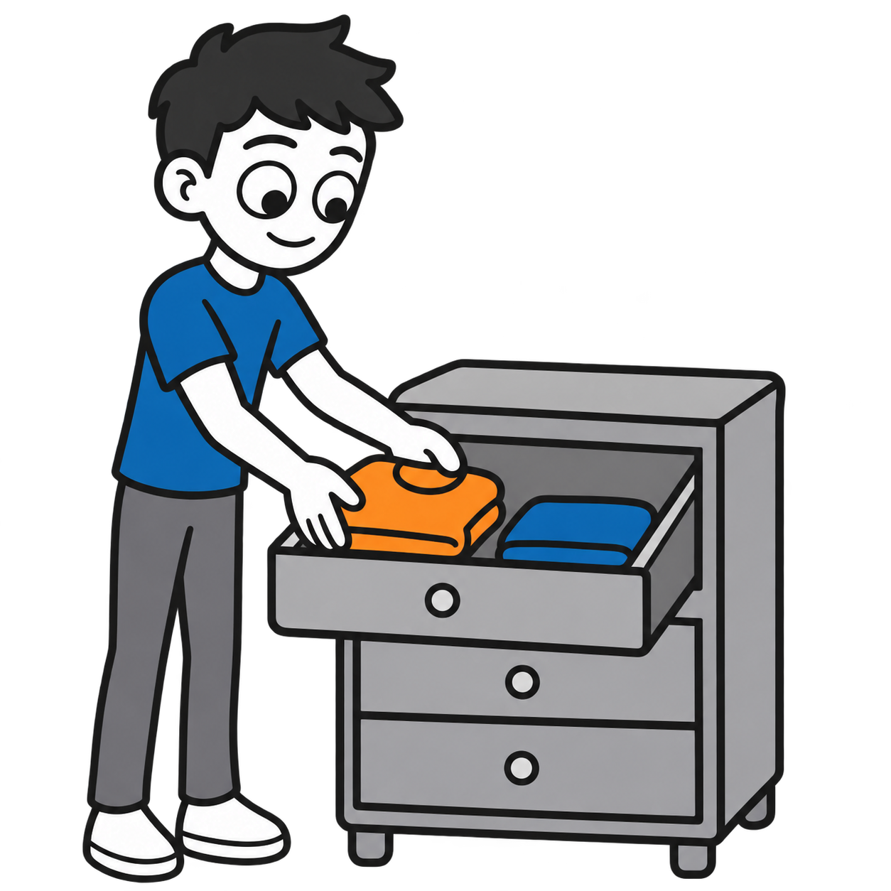
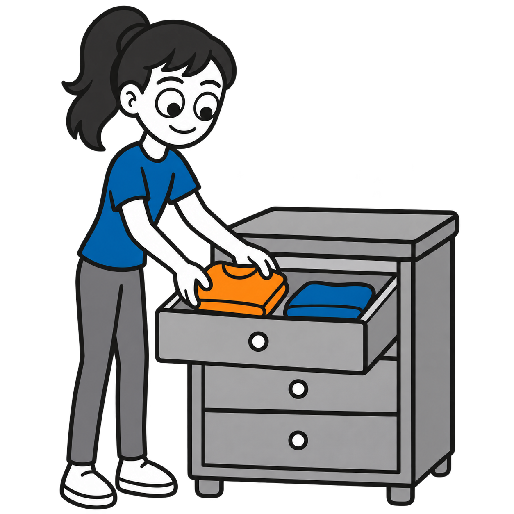

# Put clothes in drawers

Six draft AAC pictograms showing a folded shirt being placed into an open dresser drawer.

| Age | Boy | Girl |
| --- | --- | --- |
| 5 |  |  |
| 10 |  |  |
| Teen |  |  |

Visual supports by Ryan Baker-Barrett of Applied Behavioral Health Practice. https://getadhd.care · https://appliedbehavioral.health · https://github.com/appliedbhp/visual-supports. Licensed CC BY-SA 4.0 (https://creativecommons.org/licenses/by-sa/4.0/). Third-party reference credit retained: Adventurer by Lisa Wischofsky, via DiceBear, CC BY 4.0 (https://creativecommons.org/licenses/by/4.0/). Character proportions, hair, colors and action adapted using AI.
