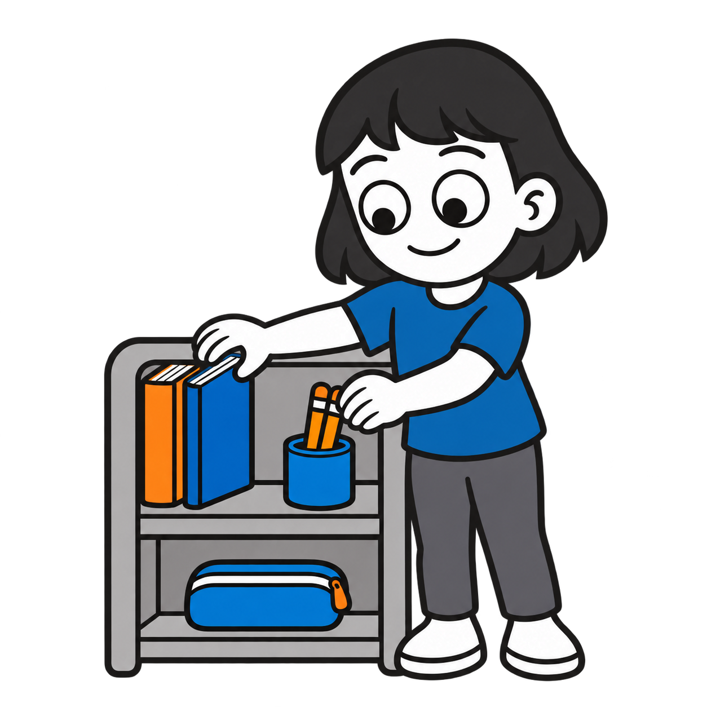
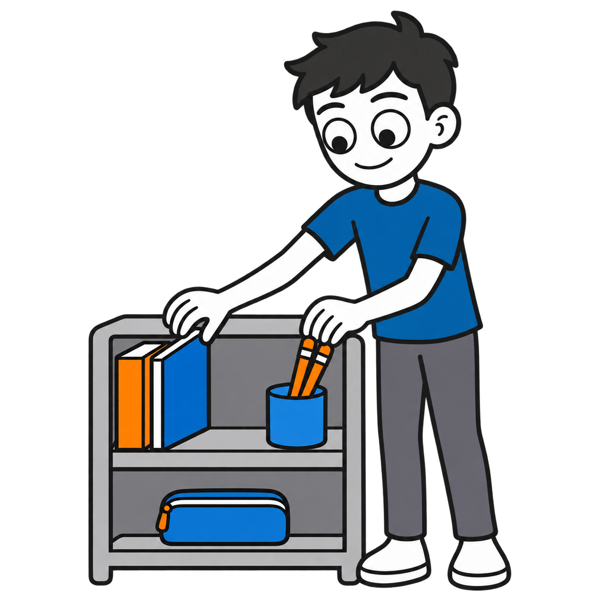
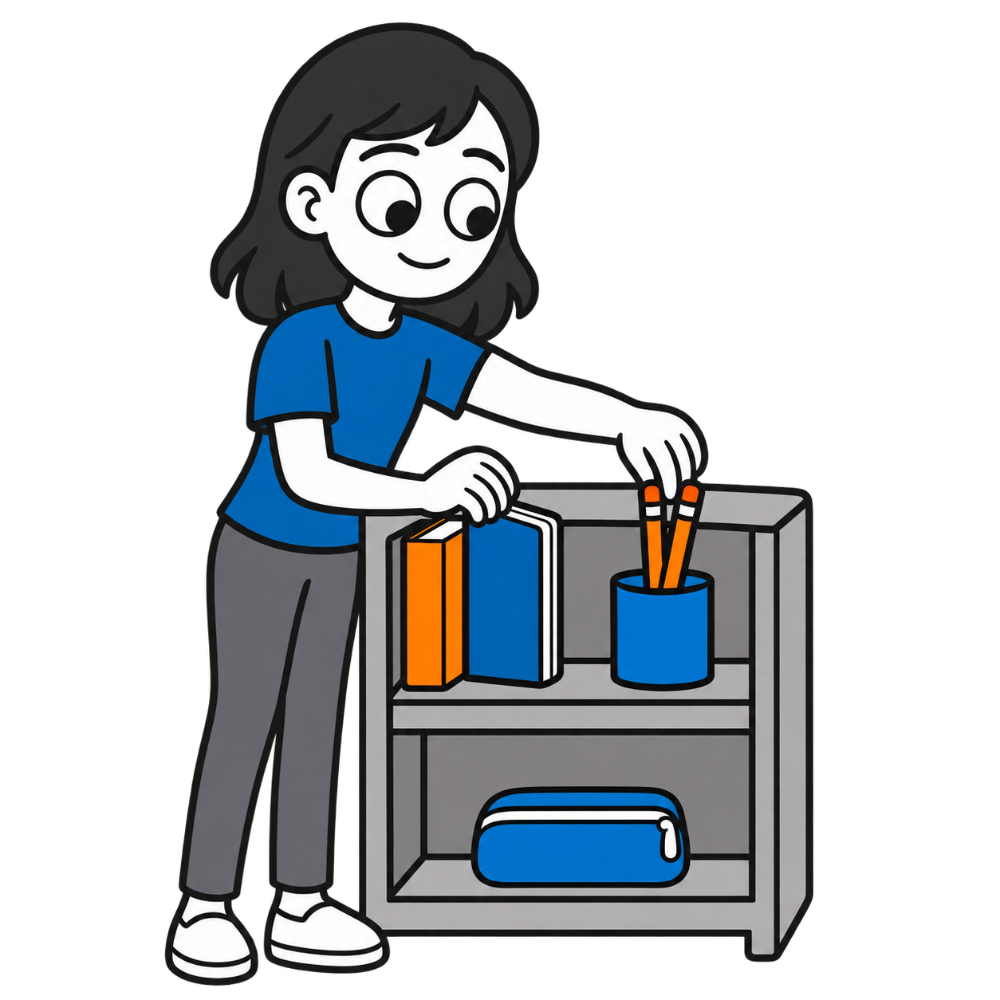
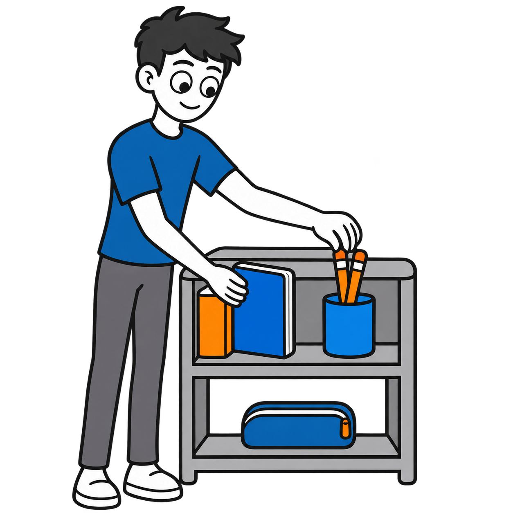
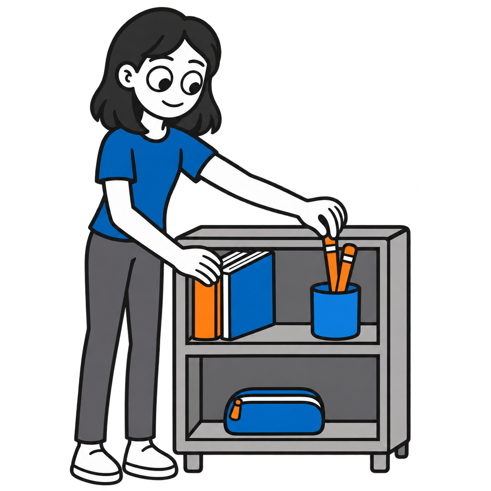

# Put school materials away: six variants

Six standalone square transparent PNGs across all three age strands, with male and female versions for ages 5, 10 and teens. Each depicts returning books/notebooks and pencils to their storage locations on a low shelf. A pencil case is stored on the lower shelf. All are **drafts pending owner review**.

| Depicted age | Male | Female |
|---|---|---|
| 5 years |  |  |
| 10 years |  |  |
| Teen (about 15) |  |  |

## Style and validation

Generated with the built-in OpenAI image generation tool using the approved homework illustration as a style reference. Requested #202020 contours, #1769AA blue and #F28C28 orange, opaque white skin, shoes and page edges, and neutral gray shelf and trousers. Each is 1254 × 1254 RGBA with genuine surrounding background transparency. Shelf backs are opaque where depicted. Full character, shelf and essential materials are inside the frame; no embedded text. Some tonal variation remains; exact hex colors are not guaranteed. Proportions vary by age.

Full prompts, descriptions, source information and SHA-256 checksums are recorded in `catalog/visuals.json`. Category: Learning and tasks.

## Attribution and rights

Visual supports by Ryan Baker-Barrett of Applied Behavioral Health Practice — https://getadhd.care · https://appliedbehavioral.health · https://github.com/appliedbhp/visual-supports — CC BY-SA 4.0 (https://creativecommons.org/licenses/by-sa/4.0/). Share and adapt, including commercially, with attribution, a license link, indication of changes, and ShareAlike for adaptations. Third-party materials retain their original licenses and attribution. Reference character credit retained: Adventurer by Lisa Wischofsky, via DiceBear, CC BY 4.0 (https://creativecommons.org/licenses/by/4.0/), https://www.dicebear.com/styles/adventurer/. Changes: action artwork adapted with AI; hairstyles, age proportions, palette and cereal-making scene customized.
