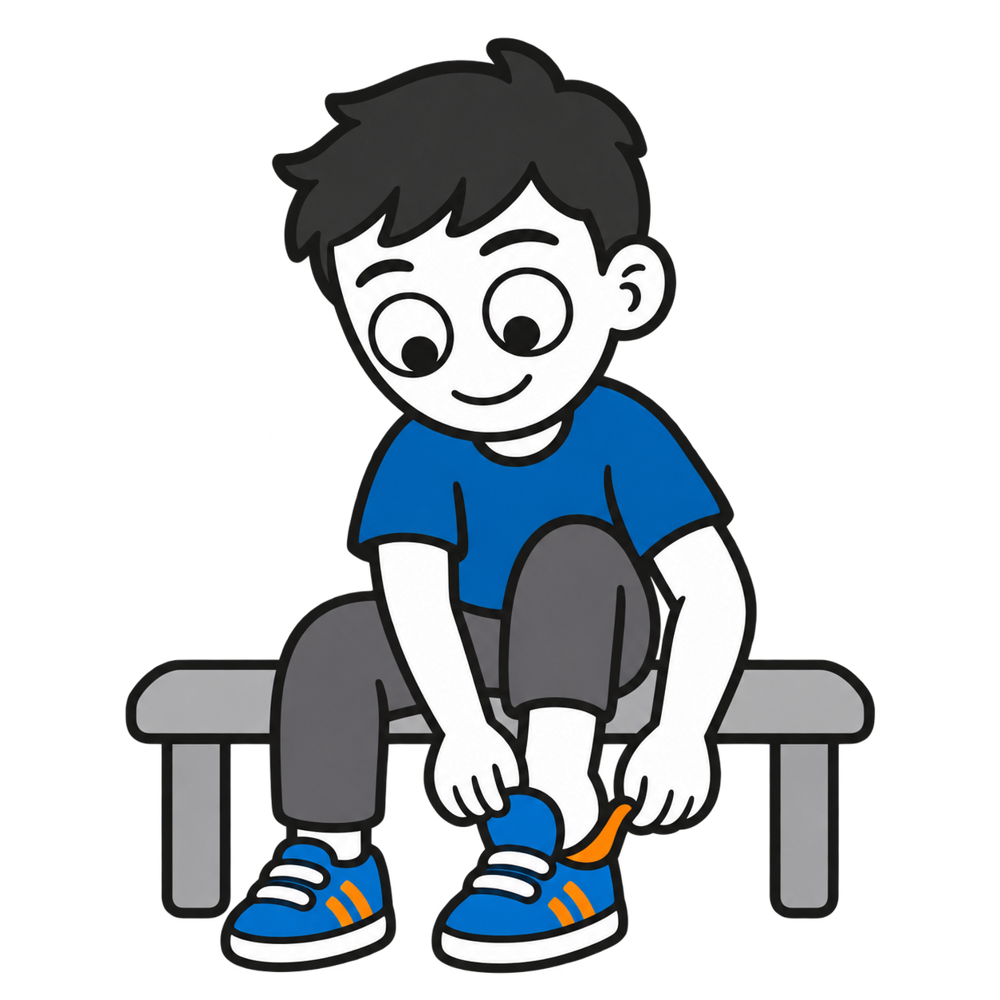
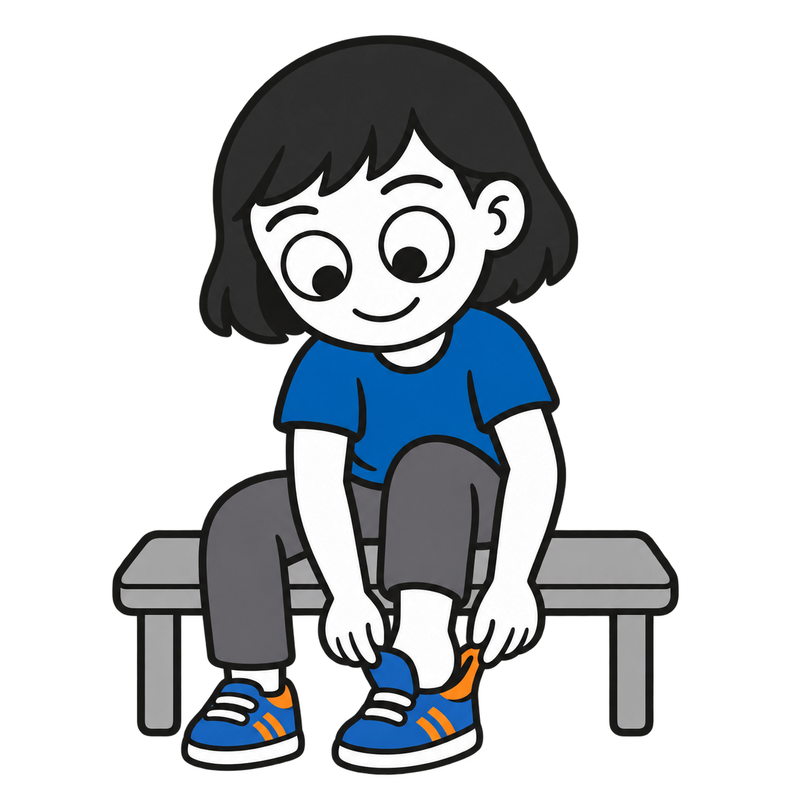
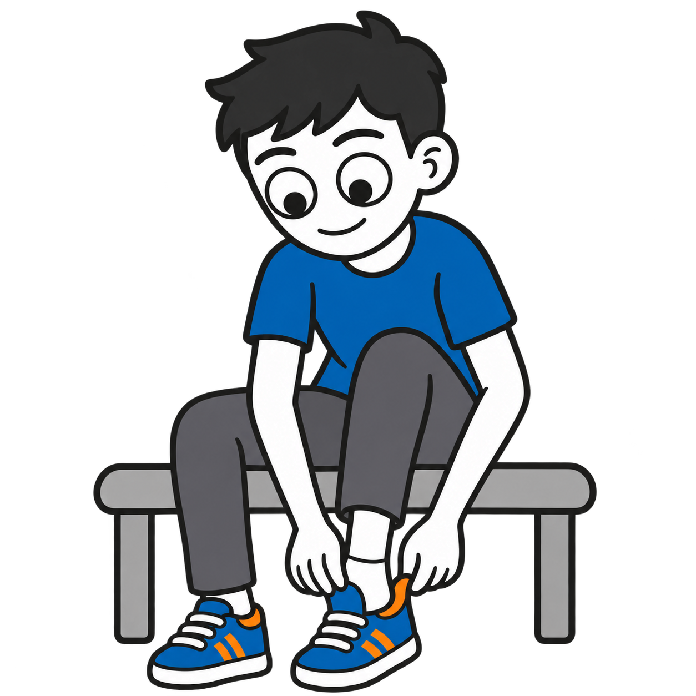
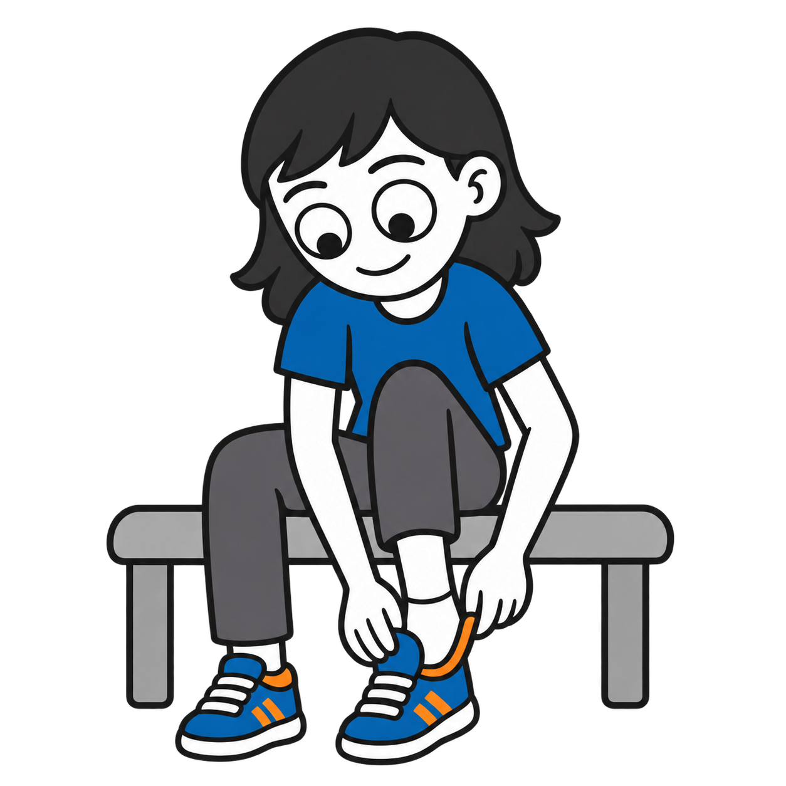
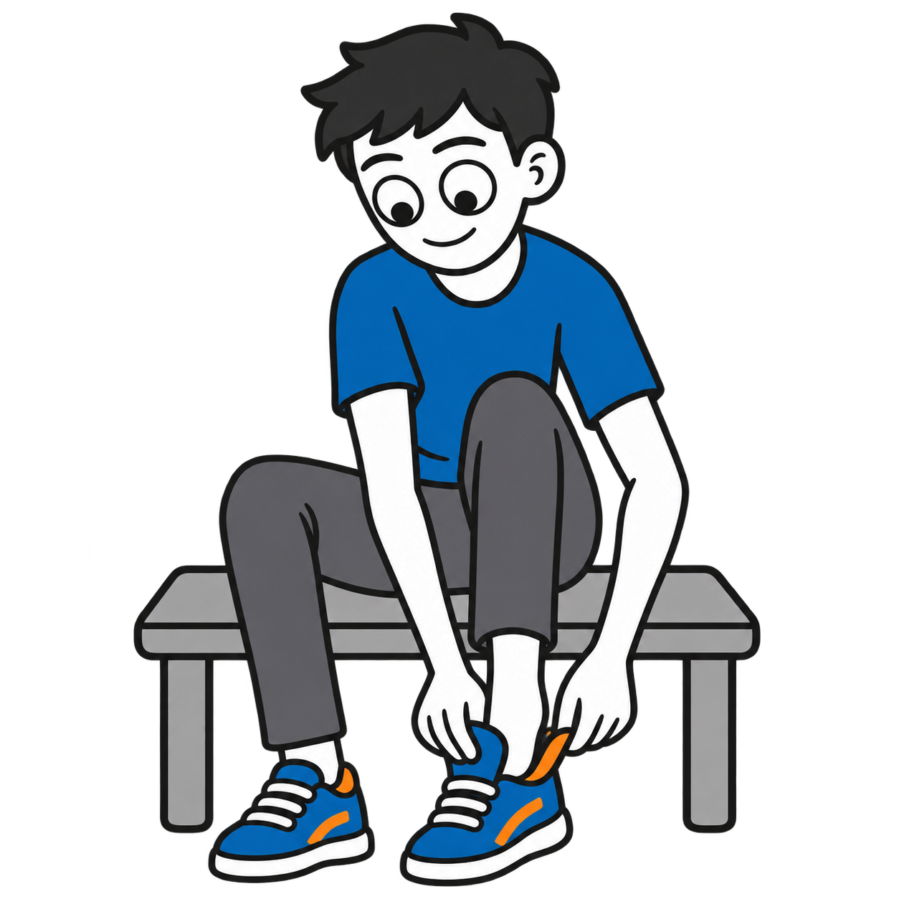
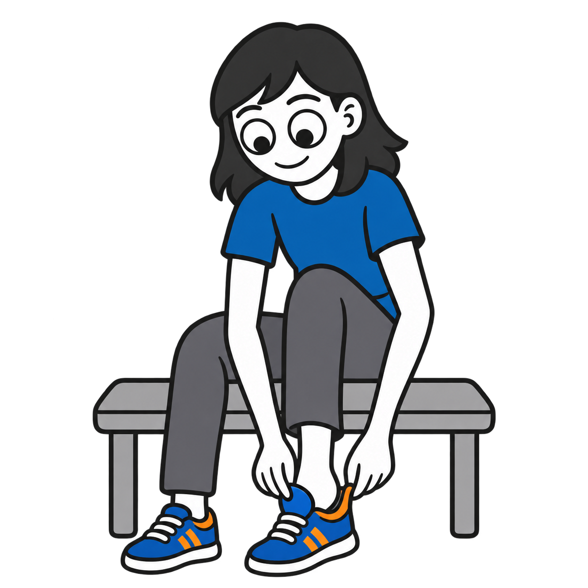

# Putting on shoes: six character variants

Six standalone square transparent PNGs, generated with the built-in OpenAI image generation tool using the approved homework illustration as a style reference. All are **drafts pending owner review**. Existing morning-routine shoe images are unchanged.

| Depicted age | Male | Female |
|---|---|---|
| 5 years |  |  |
| 10 years |  |  |
| Teen (about 15) |  |  |

## Style and validation

Blue #1769AA, orange #F28C28 and outlines #202020 requested, with opaque white skin and socks and neutral gray trousers and bench. Characters sit while pulling open the shoe collar and tongue. Each file is 1254 × 1254 RGBA with genuine background transparency. Artwork is text-free, with full characters and shoes inside the frame. Some subtle tonal variation remains; exact hex colors are not guaranteed. Younger characters have larger heads relative to their bodies; teens have longer limbs and smaller relative heads.

Individual prompts, descriptions, source information and SHA-256 checksums are in `catalog/visuals.json`.

## Attribution and rights

Visual supports by Ryan Baker-Barrett of Applied Behavioral Health Practice — https://getadhd.care · https://appliedbehavioral.health · https://github.com/appliedbhp/visual-supports — CC BY-SA 4.0 (https://creativecommons.org/licenses/by-sa/4.0/). Share and adapt, including commercially, with attribution, a license link, indication of changes, and ShareAlike for adaptations. Third-party materials retain their original licenses and attribution. Reference character credit retained: Adventurer by Lisa Wischofsky, via DiceBear, CC BY 4.0 (https://creativecommons.org/licenses/by/4.0/), https://www.dicebear.com/styles/adventurer/. Changes: action artwork adapted with AI; hairstyles, age proportions, palette and shoe-dressing scene customized.
