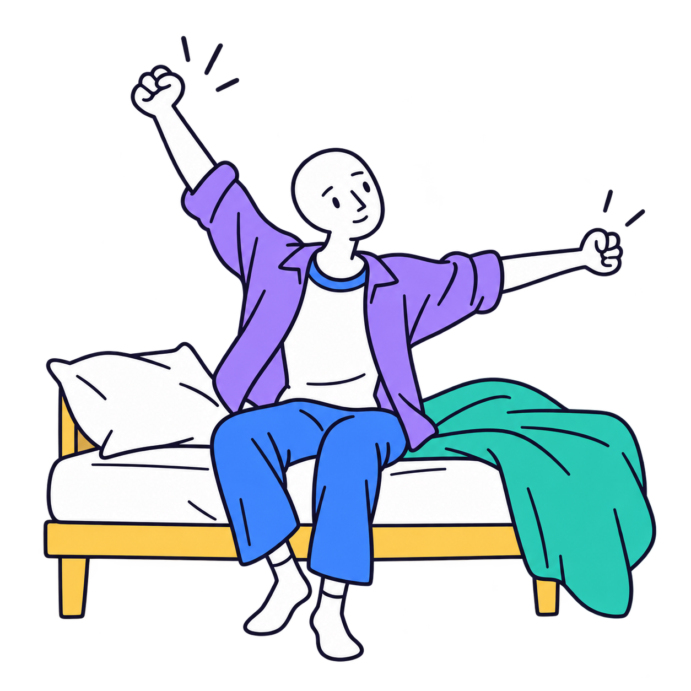
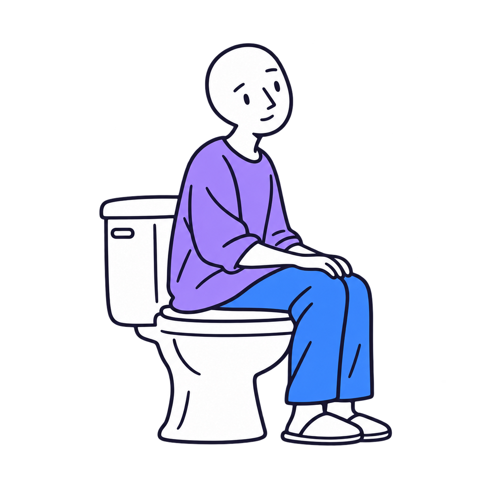
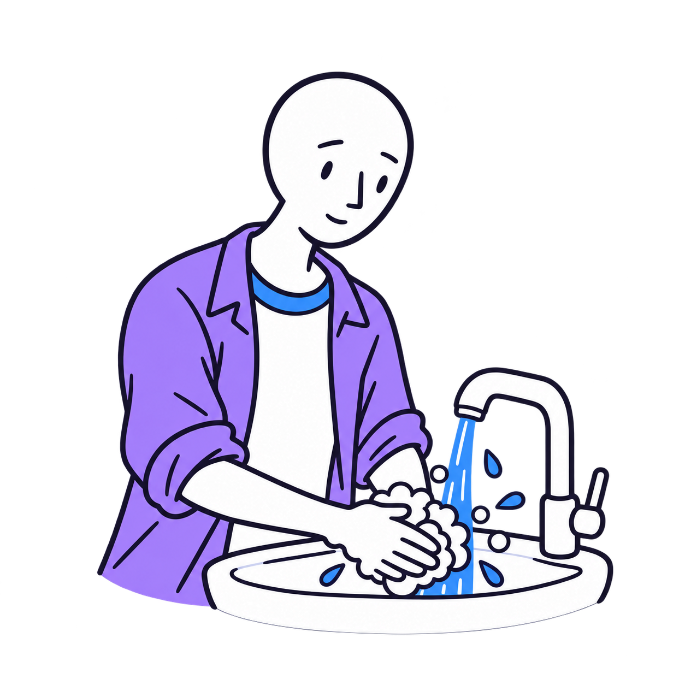
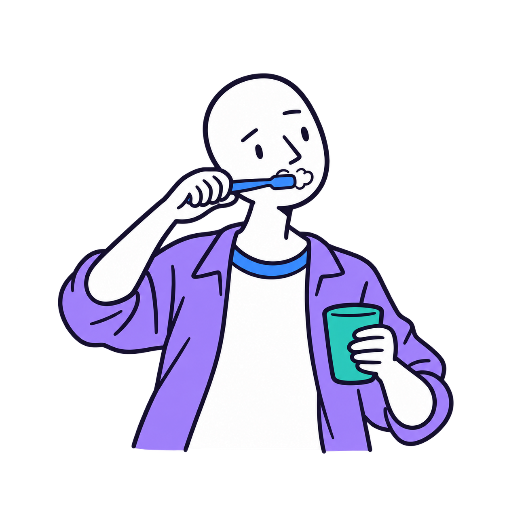
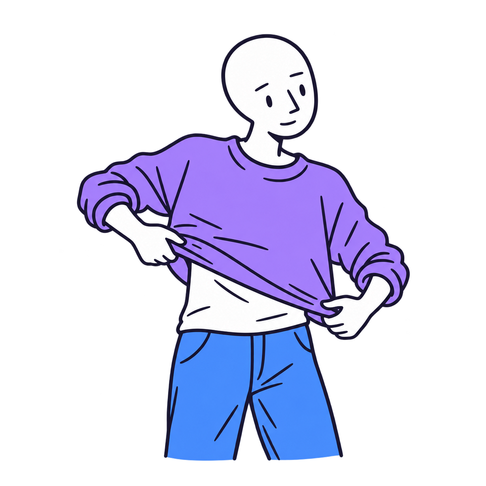
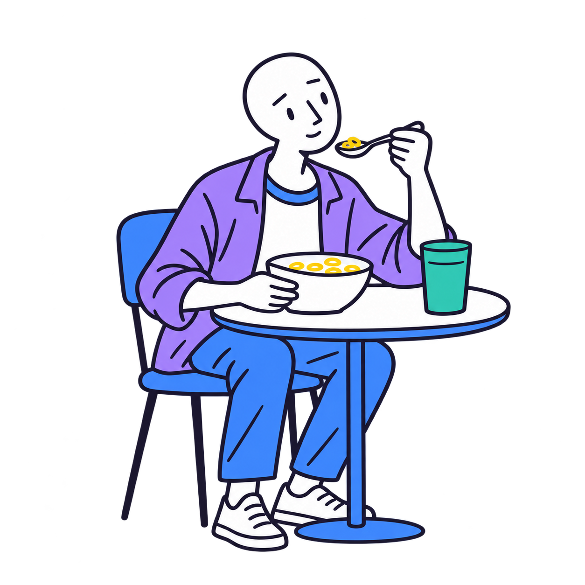
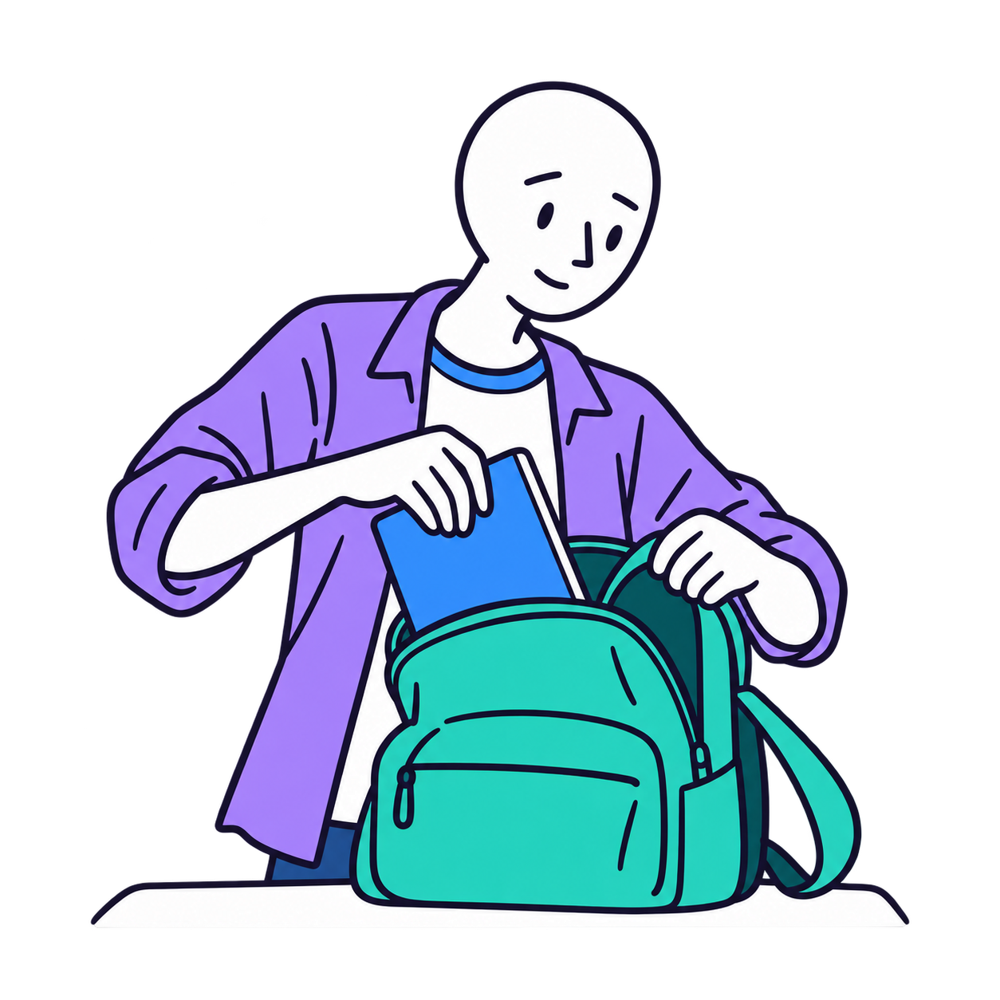

# Visual Supports

A growing library of visual supports for ages 0–18, organized by age, category, and keyword.

## Age strands

- **0–5** — Early childhood
- **6–11** — Childhood
- **12–18** — Adolescence

Every age strand uses the same eight categories: daily routines, communication, feelings and regulation, schedules and transitions, social situations, learning and tasks, self-care and independence, and safety and community.

Age is a starting filter. Allow children and caregivers to choose other age strands and styles according to preference and support needs. Use age-respectful artwork at every level of communication or reading ability.

## Current contents

The library contains 24 planned starter entries plus seven teen morning-routine PNG visuals. The morning-routine set is available under `visuals/12-18/daily-routines/morning-routine/`. All routine images are square, transparent, and text-free. Planned entries are ideas, not downloadable supports.

- `catalog/age-strands.json`: age definitions
- `catalog/categories.json`: shared categories
- `catalog/visuals.json`: searchable catalog and asset metadata
- `visuals/<age-strand>/<category>/`: artwork and printable files
- `search.py`: local age, category, and keyword search
- `CREATING-VISUALS.md`: creation workflow

## Search

Requires Python 3; no packages needed.

```sh
python3 search.py --age 8
python3 search.py --age 15 --query break
python3 search.py --age 4 --category communication
python3 search.py --status ready
```

Search includes planned entries and clearly labels their status. A future browsing website can use the same catalog. No child profiles or personal information are needed to filter by age.

## Next milestone

Choose an illustration style and create the same communication support (for example, “I need help”) for all three age strands. Review those together before expanding the library.

## Morning routine: teen series

### 1. Wake up



### 2. Use the toilet



### 3. Wash hands



### 4. Brush teeth



### 5. Get dressed



### 6. Eat breakfast



### 7. Pack a bag


