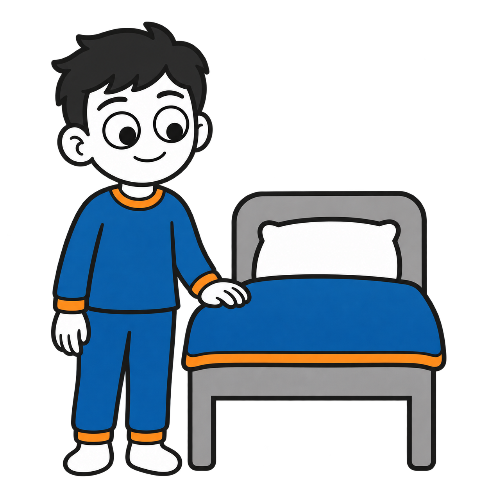
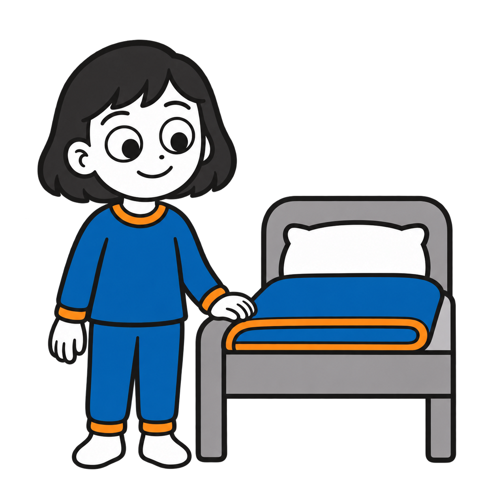
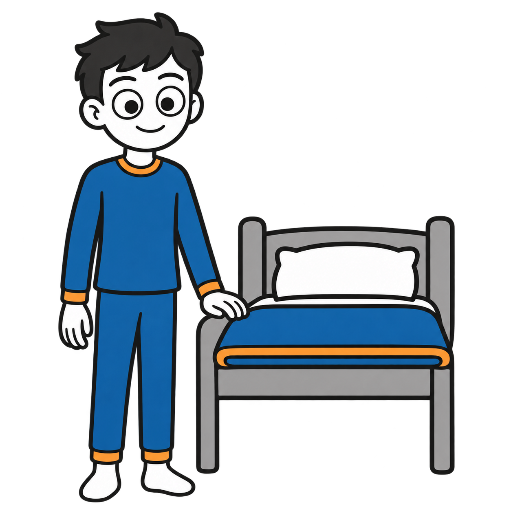
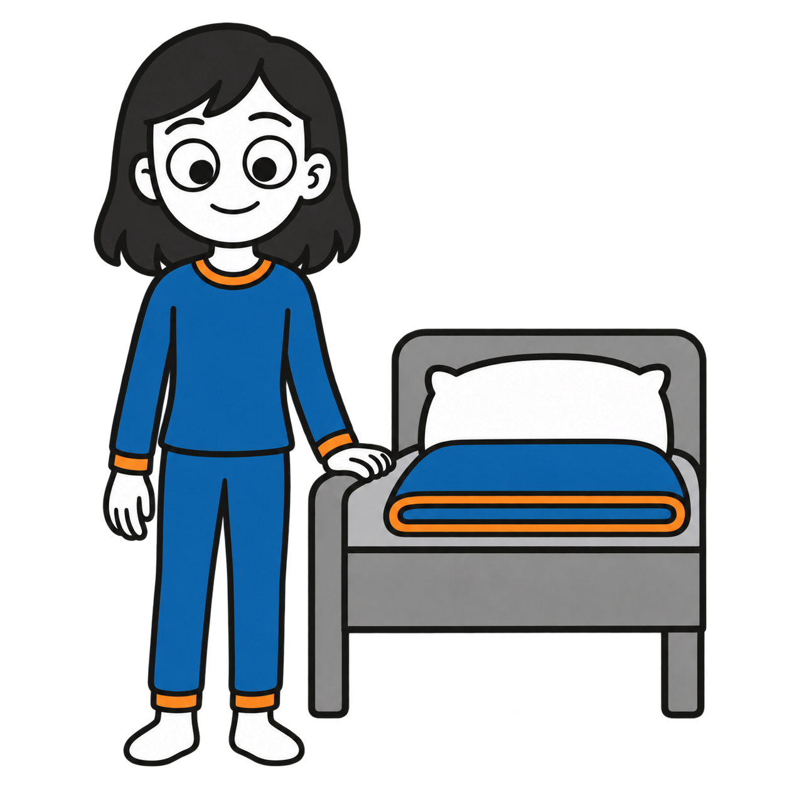
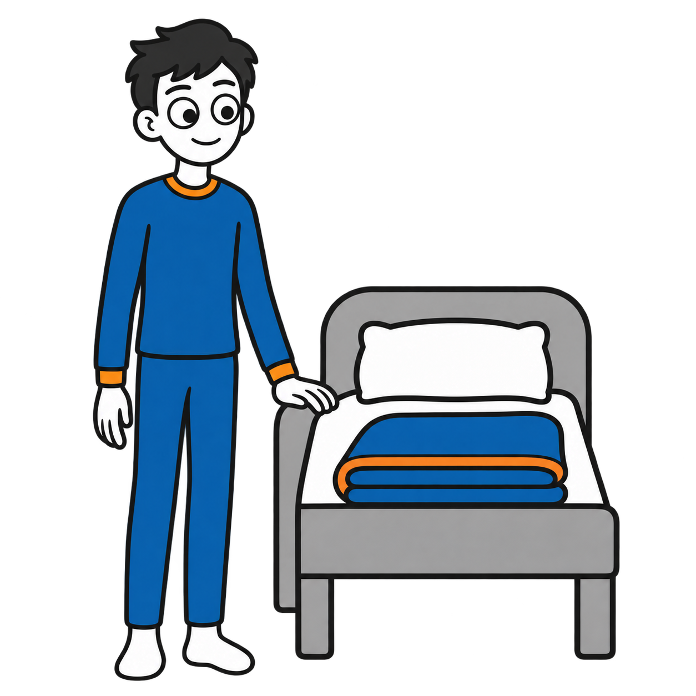
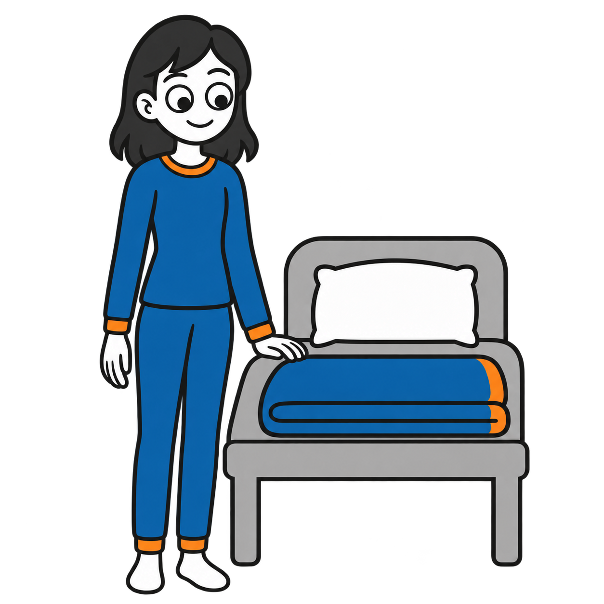

# Wearing pajamas, ready for bed: six variants

Six standalone square transparent PNGs across all three age strands, with male and female versions for ages 5, 10 and teens. Each character is already wearing pajamas and standing beside a bed, ready for bedtime. All are **drafts pending owner review**.

| Depicted age | Male | Female |
|---|---|---|
| 5 years |  |  |
| 10 years |  |  |
| Teen (about 15) |  |  |

## Style and validation

Generated with the built-in OpenAI image generation tool using the approved homework illustration as a style reference. Requested #202020 contours, #1769AA blue and #F28C28 orange, opaque white skin, socks and pillow, and a neutral gray bed. Each is 1254 × 1254 RGBA with genuine background transparency. Full character and bed are within the frame; no embedded text. Some subtle tonal variation remains; exact hex colors are not guaranteed. Age-specific proportions distinguish younger children, older children and teens.

Full prompts, descriptions, source information and SHA-256 checksums are recorded in `catalog/visuals.json`. Category: Daily routines.

## Attribution and rights

Visual supports by Ryan Baker-Barrett of Applied Behavioral Health Practice — https://getadhd.care · https://appliedbehavioral.health · https://github.com/appliedbhp/visual-supports — CC BY-SA 4.0 (https://creativecommons.org/licenses/by-sa/4.0/). Share and adapt, including commercially, with attribution, a license link, indication of changes, and ShareAlike for adaptations. Third-party materials retain their original licenses and attribution. Reference character credit retained: Adventurer by Lisa Wischofsky, via DiceBear, CC BY 4.0 (https://creativecommons.org/licenses/by/4.0/), https://www.dicebear.com/styles/adventurer/. Changes: action artwork adapted with AI; hairstyles, age proportions, palette and cereal-making scene customized.
