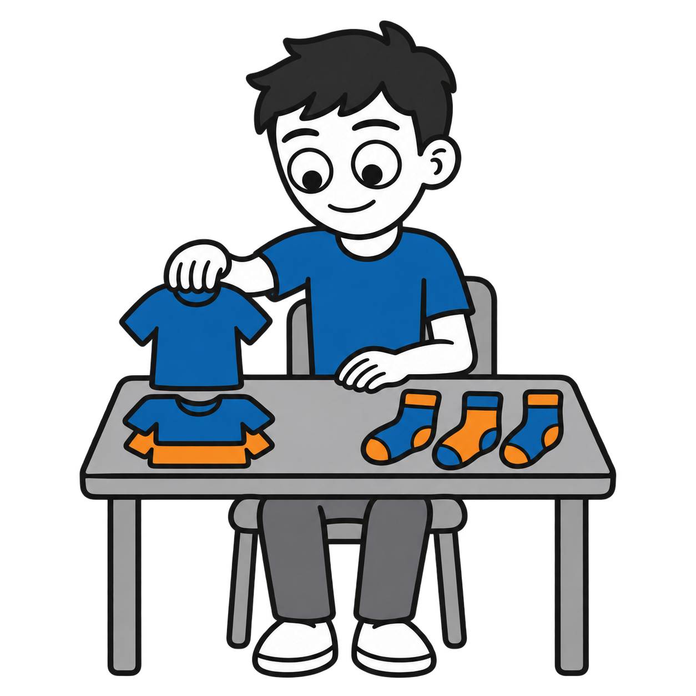
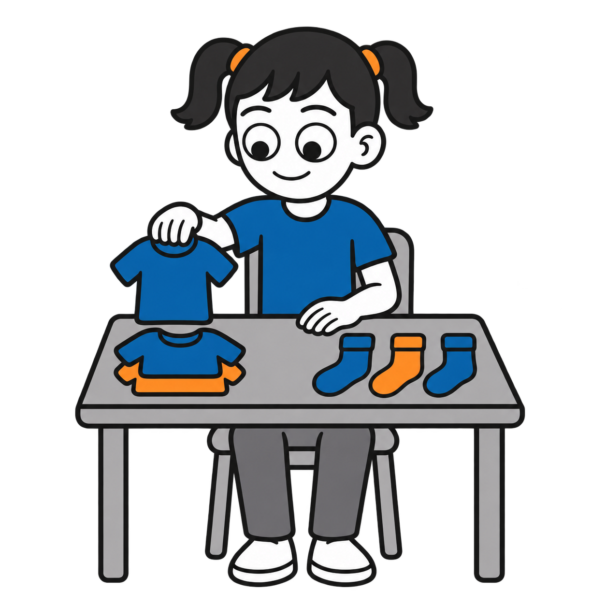
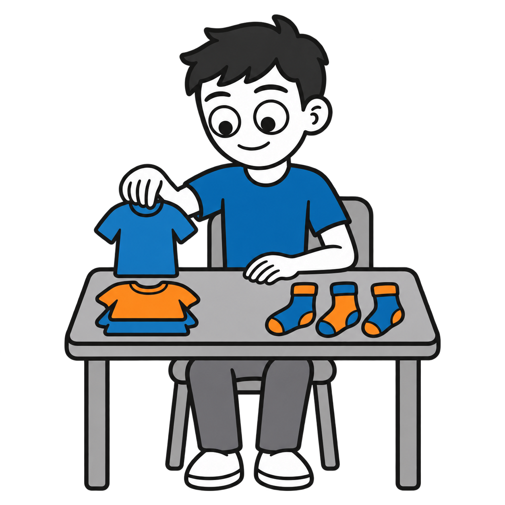
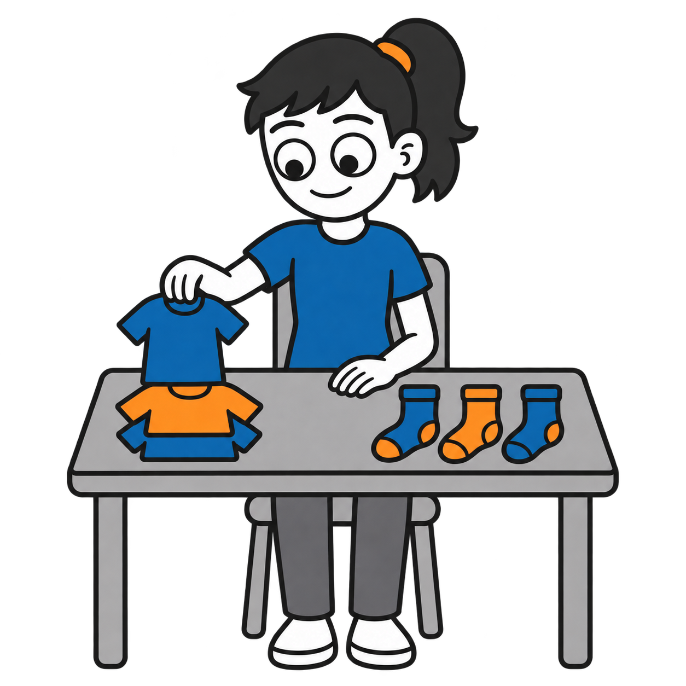
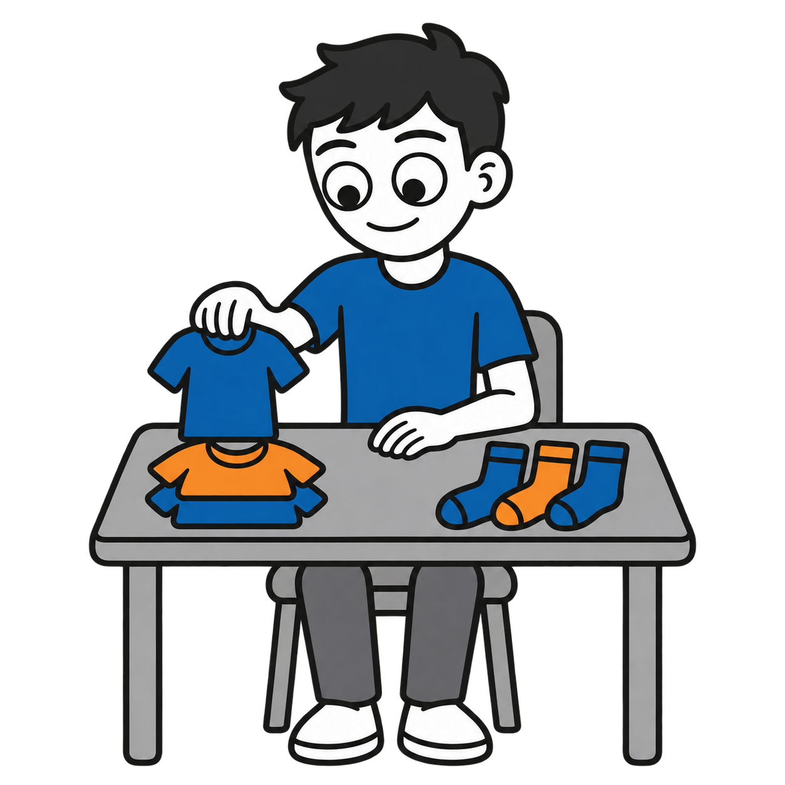
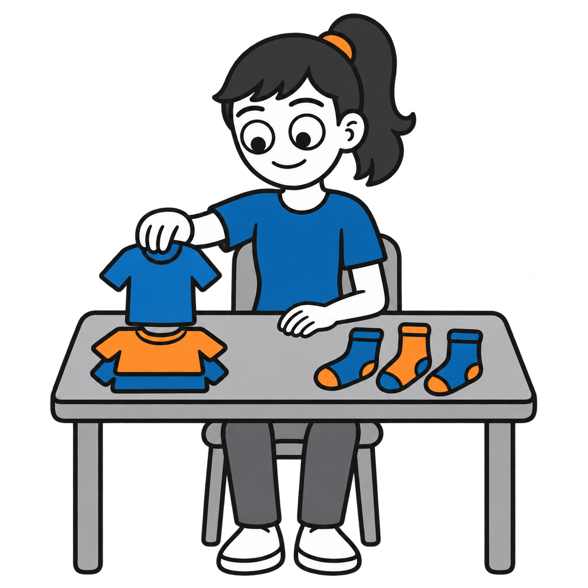

# Sort clothes by type

Six draft AAC pictograms show a character placing a shirt with other shirts while socks sit separately. Both groups contain blue and orange garments.

| Depicted age | Boy | Girl |
|---|---|---|
| 5 |  |  |
| 10 |  |  |
| Teen |  |  |

The PNGs have transparent backgrounds. Age differences are subtle in the seated pose, and some tonal variation remains in the fills. Prompts and image metadata are in the catalog.

Visual supports by Ryan Baker-Barrett of Applied Behavioral Health Practice. https://getadhd.care · https://appliedbehavioral.health · https://github.com/appliedbhp/visual-supports. Licensed CC BY-SA 4.0 (https://creativecommons.org/licenses/by-sa/4.0/). Third-party reference credit retained: Adventurer by Lisa Wischofsky, via DiceBear, CC BY 4.0 (https://creativecommons.org/licenses/by/4.0/). Character proportions, hair, colors and action adapted using AI.
