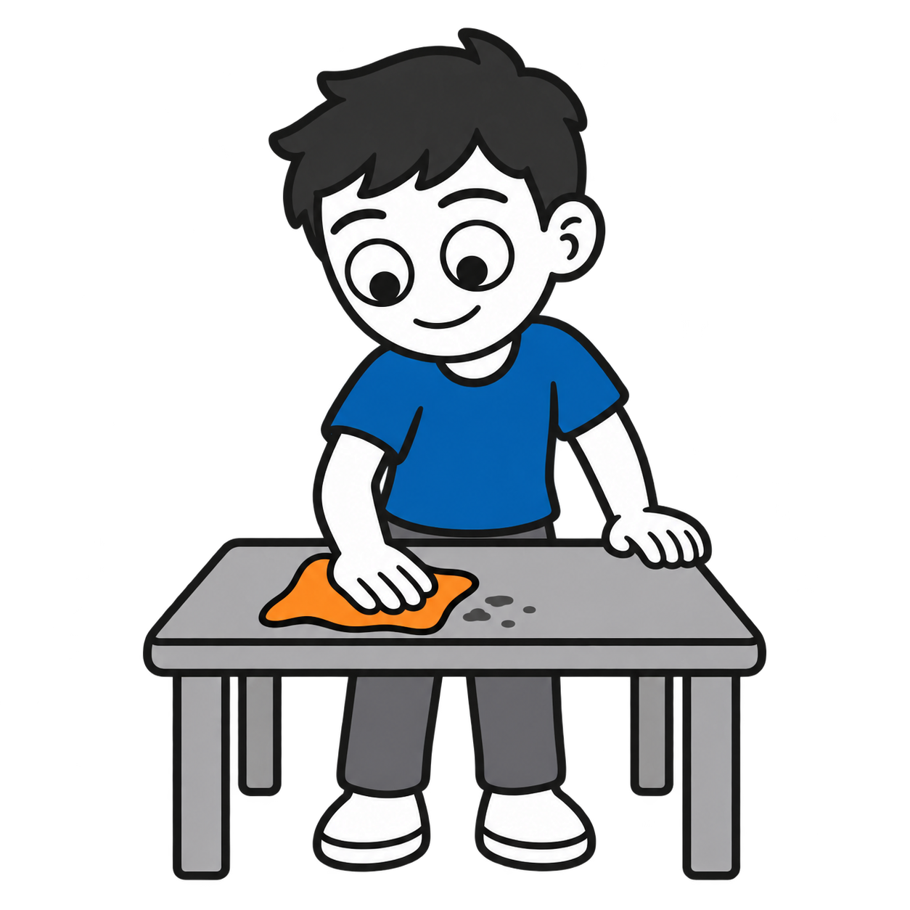
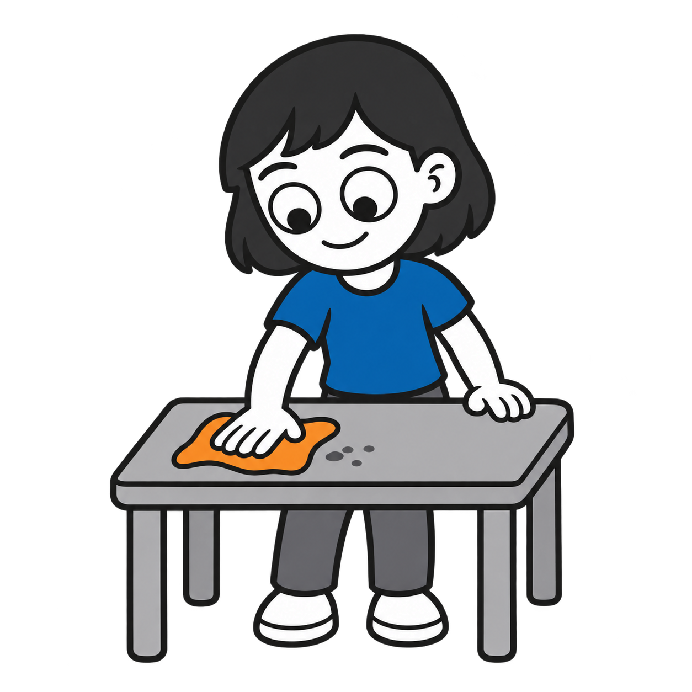
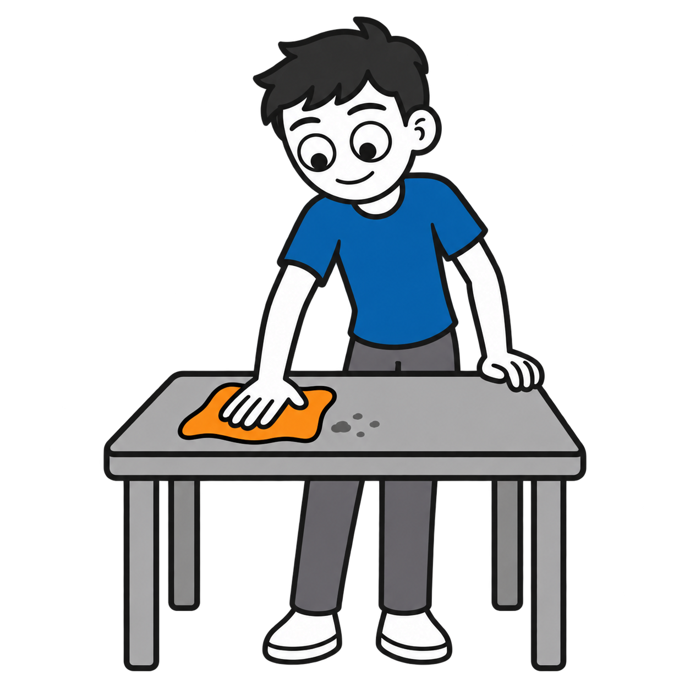
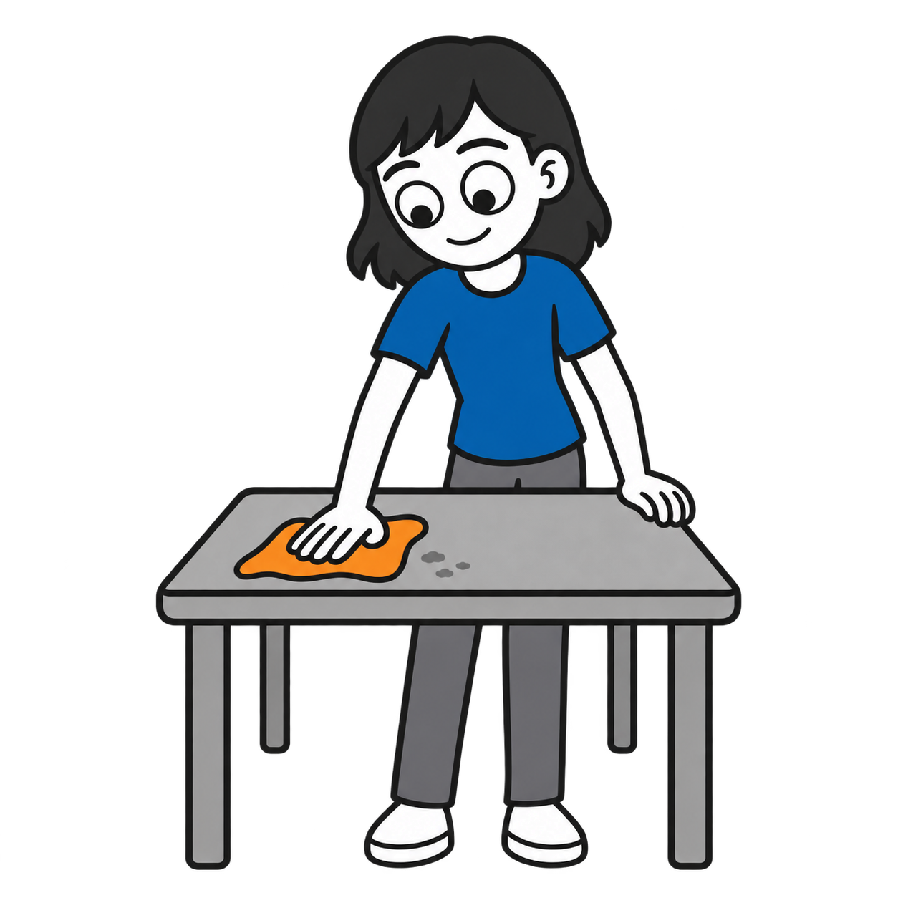
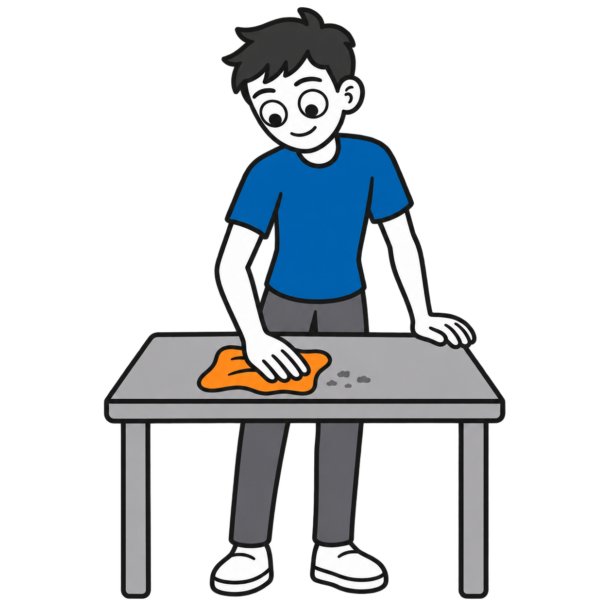
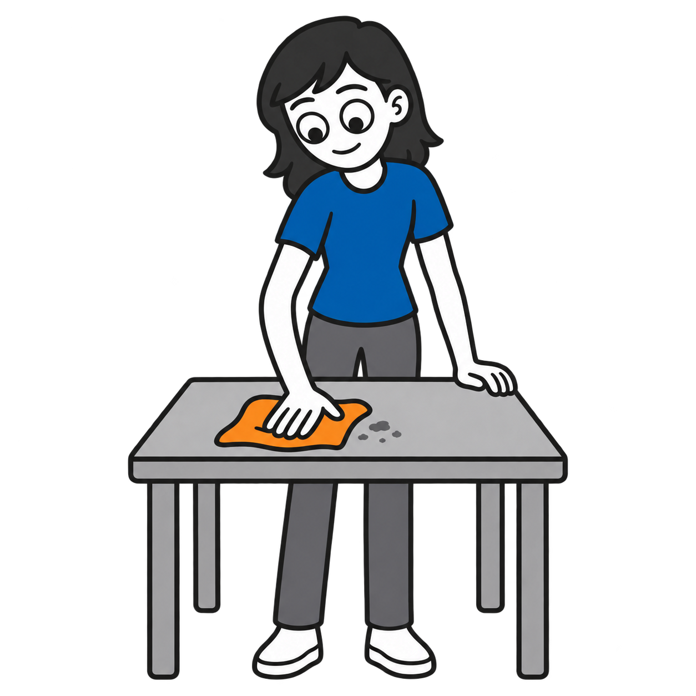

# Wipe off surface

Six transparent PNGs for ages 5, 10, and teens, all marked as drafts for review.

| Depicted age | Boy | Girl |
|---|---|---|
| 5 |  |  |
| 10 |  |  |
| Teen |  |  |

Visual supports by Ryan Baker-Barrett of Applied Behavioral Health Practice. https://getadhd.care · https://appliedbehavioral.health · https://github.com/appliedbhp/visual-supports. CC BY-SA 4.0 (https://creativecommons.org/licenses/by-sa/4.0/). Credit the creator, link the license, indicate changes, and share adaptations under the same license. Third-party materials retain their original licenses and attribution. Character reference credit: Adventurer by Lisa Wischofsky, via DiceBear, CC BY 4.0 (https://creativecommons.org/licenses/by/4.0/). Character proportions, hair, colors and action adapted using AI.
