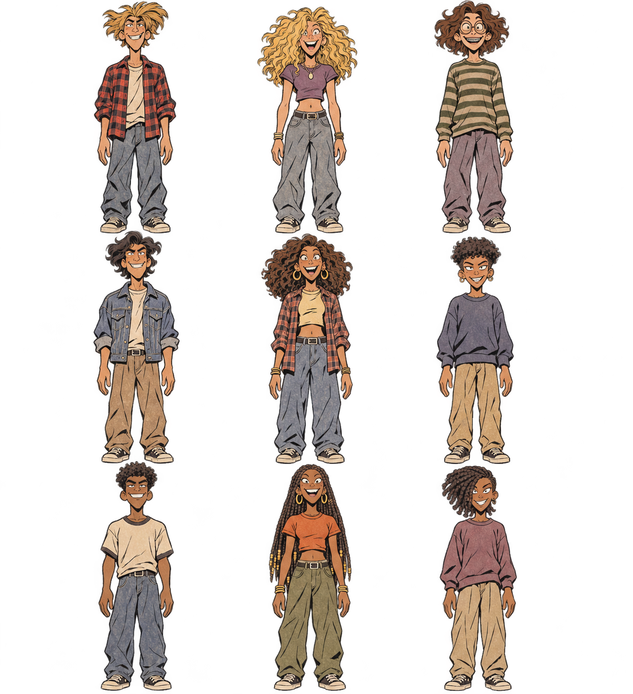

# Field guide character stylesheet prompt

Attach [the PNG](field-guide-character-stylesheet.png) as the visual reference each time. Choose a character from the grid and fill in the bracketed fields in the prompt. If the generator blends characters, attach a crop of the selected figure instead.

| Skin tone | Male · left column | Female · center column | Nonbinary · right column |
| --- | --- | --- | --- |
| Light | Top left · sandy cowlick | Top center · crimped blonde hair | Top right · brown shag, round glasses and braces |
| Medium | Middle left · swept dark waves | Middle center · shoulder-length ringlets | Middle right · short, dense curls |
| Dark | Bottom left · short coils | Bottom center · long box braids | Bottom right · side-swept twists |

## Copyable prompt

> Create one original illustration of **[action]** in **[setting, or transparent background]**. Use only the character in **[skin tone: light, medium, or dark]** row and **[gender: male, female, or nonbinary]** column of the attached stylesheet, at **[grid position]**. If the attachment is a single-character crop, use that figure directly. Treat the attachment as an identity and style reference for a single scene.
>
> Keep the selected character recognizable through their skin tone, hair silhouette and texture, exaggerated facial geometry, distinguishing features, and everyday ’90s outfit. Change the pose, gaze, and expression to fit the action. Show believable hand grips and clear contact with any props.
>
> Match the loose, slightly jittery hand-drawn outlines, varied ink weight, angular proportions, subtle paper grain in the artwork, and textured clothing folds. Use earthy ochre, olive, dusty terracotta, and slate blue with a few brighter accents. For an outdoor scene, use gouache and watercolor textures, habitat-appropriate plants and terrain, and keep the background quieter than the figure. If transparency is requested, leave the space around the figure and essential props transparent.
>
> Compose one readable scene with no labels, captions, grid lines, or watermark.
