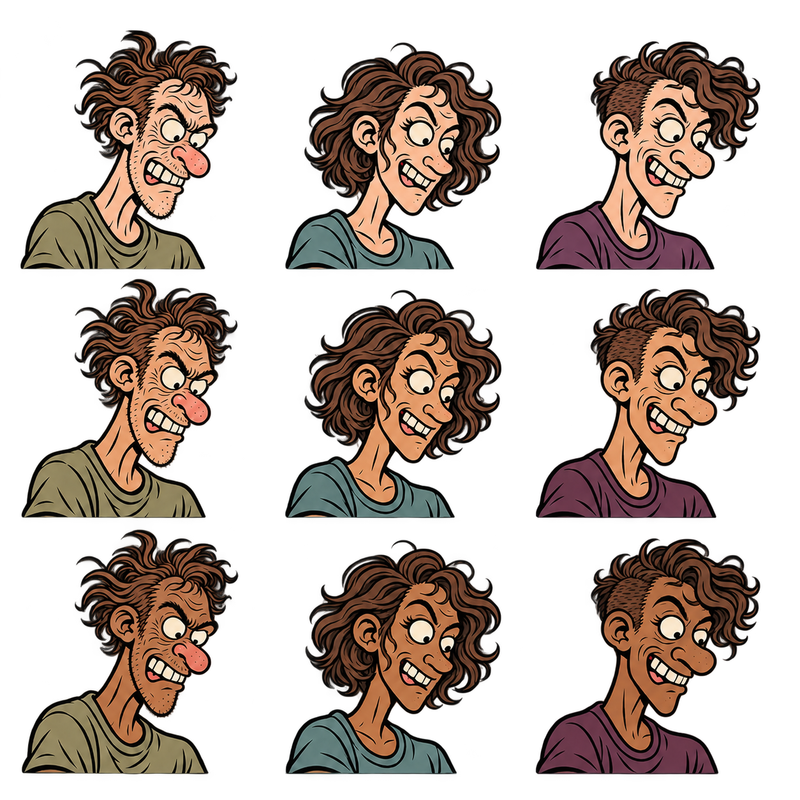

# Teen comic character reference prompt

Attach the PNG as the direct visual reference for every new scene. Select one portrait by row and column before generating.

| Skin tone | Left: male | Center: female | Right: nonbinary |
| --- | --- | --- | --- |
| Light | Top left | Top center | Top right |
| Medium | Middle left | Middle center | Middle right |
| Dark | Bottom left | Bottom center | Bottom right |

## Copyable prompt

> Create one original, text-free comic illustration of **[describe the action]**. Use **[row: light, medium, or dark]** and **[column: male, female, or nonbinary]** from the attached character reference sheet. Draw that individual only, keeping their facial proportions, hairstyle, skin tone, and shirt color consistent with the selected portrait.
>
> Match the scruffy comic ink: thick-to-thin black brush lines, wiry hair, expressive eyebrows, slightly uneven ivory teeth when visible, sparse hatching, and flat colors. Change the pose, gaze, and expression to suit the scene. Keep the face, hands, and essential props prominent. Show natural grips, connected limbs, and clear contact between hands and objects. Keep the background transparent. Use no captions, lettering, or logos.
>
> For an editable SVG deliverable, convert the approved illustration into vector paths and verify that the face, linework, and transparent edges survive conversion.

Use the same sheet as the reference for each new image. Include the activity name and common synonyms as catalog keywords when publishing scene illustrations.
